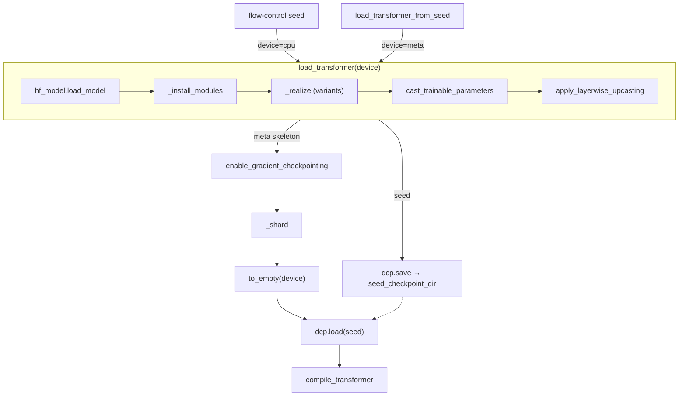

# Model adapters

`BaseModelAdapter` wraps one DiT family's transformer behind a single velocity interface, `_predict_velocity(batch, timestep) -> velocity`. Every sampler, trainer and server works through that interface in the framework's conventions, so none of them depends on a model's time scale, prediction target or token layout. Callers see `predict_velocity_batched` ([microbatching.md](microbatching.md)) under `use_variant` ([variants.md](variants.md)). A **family** is one `arch` (`flux1`, `qwen`, `sd3`, ...). A **type** is a variant of that architecture's inputs or checkpoint (`base`, `edit`, `kv`, `d_concat`, ...). Each `(arch, type)` pair is one registered adapter class.

## Config examples

### Choose a model

```jsonc
"model": {
  "arch": "qwen", "type": "base" // registry tag "qwen_base"
  // "micro_batch_size": 1,
  // "use_cache": true
}
```

### Another checkpoint of the same architecture

```jsonc
"model": {
  "arch": "flux1", "type": "base",
  "hf_model": { // replaces the adapter's default loader as a whole: name every field
    "library": "diffusers",
    "class_name": "FluxTransformer2DModel",
    "pretrained_model_id": "black-forest-labs/FLUX.1-Krea-dev",
    "subfolder": "transformer"
    // "dtype": "bfloat16"
  }
}
```

### An out-of-core adapter

```jsonc
{
  "imports": ["flow_control.contrib.efficient_layered"], // registers "qwen_efficient_layered"
  "model": {"arch": "qwen", "type": "efficient_layered"}
}
```

### A weight-only fp8 checkpoint

```jsonc
"model": {"arch": "ideogram4", "type": "base"} // fp8 repo, dequantized to hf_model.dtype at load
// "hf_model": {..., "dequantize": false} passes the checkpoint to from_pretrained unchanged
```

## Loading



When `load_model` reuses a cached transformer (same `hf_model.config_key`), the adapter only calls `_attach`. The shared model cache is described in [../scripts/serving.md](../scripts/serving.md).

## Python spec

### Framework conventions

| Quantity | Convention | Translations inside adapters |
|---|---|---|
| `timestep` | σ ∈ [0, 1], 1 = pure noise, shape `[B]` | SD3 `σ * 1000`; Z-Image, Ideogram 4, HiDream-O1 `1 - σ`; Cosmos3 `σ / timestep_scale` |
| velocity | `ε - x₀` (= dx/dσ for `x = (1-σ)x₀ + σε`), returned as `[B, N, D]` | Z-Image, Ideogram 4 negate the output; HiDream-O1 predicts x₀ and returns `(x - x₀) / σ` |
| latents | packed `[B, N, D]`, channels ordered `(c ph pw)` (`_pack_latents`), in the processor's normalized coordinates | SD3, Z-Image, Cosmos3 `_unpack_latents` to `BCHW`; Ideogram 4 permutes to `(ph pw c)` |

### The adapter

```python
class BaseModelAdapter[TModel: ModelMixin | PreTrainedModel, TBatch: Batch](
    VariantsMixin, MicrobatchMixin, ABC
):
    arch: str
    type: str
    hf_model: HfModelLoader[TModel]      # the base weights
    storage_dtype: TorchDType | None = None   # precision.md
    trainable_dtype: TorchDType = torch.bfloat16
    patch_size: int = 2                  # these three match the processor preset
    vae_scale_factor: int = 8
    latent_channels: int = 16

    transformer: TModel                  # property: hf_model.model, the base module
    device: torch.device
    dtype: torch.dtype                   # hf_model.dtype, the compute dtype

    def load_transformer(self, device: torch.device) -> None: ...

    # what a family implements
    def _install_modules(self) -> None: ...          # optional
    def _prepare_timestep(self, timestep: Tensor) -> Tensor:  # optional
        return timestep.to(device=self.device, dtype=self.dtype)
    @abstractmethod
    def _predict_velocity(self, batch: TBatch, timestep: Tensor) -> Tensor: ...
    def cost_test(self) -> Iterator[dict]: ...       # optional: SftTrainer.run_cost_test

class Batch(TypedDict):                  # each family extends it with its condition fields
    image_size: tuple[int, int]          # pixel (H, W)
    clean_latents: torch.Tensor          # [B, N, D], training only
    noisy_latents: torch.Tensor          # [B, N, D]

adapter_registry: Registry[BaseModelAdapter]   # tag f"{arch}_{type}"
ModelAdapter = Annotated[BaseModelAdapter, RegistryUnion(adapter_registry, _adapter_discriminator)]
```

Caller:

```python
model = parse_model_adapter(config["model"])
model.load_transformer(device)
with torch.no_grad(), model.use_variant("ema"):
    velocities = model.predict_velocity_batched(rows, [timestep(row) for row in rows])  # fp32 [1, N, D] each
```

### `_predict_velocity`

- `batch` holds the row's data fields (keys without `_`), with floating tensors cast to `self.dtype` and moved to `self.device`, plus the active variant's cached `_` fields. Every tensor has the same leading dimension `B`: 1 on the sequential path, up to `micro_batch_size` when collated densely. Non-tensor fields such as `image_size` are shared by the whole batch.
- `timestep` is `[B]`, as `_prepare_timestep` returned it.
- Run the network through `self.module()`, never `self.transformer`. `module()` is the full module of the active variant: a full variant or a full-weight EMA has its own module, while LoRA variants live inside the base module and are selected through the ContextVar. Architecture config may be read from `self.transformer.config`.
- `_`-prefixed fields may be written to `batch`: position ids, packing metadata, KV caches. They persist only for no-grad forwards with `use_cache`, into `row["_cache"][variant]`, keyed by variant because a KV cache depends on the weights. A cache depends on the row's conditions and the variant, never on σ or the noisy latents. After a dense forward only `shared_cache_fields` survive, so per-sample state (KV) requires the sequential path. A cache that changes what the forward computes, such as KV replay, is used only when `self.use_cache and not torch.is_grad_enabled()` (`QwenImage21Adapter`, `Flux2KVAdapter`, `Cosmos3KVAdapter`).
- Return the velocity as `[B, N, D]` in the layout of `noisy_latents`. The base class checks the leading dimension and casts the result to fp32.
- A forward that only handles `B = 1` keeps `supports_dense_batching = False`, as `HiDreamO1Adapter` and `Cosmos3Adapter` do.

`_prepare_timestep` is overridden to keep fp32 when the model time near σ = 1 is finer than bf16 resolution (`Cosmos3Adapter`, `HiDreamO1Adapter`, `Ideogram4Adapter`; see [precision.md](precision.md)).

### A new family

```python
class FooBatch(Batch):
    prompt_embeds: torch.Tensor                 # [B, L, D]
    _img_ids: NotRequired[torch.Tensor]         # adapter cache, layout only


@adapter_registry.register("foo_base")
class FooAdapter[TBatch: FooBatch](BaseModelAdapter[FooTransformer2DModel, TBatch]):
    arch: Literal["foo"] = "foo"
    type: Literal["base"] = "base"
    hf_model: HfModelLoader[FooTransformer2DModel] = HfModelLoader(
        library="diffusers",
        class_name="FooTransformer2DModel",
        pretrained_model_id="org/foo",
        subfolder="transformer",
    )
    patch_size: int = 2
    vae_scale_factor: int = 8
    latent_channels: int = 16

    supports_dense_batching = True              # microbatching.md
    dense_batch_fields = ("image_size", "noisy_latents", "prompt_embeds")
    shared_cache_fields = ("_img_ids",)
    lora_target_modules = ("attn.to_q", "attn.to_k", "attn.to_v", "attn.to_out.0")
    # lora_exclude_modules = (...)              # linears with no gradient path
    # lora_extra_trainable = (...)              # modules a LoRA variant clones and trains whole

    def _install_modules(self) -> None:         # meta-safe replacements, fp32 restores
        ...

    def _predict_velocity(self, batch: TBatch, timestep: torch.Tensor) -> torch.Tensor:
        if "_img_ids" not in batch:
            batch["_img_ids"] = self._image_ids(batch["image_size"])  # batch 1, independent of B
        return self.module()(
            hidden_states=batch["noisy_latents"],
            encoder_hidden_states=batch["prompt_embeds"],
            timestep=timestep,                  # σ; rescale here if the model expects another range
            img_ids=batch["_img_ids"],
            return_dict=False,
        )[0]
```

- One class may serve several checkpoints: register it under each tag, widen `type` (`Literal["base", "turbo"]`), and pick `hf_model.pretrained_model_id` in `model_post_init` (`Krea2Adapter`, `Flux3Adapter`, `HiDreamO1Adapter`).
- `_install_modules` runs once per fresh load: inside the meta context when training from a seed, on CPU when building the seed, and on the device otherwise. It runs before the variants are realized, so full copies and LoRA targeting see the replaced modules. Module surgery belongs there, not in a `load_transformer` override (`Flux1DConcatAdapter` widens `x_embedder`; `Flux2KVAdapter` sets attention processors).
- `library: "custom"` loads vendored transformers-style modeling code by dotted path (`HiDreamO1Transformer`).
- A family must not override `load_transformer`, `_realize` / `_attach`, `use_variant`, or replace `hf_model.model` after load. It overrides `predict_velocity_batched` only to change the physical batch layout ([microbatching.md](microbatching.md)).

### Checkpoint layouts and fp8

A checkpoint whose key names differ from the diffusers class gets a loader subclass:

```python
class Ideogram4Loader(HfModelLoader[Ideogram4Transformer2DModel]):
    library: Literal["diffusers"] = "diffusers"
    class_name: str = "Ideogram4Transformer2DModel"
    pretrained_model_id: str = IDEOGRAM4_REPO          # defaults: a config writes only what differs
    subfolder: str | None = "transformer"

    def _convert(self, key, tensor):                   # checkpoint entry -> state-dict entries
        if ".attention.qkv." in key:                   # fused qkv -> to_q / to_k / to_v
            for name, part in zip(("to_q", "to_k", "to_v"), tensor.chunk(3, dim=0)):
                yield key.replace(".attention.qkv.", f".attention.{name}."), part
        else:
            yield key.replace(".attention.o.", ".attention.to_out.0."), tensor
```

- `HfModelLoader._fp8_files` detects `<name>.weight` stored as e4m3 next to a per-row `<name>.weight_scale`. `_load_dequantized` builds the model from its config, loads `w.to(dtype) * scale[:, None]`, casts every other floating tensor to `dtype`, passes each entry through `_convert`, and assigns the state dict. `_convert` runs only on this path.
- `FullVariant.hf_model` is typed as a bare `HfModelLoader`, so a loader subclass instance survives validation. The adapter converts config dicts into its loader with a `model_validator(mode="before")` (`Ideogram4Adapter._fp8_loaders`).

### Meta init and the seed checkpoint

```python
# BaseTrainer.load_transformer_from_seed, with seed_checkpoint_dir set
with torch.device("meta"):
    model.load_transformer(device=torch.device("meta"))  # config only, no weights read
model.enable_gradient_checkpointing()                     # when gradient_checkpointing
self._shard(model)                                        # fully_shard: blocks, full variant copies, root
model.transformer.to_empty(device=self.device)            # uninitialized storage for params and buffers
dcp.load(model_sd, checkpoint_id=seed_checkpoint_dir,
         planner=DefaultLoadPlanner(allow_partial_load=True))
```

The seed is `load_transformer(cpu)` saved with `dcp.save` (`flow-control seed`, or `launch.generate_dcp_seed: true`). It contains everything `load_transformer` produced: weights, persistent buffers created by `_install_modules`, full variant copies, LoRA initial values and LoRA `path` files. With a seed, each rank materializes only its own shard. Without one, the whole transformer loads on the device, or on CPU when `hsdp_shard_dim > 1`, and is sharded afterwards. FSDP2 and DCP: [../guides/fsdp2-dcp.md](../guides/fsdp2-dcp.md).

`dcp.load` restores only the state dict and allows partial loads, so two kinds of state come back wrong without any error:

1. **Tensors computed in `__init__`.** Under the meta context, RoPE frequency tables and timestep tables are created on meta. `to_empty` then gives buffers uninitialized storage. A non-persistent buffer is missing from the seed, so it stays garbage, and the sampler produces noise. The fix is to reimplement the offending module in the adapter so it is meta-safe, and to install it in `_install_modules`:
   - register the table as a persistent buffer, so the CPU-built seed carries it (`PatchedQwenEmbedRope`, the persisted buffers of `HiDreamO1Transformer`);
   - derive it on every call (`Cosmos3RotaryEmbedding.inv_freq`, the qwen21 `TemporalTimesteps`; Krea 2's and FLUX.3's RoPE already compute in `forward`);
   - build it as a plain tensor attribute outside the meta context (`QwenImage21Adapter` builds `QwenImage21Rope` under `torch.device("cpu")` and keeps it complex64, because a buffer would be cast by `model.to(dtype)`);
   - recompute it after `to_empty` (`HiDreamO1Transformer.to_empty`).
2. **`_keep_in_fp32_modules`.** diffusers' `from_pretrained` keeps those modules in fp32. The meta path builds the model from its config and casts everything to `hf_model.dtype`, and `dcp.load` copies into the existing dtype, so those modules end up in bf16. A family that needs fp32 modules restores them in `_install_modules`, which runs on both the seed path and the meta path (`Cosmos3Adapter`: `self.transformer.time_embedder.float()`). The fp8 path (`_load_dequantized`) keeps no fp32 modules either, and the same fix applies.

## Extension points and core contracts

**Extension points**

- A new family, or a new type of an existing one: subclass `BaseModelAdapter` (or a family class), register it under `f"{arch}_{type}"` in `adapter_registry`, and implement `_predict_velocity`. Optionally add `_install_modules`, `_prepare_timestep`, the LoRA hints, `cost_test`, the dense-batching declarations, and a loader subclass. Core families live in `flow_control/adapters/`. Experimental ones go in `flow_control/contrib/` or in `local/`, loaded through `imports`.
- The processor preset for the family is a separate extension ([../processors/processors.md](../processors/processors.md)). Its `patch_size`, `vae_scale_factor` and `latent_channels` must equal the adapter's.

**Core contracts**

- The framework conventions above: σ time, `ε - x₀` velocity, packed `[B, N, D]` latents in `(c ph pw)` order. Every sampler node, objective and reward depends on them.
- `_predict_velocity` runs `self.module()`. The variant mechanism (`use_variant`, `module()`, the ContextVar) belongs to [variants.md](variants.md).
- `predict_velocity_batched` is a collective that returns fp32 velocities ([microbatching.md](microbatching.md), [precision.md](precision.md)).
- The `load_transformer` order and the seed / meta-init path: anything a family adds must survive `to_empty` + `dcp.load`.
- `_`-prefixed row fields are adapter caches, keyed per variant ([../overview/row.md](../overview/row.md)).
