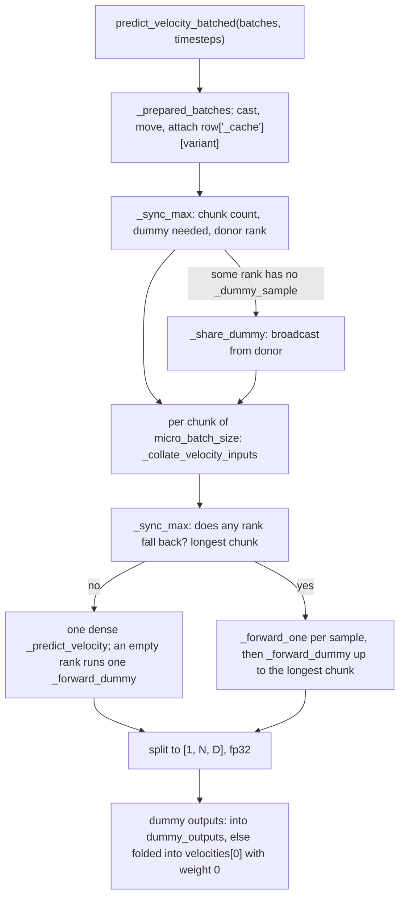
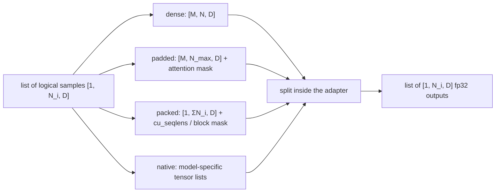

# Microbatching

Microbatching runs several logical samples in one physical forward. It improves throughput for small models and short sequences; large models and long sequences already saturate the GPU at `micro_batch_size: 1`. The convention is that code outside the adapter never knows about microbatches. Samplers, trainers, objectives and rewards handle one **logical sample** at a time: a row whose tensors have leading dimension 1. They hand the adapter a **microbatch** (`list[Row]`). Only the adapter knows the architecture, so only the adapter turns logical samples into physical forwards, and it returns one velocity per logical sample.

## Config examples

### Rollout and training microbatches

```jsonc
{
  "train_batch_size": 4608,     // logical items per optimizer update, summed over ranks
  "train_micro_batch_size": 4,  // logical items per backward, per rank
  "model": {
    "arch": "sd3", "type": "base",
    "micro_batch_size": 4       // logical samples per physical forward: rollout, validation, training
  }
}
```

### A large model

```jsonc
"model": {"arch": "qwen", "type": "base"} // "micro_batch_size": 1: one forward per logical sample
```

`model.micro_batch_size` bounds physical forwards, counted after branch and tile expansion. The Executor also uses it to decide how many sampling runs to keep in flight ([../sampler/runtime.md](../sampler/runtime.md)). `train_micro_batch_size` is a trainer field ([../training/trainers.md](../training/trainers.md)). It bounds the logical items whose autograd state one backward holds; their forwards are still chunked by `micro_batch_size`.

## One call, every rank



## Python spec

### Caller

```python
# Executor._forward: once per variant, in the same order on every rank, even with an empty list
dummies: list[torch.Tensor] = []
for variant in self.variants:
    with model.use_variant(variant):
        outputs = model.predict_velocity_batched(
            [calls[i].row for i in slots], [timestep(calls[i].row) for i in slots],
            dummy_outputs=dummies,       # collected across variants
        )
if dummies:  # under autograd: dummies join the graph with weight 0, so FSDP backward lines up
    velocities[0] = velocities[0] + sum(output.sum() * 0 for output in dummies)
```

### Adapter

```python
class MicrobatchMixin(BaseModel):
    micro_batch_size: PositiveInt = 1
    use_cache: bool = True                              # keep _ caches across no-grad Executor rounds
    supports_dense_batching: ClassVar[bool] = False
    dense_batch_fields: ClassVar[tuple[str, ...]] = ()  # inputs the default collator stacks
    shared_cache_fields: ClassVar[tuple[str, ...]] = () # layout-only caches, independent of B

    def predict_velocity_batched(
        self, batches: list[Any], timesteps: list[torch.Tensor], *,
        dummy_outputs: list[torch.Tensor] | None = None,
    ) -> list[torch.Tensor]: ...                        # one fp32 [1, N, D] per logical sample, in order

    def _collate_velocity_inputs(
        self, batches: list[Any], timesteps: list[torch.Tensor]
    ) -> tuple[Any, torch.Tensor] | None: ...           # None: this chunk runs sequentially
```

The default collator only stacks along `B`:

| Value of a `dense_batch_fields` key | Dense when | Collated value |
|---|---|---|
| tensor | every sample has shape `[1, ...]`, and all shapes are equal | `torch.cat(dim=0)` |
| list (e.g. `reference_latents`) | lengths are equal and each element is collatable | list of collated elements |
| anything else (`image_size`, counts) | equal across the chunk | the shared value |
| present in some samples only | never | |
| absent everywhere | | omitted |

Keys outside `dense_batch_fields` are dropped from the dense batch. `shared_cache_fields` are taken from the first sample that has them, and after the forward they are copied back to every sample. Timesteps are concatenated to `[M]`. A family adds per-sample values by extending the collator (`Flux3Adapter` collates `sigma_next`).

Stacking requires identical shapes, which means the same resolution and the same text length. The data stack groups rows of similar cost to balance FSDP ranks ([../data/data.md](../data/data.md)). A dense forward happens only where "similar" turns out to be "identical": a fixed resolution and padded text.

| Path | In-tree adapters |
|---|---|
| Dense stacking | FLUX.1 (all types), FLUX.2 `base`, FLUX.3, SD3, Krea 2, LongCat, Qwen-Image (`base`, `edit`, `layered`), Ideogram 4, Z-Image (stacked, then unbound into its native per-sample list API) |
| Sequential only | FLUX.2 `kv`, Cosmos3, Qwen-Image 2.1, HiDream-O1, contrib `efficient_layered` |

No in-tree adapter pads or packs.

### Variable length

The list boundary already accommodates ragged physical layouts. Padding and sequence packing belong to an adapter that overrides `predict_velocity_batched`:



Such an adapter builds position ids per logical segment, prevents cross-sample attention (block-diagonal masks or varlen metadata), and treats the text, target and reference streams of one sample as a single model-specific topology. Each stream is not packed separately. It keeps the collective rules below by reusing `_sync_max`, `_forward_dummy` and `_share_dummy`.

## Extension points and core contracts

**Extension points**

- Enable stacking for a family: set `supports_dense_batching`, `dense_batch_fields`, `shared_cache_fields`, and override `_collate_velocity_inputs` for per-sample values the default does not stack.
- Padding, packing or native ragged inputs: override `predict_velocity_batched` in the adapter. Nothing outside the adapter changes.

**Core contracts** (`predict_velocity_batched` is a collective)

- Every rank calls it equally often and in the same variant order. An empty list is a legal call and returns `[]`.
- Ranks agree through `_sync_max` (a MAX all-reduce) on the chunk count, on dense versus sequential for each chunk, and on the longest chunk. A rank with less work pads with forwards on `_dummy_sample`, the last real prepared sample. A rank that has never held one receives it from a donor rank through `_share_dummy`. Physical forward counts are therefore equal on every rank, as FSDP requires.
- Under autograd, dummy outputs join the graph with weight 0 so backward counts match. A training call therefore needs at least one real item on every rank, and trainers give every rank the same number of train items (`MicrobatchTrainMixin.iter_micro_updates`).
- Outputs: one fp32 tensor per logical sample, leading dimension 1, in input order.
- Callers never stack rows, and never pass a row whose leading dimension is not 1.
