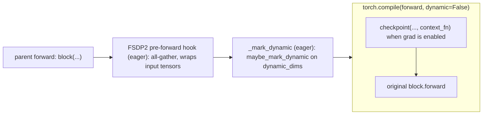

# Parallelize

`ParallelizeMixin.parallelize` turns a loaded transformer into the module that runs: attention backend, activation checkpointing, per-block `torch.compile`, and FSDP2 units. Only the adapter knows its blocks, which block inputs carry the sequence and which ops are worth keeping for backward, so the adapter owns all four steps. The policies are model fields; the trainer only supplies the mesh.

## Config examples

### Variable-resolution LoRA RL

```jsonc
"model": {
  "type": "flux2",
  "gradient_checkpointing": "selective", // keep attention outputs, recompute the rest; "block" (default), "none"
  "torch_compile": {                     // one graph set covers every resolution: the adapter's dynamic_dims
    "mode": "max-autotune-no-cudagraphs" // Inductor GEMM templates; minutes per new graph, cached on disk
    // "fullgraph": true,
    // "recompile_limit": 64
  }
}
```

### External FlashAttention 2

```jsonc
"model": {
  "type": "flux2",
  "attention_backend": "flash" // diffusers AttentionBackendName; null keeps the model's ("native": SDPA)
}
```

### No compile

```jsonc
"model": {
  "type": "flux2"
  // "gradient_checkpointing": "block", // each block recomputed whole in backward, under the forward's variant
  // "torch_compile": null
}
```

## Wrapping one block



`parallelize` builds this from the inside out on every block, then shards. `block.forward` is replaced in place, so FQNs, the seed and checkpoints do not change.

## Python spec

### The mixin

```python
CheckpointingPolicy = Literal["none", "block", "selective"]

class TorchCompileConfig(BaseModel):          # adapters/parallelize.py
    backend: str = "inductor"
    mode: str | None = None
    fullgraph: bool = True                     # a break inside a block is a bug: ContextVar.set, .item(); False needs "none" checkpointing
    options: dict[str, str | int | bool] | None = None
    recompile_limit: int = 64                  # graphs per compiled frame; see the budget below

    def compile(self, function: Callable) -> Callable:  # torch.compile(function, dynamic=False, ...)

class ParallelizeMixin(BaseModel):
    attention_backend: str | None = None
    gradient_checkpointing: CheckpointingPolicy = "block"
    torch_compile: TorchCompileConfig | None = None
    block_classes: ClassVar[tuple[str, ...]] = ()                # (): transformer._no_split_modules or _repeated_blocks
    dynamic_dims: ClassVar[dict[str, dict[str, int]]] = {}       # block class -> {forward argument: sequence dim}

    def parallelize(self, mesh: DeviceMesh | None) -> None:  # None: fully_shard's default mesh
        self._set_attention_backend()                    # transformer.set_attention_backend, when not None
        for block in self._blocks():                     # every block_classes module, full variant copies included
            self._checkpoint(block)                      # gradient_checkpointing; pinned unless torch_compile
            if self.torch_compile is not None:
                self._compile(block)                     # torch.compile(block.forward, dynamic=False), then _mark_dynamic in front
        self._shard(blocks, mesh)                        # fully_shard: blocks, full variant copies, root

    # steps a family may override
    def _set_attention_backend(self) -> None: ...
    def _blocks(self) -> list[nn.Module]: ...            # outermost matches only
    def _checkpoint(self, block: nn.Module) -> None: ...
    def _saved_ops(self) -> set[OpOverload]: ...         # "selective": MUST_SAVE; the aten SDPA ops, plus FA2's for "flash" / "flash_varlen"
    def _compile(self, block: nn.Module) -> None: ...
    def _mark_dynamic(self, dims: dict[str, int], arguments: dict[str, Any]) -> None: ...  # the block's bound arguments
    def _shard(self, blocks: list[nn.Module], mesh: DeviceMesh | None) -> None: ...

    # provided by VariantsMixin
    def pin_variant(self, checkpoint: Callable) -> Callable: ...  # pinned_checkpoint(checkpoint, self._active)
```

`uv run -m flow_control.adapters.parallelize` checks every policy with and without compile on a toy model under a one-rank FSDP2 mesh: gradients after a variant switch before backward, and no recompile for a new length.

`BaseModelAdapter` composes it with `VariantsMixin` and `MicrobatchMixin` ([adapter.md](adapter.md#the-adapter)).

### Caller

```python
# BaseTrainer.load_transformer_from_seed
with torch.device("meta"):
    model.load_transformer(device=torch.device("meta"))
model.parallelize(self.mesh)                         # the policies come from the model config
model.transformer.to_empty(device=self.device)      # compile is lazy: the first forward traces the loaded weights
dcp.load(model_sd, checkpoint_id=seed_checkpoint_dir, planner=DefaultLoadPlanner(allow_partial_load=True))
```

### A family

```python
@adapter_registry.register("flux2")
class Flux2Adapter[TBatch: Flux2Batch](BaseModelAdapter[Flux2Transformer2DModel, TBatch]):
    dynamic_dims = {
        "Flux2TransformerBlock": {"hidden_states": 1, "image_rotary_emb": 0},        # image tokens; RoPE (cos, sin) of text + image
        "Flux2SingleTransformerBlock": {"hidden_states": 1, "image_rotary_emb": 0},  # text + image tokens
    }
```

A tuple argument is marked element-wise. A dimension not listed specializes: text padded to a fixed length, the physical batch size, the head count. A key that names no found block class, or an argument the block's `forward` lacks, raises in `parallelize`.

A family whose attention requires one backend fixes the field (contrib `efficient_layered` needs flex for its block masks):

```python
class EfficientLayeredQwenImageAdapter(QwenImageAdapter[EfficientLayeredQwenImageBatch]):
    attention_backend: Literal["flex"] = "flex"   # _install_modules also sets it: serving loads without parallelize
```

A model outside diffusers' attention dispatch overrides `_set_attention_backend`, or keeps its own switch (`HiDreamO1Adapter.use_flash_attn`). HiDream's flash path swaps each decoder layer's attention only around the layer call, so a recompute of the wrapped `forward` would run the dense attention; `HiDreamO1Adapter._checkpoint` enables the vendored checkpoint, which wraps the swap, instead.

### Checkpointing and variants

| Policy | Saved for backward | Recompute runs under |
|---|---|---|
| `"block"` | each block's inputs | the forward's variant |
| `"selective"` | inputs and the outputs of `_saved_ops` (attention) | the forward's variant |

- Both policies use one wrapper (`_checkpoint`): non-reentrant `checkpoint`, entered only when grad is enabled. No-grad rollouts run the block directly. The checkpoint sits inside the compiled region for both, so AOTAutograd compiles the recompute into the backward graph instead of replaying the compiled forward.
- `"selective"` passes `context_fn=partial(create_selective_checkpoint_contexts, saved)`; `"block"` passes no `context_fn`. Dynamo traces either, but not an explicit `noop_context_fn`.
- Recompute must see the variant of the forward ([variants.md](variants.md)). In a compiled block the recompute is part of the compiled backward of the graph that the forward selected, so the variant is fixed by the graph. In an eager block the recompute reads the ContextVar again, so `_checkpoint` checkpoints it through `pin_variant` (`pinned_checkpoint`, [variants.md](variants.md#realization)). A `ContextVar.set` inside a compiled region breaks the graph and raises under `fullgraph`, which is why pinning happens only on eager blocks.
- `"selective"` saves the attention output and its logsumexp of every block. It costs that memory in exchange for never recomputing attention, the most expensive op of a block.
- `torch_compile.fullgraph: false` with checkpointing fails validation: a block that falls back to eager (a graph break, the recompile limit) would recompute unpinned, under the backward's variant.

### Variable sequence length

- `_compile` compiles each block's `forward` with `dynamic=False`. Only the dims in `dynamic_dims` are symbolic, so one graph set serves every resolution of a bucketed dataset, and everything else keeps specialized kernels. `dynamic=True` would make every dimension symbolic, and max-autotune then falls back to cuBLAS for some GEMMs.
- `_mark_dynamic` runs eagerly, after FSDP2's pre-forward hook and before the compiled frame. For its post-backward hook, FSDP2 passes inputs that require grad through an autograd function (`RegisterPostBackwardFunction`), so a mark set before the hook is lost.
- `maybe_mark_dynamic`, not `mark_dynamic`: a guard on a marked dim raises `ConstraintViolationError` under `mark_dynamic`, and becomes one more graph set under `maybe_mark_dynamic`. Inductor's lowering of the aten SDPA backward adds one: `sdpa_constraint` copies inputs whose strides are not 8-aligned, and the saved logsumexp `[B, H, S]` has stride `S`. Grad-enabled graphs therefore come in two sets, `S % 8 == 0` and the rest; no-grad graphs in one.
- Graphs per compiled frame: weight sets run under compile (base, each LoRA slot set, each fp32 EMA slot set, a full-weight EMA under autocast) × grad on / off × distinct physical batch sizes × guard splits. Checkpointed blocks of every class compile the same wrapper, so their graphs share one frame; `recompile_limit` must cover all classes together. Past the limit, `fullgraph` raises `FailOnRecompileLimitHit`.
- Padding to a few fixed lengths is not needed to bound recompiles. Padding or packing is needed only to stack samples of different lengths into one physical batch ([microbatching.md](microbatching.md#variable-length)).

### Attention backends

- `null` keeps diffusers' `native` backend, `scaled_dot_product_attention`. Its flash kernel is PyTorch's bundled FlashAttention-2 (sm80+).
- `"flash"` calls the external `flash-attn` package, which is not a dependency. Its ops are custom ops outside `sdpa_constraint`, so its backward adds no `S % 8` guard.
- `_saved_ops` covers both. Under any other backend (flex, sage, hub kernels) `"selective"` keeps nothing and `parallelize` warns; a family using one extends `_saved_ops`.
- Serving loads the transformer without `parallelize`, so `attention_backend` and `torch_compile` do not apply there.

## Extension points and core contracts

**Extension points**

- `dynamic_dims` for a new family: name each block input whose length varies with resolution or text length, keyed by block class.
- `block_classes` when the transformer's `_no_split_modules` / `_repeated_blocks` miss a block or list a module that is not one.
- Override a step (`_set_attention_backend`, `_blocks`, `_saved_ops`, `_checkpoint`, `_compile`, `_mark_dynamic`, `_shard`) for a model whose structure the defaults do not fit. A family that overrides `parallelize` itself keeps the contracts below.

**Core contracts**

- `parallelize` runs once, after `load_transformer` and before `to_empty` / `dcp.load`, on every rank in the same order. It adds no state and changes no FQN, so a seed built without it loads into a parallelized transformer.
- Checkpoint inside the compiled region, marks and FSDP hooks outside it. Recompute runs under the forward's variant: fixed by the graph when compiled, pinned when eager.
- Each FSDP2 unit's trainable parameters share one dtype ([../guides/fsdp2-dcp.md](../guides/fsdp2-dcp.md#sharding-units)). Full variants are separate units.
