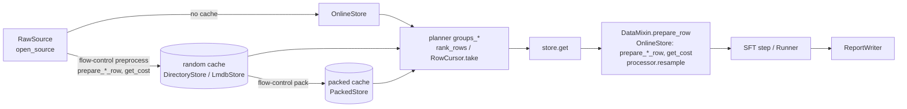

# Data

The data stack turns a downloaded dataset into the rows that SFT, the RL `Runner`, validation and inference consume, and decides which rank reads which row at which step. On-disk layouts are in [formats.md](formats.md); the keys of a row are in [row.md](../overview/row.md).

| Stage | Job | Code |
|---|---|---|
| Raw source | Read a dataset into rows that carry `key`, coerced to the processor's input `TypedDict` | `data/sources/`, `source_registry` |
| Preprocess | Per-row encoding that needs no random seed: text embeddings, VAE posterior mean and std | `processor.prepare_training_row` / `prepare_inference_row`, `flow-control preprocess` |
| Shuffle and group | Per-epoch order: groups of `n` adjacent rows with similar `cost`, split across ranks | `data/grouping.py` |
| Resample | Per-draw randomization on the consumer's device, drawn in fp32 | `processor.resample` |
| Consume | Train loop, RL `Runner`, validation, inference. Every row stays its own dict | `training/` |
| Report | Preview images, full result rows, a metrics jsonl | `data/reports.py` |

**cost**: the token total of one forward on the row (latent + text + reference tokens), because a DiT attends over all of them. It is the sort key of every plan.

**group**: `n` adjacent planned rows with similar cost. The ranks consume groups in lock-step, so every FSDP collective forward sees rows of similar cost on every rank. Groups exist for load balance, not as exact-shape buckets. Multi-reference editing rows vary in prompt length, reference count and resolution, so exact buckets would be many and nearly empty. This gives two regimes:

- Small models (≤ 4B) with padded text at one fixed resolution, as in the SD3.5 diffusion-RL setting: the rows of a group have identical shapes, and stacking them in the adapter ([microbatching](../adapters/microbatching.md)) is the throughput lever.
- Large models with long, unpadded, variable sequences (Qwen-Image family): stacking gains nothing, and FSDP balance is the problem the group solves.

A group is also the pool that sequence packing would draw from.

The dataset config alone selects one of three working modes:

| | No cache | Random cache | Packed cache |
|---|---|---|---|
| `dataset` | Any raw source `type` | `{"type": "cache"}` on a `flow-control preprocess` output | `{"type": "cache"}` on a `flow-control pack` output |
| Store | `OnlineStore` | `DirectoryStore` / `LmdbStore` | `PackedStore` |
| Encoding | On every rank, at every fetch. The processor's encode models load next to the trainer | Once, offline | Once, offline |
| Training plan | `groups_plain`: strict shuffle, no cost grouping | `groups_shuffled`: strict shuffle, cost-sorted megabatches | `groups_packed`: shards reshuffled, groups pre-formed inside a shard |
| `prompt_sampling: "independent"` | Yes | Yes | No |
| For | Debugging, and tasks where caching saves little and the processor fits beside the trainer | Debugging and small runs; convenient on a local NVMe disk, from tens of rows up | Large runs: shards are read sequentially |

## Config Specs Examples

### No Cache

```jsonc
"dataset": {
  "type": "csv", "path": "./examples/tie_en.csv", // any trainer or inference config: read and encoded online on every rank
  "attachment_dir": "./examples/assets",          // relative image paths in the table resolve here
  "limit": 64                                     // the first 64 rows
}
```

```jsonc
"dataset": {
  "type": "concat", // every other key is a source config of its own
  "portraits": {"type": "plain_directory", "path": "./data/portraits", "is_rgba": true},
  "magick": {"type": "csv", "path": "./data/magick.csv", "attachment_dir": "./data/magick/images", "limit": 2000}
}
```

### Preprocess Into a Random Cache

`flow-control preprocess preprocess.jsonc`:

```jsonc
{
  "dataset": {"type": "lines", "path": "./data/pickscore/train.txt"}, // a raw source; a cache is rejected
  "processor": {"task": "t2i", "preset": "flux1", "default_resolution": [512, 512]},
  "processing_mode": "inference", // the consumer's mode: "training" for SFT; "inference" for RL, validation, inference
  "save_extra": true,             // keep the source fields (the prompt a reward reads) next to the encoded ones
  // "reassign_keys": false,      // true: key = row index, for sources whose keys are not unique or not [A-Za-z0-9._-]+
  "output": {"path": "./data/pickscore_flux_512/train", "backend": "directory"}, // or "lmdb"; "overwrite": false
  "processor_devices": [0, 1, 2, 3] // one processor worker per device; also "all" or a count
  // "processor_concurrency": 1,    // rows in flight per processor worker (async LLM captioning)
  // "num_loader_workers": 1, "num_sink_workers": 1, "queue_size": 16
}
```

### Pack Into Tar Shards

`flow-control pack pack.jsonc`:

```jsonc
{
  "input": "./data/big/flux1",          // a random cache
  "output": "./data/big/flux1_packed"
  // "shard_size": 480,                 // rows per shard; a multiple of the trainer's group_size (480 = lcm(16, 24) * 10)
  // "group_size": 16,                  // only checked against shard_size and recorded in meta.json
  // "seed": 0,                         // which rows share a shard
  // "num_workers": 8, "overwrite": false
}
```

The trainer then reads `{"type": "cache", "path": "./data/big/flux1_packed"}`.

### SFT Grouping

```jsonc
{
  "dataset": {"type": "cache", "path": "./data/big/flux1_packed"},
  "train_batch_size": 16,      // rows per optimizer update, all ranks together
  "train_micro_batch_size": 2, // rows per backward on one rank
  // "group_size": 16,         // world_size divides it; train_micro_batch_size divides group_size / world_size
  // "megabatch_groups": 64,   // random cache: groups per cost-sorted megabatch
  // "shuffle_mode": "auto",   // packed cache: "auto" = "shard" (groups_packed); "strict" = groups_shuffled, random seeks
  // "num_dataloader_workers": 1,
  "validation_dataset": {"type": "cache", "path": "./data/big/flux1_validation", "limit": 64}
}
```

### RL Prompts

```jsonc
{
  "dataset": {"type": "cache", "path": "./data/pickscore_flux_512/train"}, // preprocessed in "inference" mode with save_extra
  "num_prompts_per_epoch": 48,   // M distinct prompts per RL epoch; world_size divides it
  "num_rollouts_per_prompt": 16  // K, all sampled by the Runner from one prepared row
  // "prompt_sampling": "chunked", // "independent": a fresh randperm(N)[:M] every epoch (baseline reproduction; not on a packed cache)
  // "group_size": 16
}
```

An RL epoch is `num_prompts_per_epoch` distinct prompts, not a pass over the dataset. A prompt repeated inside one epoch would merge into one advantage group of 2K, because advantages group rollouts by `key`.

### Inference Report

```jsonc
{
  "dataset": {"type": "cache", "path": "./demo/preprocess_flux2_tie"},
  "report": {
    "path": "./demo/inference_flux2_tie",
    // "previews": true, // previews/<key>.png
    "records": true      // records/: the result rows as a random cache
  },
  // "save_extra": false, // records hold key, cost, image_size and the decoded outputs; true: the whole working row
  "reward": {"type": "pickscore"} // scores go to metrics.jsonl and into the records
}
```

Records are a random cache. A consumer reads them when the rows hold the fields it needs, e.g. the contrib VAE trainer (`clean_image`):

```jsonc
"dataset": {"type": "cache", "path": "./demo/inference_flux2_tie/records"}
```

## Stages and Modes



| Consumer | Store | Plan (`make_planner`) | Reader | Padding rows | Resume state |
|---|---|---|---|---|---|
| SFT | `open_train_store` (`training`) | shuffled, `group_size`, `RowStream(multiple_of=rows per update)` | `RowStream` + `StatefulDataLoader` | Forwarded, loss weight 0 | Loader `state_dict` + `current_step` |
| RL (`grpo`, `nft`, `awm`, `ram`) | `open_inference_store(dataset)` | shuffled, `group_size` | `RowCursor`, then `Runner.submit(k=K)` | Skipped by `RowCursor.take` | Cursor `(pass, position)` |
| Validation | `open_inference_store(validation_dataset)` | unshuffled, groups of `world_size` | `RowStream`, then `Runner.submit(k=1)` | Sampled, neither scored nor logged | None |
| Inference | `open_inference_store(dataset)` | unshuffled, groups of `world_size` | `RowStream`, then `Runner.submit(k=1)` | Sampled, neither scored nor written | None |
| VAE (contrib) | own `_open_store` | `groups_plain`, groups of `world_size`, cost-blind | `RowStream` + `StatefulDataLoader` | Forwarded, loss weight 0 | Loader `state_dict` + `current_step` |

## Python Spec

### Sources

```python
class RawSource(Protocol):  # data/sources/base.py; map-style
    def __len__(self) -> int: ...
    def __getitem__(self, index: int) -> Row: ...  # a new dict with `key`; raw values (strings, paths, PIL, arrays, tensors)

source_registry: Registry[Any]  # duck-typed members, constructed with the config's other keys as kwargs

def open_source(config: dict[str, Any], coerce_to: type | None) -> RawSource:
    # pops "type", "limit", "attachment_dir"; "type": "concat" opens every other value as a source
    # member -> CoercedSource(coerce_to, attachment_dir) -> LimitedSource(limit)
```

- Built-in members are generic loaders: `csv`, `jsonl`, `lines`, `parquet`, `inline`, `plain_directory`, `raw_directory`, `huggingface`. A reader for one specific dataset is ad hoc and goes to contrib, even for a published dataset (`contrib/efficient_layered/dataset.py`, `prism_layers_pro`).
- Tabular sources take `key` from a `key` column and fall back to the row index. Directory sources use file or sub-directory names.
- `coerce_to` is `get_processor_input_typeddict(processor_class, mode)`. Its `ImageTensor` / `ImageTensorList` / `JsonStrList` fields (`data/coercion.py`) turn paths, PIL images and arrays into `[1, C, H, W]` tensors in `[0, 1]` (`;` separates a path list) and JSON strings into values. Unknown fields pass through.

A source in contrib:

```python
# flow_control/contrib/my_dataset/__init__.py; configs list it in "imports"
from flow_control.data import KEY, Row, source_registry

@source_registry.register("my_dataset")
class MyDatasetSource:
    def __init__(self, path: str, split: str = "train"):  # {"type": "my_dataset", "path": ..., "split": ...}
        self.items = load_manifest(path, split)              # cheap metadata only; open heavy handles lazily (pickled into workers)

    def __len__(self) -> int:
        return len(self.items)

    def __getitem__(self, index: int) -> Row:
        item = self.items[index]
        return {KEY: item["id"], "prompt": item["caption"], "clean_image": item["file"]}  # the path is loaded by coercion
```

### Stores

```python
class RowStore(Protocol):  # data/store.py
    index: Index
    def __len__(self) -> int: ...
    def get(self, row_id: int) -> Row: ...  # row_id = position in index; a fresh dict the consumer may modify

def open_store(config: DatasetConfig, *, processor_class: type, mode: Literal["training", "inference"]) -> RowStore:
    # "type": "cache" -> open_cache(path, limit=...): meta.json picks Directory / Lmdb / PackedStore
    # other types     -> OnlineStore(open_source(config, coerce_to=<processor input TypedDict for mode>))
```

| Store | `get` | Notes |
|---|---|---|
| `DirectoryStore` | `torch.load(<cache>/<loc>)` | |
| `LmdbStore` | Read-only `lock=False` environment, opened lazily | One environment per path per process: `close()` before opening the same path again |
| `PackedStore` | `seek(offset)` + `read(size)` in `shards/<shard>.tar` | At most `MAX_OPEN_SHARDS` handles per process, evicted LRU |
| `OnlineStore` | `source[row_id]`: raw read and coercion | Index has positional keys, `cost=0`, `sig=""` |

Every store pickles into DataLoader workers: handles are dropped on pickle and reopened in the receiving process. Rows load with `torch.load(weights_only=True)`.

### Plans

```python
PlannedRow = tuple[int, bool]           # (row_id, is_padding)
Group = list[PlannedRow]                # exactly n rows
Planner = Callable[[int], list[Group]]  # epoch -> groups; a pure function of (seed, epoch)

groups_shuffled(index, n, k, seed, epoch)                         # permutation -> megabatches of n*k -> sort by (cost, sig) -> cut into n -> shuffle the groups
groups_packed(index, n, seed, epoch, shuffle_within_shard=False)  # permute shards; consecutive n rows of a shard form a group; no group crosses shards
groups_sorted(index, n)                                           # whole index by (cost, sig), cut into n
groups_plain(num_rows, n, seed, epoch, shuffle)                   # no cost: optional permutation, cut into n

def rank_rows(groups: list[Group], rank: int, world_size: int) -> list[PlannedRow]:
    return [row for g in groups for row in g[rank::world_size]]  # raises unless world_size divides n
```

- Megabatch: sorting the whole index would make every epoch nearly the same order. Sorting inside random megabatches of `group_size * megabatch_groups` rows keeps the order random and each group cost-tight. In a packed cache the shard is the megabatch, fixed at pack time.
- Padding: `_chunk_with_padding` fills a short last group by cycling through that group's own rows, flagged as padding. Padding then costs what its neighbours cost, and every rank gets the same row count.
- Strided split: inside a cost-sorted group, rank `r` takes elements `r, r + R, ...`, so the ranks' i-th rows are adjacent in cost order. Each rank takes `n / R` rows of every group, so all ranks work in the same group at the same time. A contiguous split would give rank 0 the cheapest rows of a group and rank `R - 1` the most expensive at the same step.

`DataMixin.make_planner(store, *, shuffle, micro_batch_size=1)`:

| | `shuffle=True` (SFT, RL prompts) | `shuffle=False` (validation, inference) |
|---|---|---|
| `n` | `group_size` | `world_size` |
| `OnlineStore` | `groups_plain(shuffle=True)` | `groups_plain(shuffle=False)` |
| Random cache | `groups_shuffled(k=megabatch_groups)` | `groups_sorted` |
| Packed cache | `groups_packed` (`shuffle_mode` `auto` / `shard`), `groups_shuffled` (`strict`) | `groups_sorted` |

An unshuffled plan already keeps the whole set in cost order, so one row per rank per group balances the ranks. A `group_size` group there would only add up to `group_size - 1` padding rows.

### RowStream and the Loader

```python
class RowStream(Dataset):  # data/stream.py; map-style and stateless
    def __init__(self, store, planner, rank, world_size, *, multiple_of: int = 1): ...

    def set_epoch(self, epoch: int) -> None:  # main process, before the epoch's iterator: the rows are pickled into the workers then
        rows = rank_rows(self.planner(epoch), self.rank, self.world_size)
        self._rows = rows[: len(rows) - len(rows) % self.multiple_of]  # whole optimizer updates; the same count on every rank

    def __getitem__(self, i: int) -> Row:  # runs in a DataLoader worker
        row_id, padding = self._rows[i]
        row = self.store.get(row_id)
        if padding:
            row[PADDING] = True
        return row

def build_loader(stream, *, batch_size, num_workers) -> StatefulDataLoader:
    # shuffle=False, collate_fn=identity_collate (a list of row dicts, never stacked), worker_init_fn=seed_worker
```

SFT, through `EpochLoopMixin`:

```python
self.make_train_loader(store, planner, micro_batch_size=self.train_micro_batch_size, num_workers=self.num_dataloader_workers)
# -> RowStream(multiple_of=grad_acc_steps * micro_batch_size); steps_per_epoch = len(loader) // grad_acc_steps

for epoch, items, is_sync_step in self.epoch_microbatches():  # epoch = current_step // steps_per_epoch
    rows = [deep_cast_float_dtype(self.prepare_row(item, mode="training", epoch=epoch), self.model.dtype) for item in items]
```

The tail cut by `multiple_of` holds different rows every epoch, since the plan is reshuffled.

### RowCursor

```python
class RowCursor:  # data/stream.py; RL prompts
    def __init__(self, store, planner, seed: int, sampling: PromptSampling = "chunked"): ...
    def take(self, count: int, *, epoch: int) -> list[int]: ...  # count distinct global row ids, padding skipped; identical on every rank
    def state_dict(self) -> dict[str, int]: ...                   # {"pass": ..., "position": ...}
```

- `chunked` walks the flattened groups of `planner(pass)`. At the end of a pass, the take continues in the next pass's plan and drops duplicates within the take. No prompt repeats within a pass, and the prompts of one take are adjacent in cost.
- `independent` returns `randperm(N)[:count]` seeded by `epoch`. It is cost-blind and raises on a `PackedStore`, where it would seek at random across shards.

`RolloutMixin._start_rollouts`:

```python
ids = self._cursor.take(self.num_prompts_per_epoch, epoch=epoch)  # the same ids on every rank
mine = ids[self.rank :: self.world_size]                           # whole prompts, strided like rank_rows
groups = self.runner.submit(
    ((i, store.get(i)) for i in mine),  # pulled lazily on the main thread when the executor has room
    self.rollout.sample, self.rollout.score,
    prepare=prepare,                    # deep_cast_float_dtype(self.prepare_row(item, mode="inference", epoch=epoch), model.dtype)
    k=self.num_rollouts_per_prompt, epoch=epoch, ...,
)
```

`Runner._start_group` calls `prepare` once per prompt. Each of the K rollouts of `ctx.rollouts()` starts from `data(prepared)` with its own noise, so the K rollouts share one online encoding and one resample. The K-repeat belongs to the Runner ([rollouts.md](../training/rollouts.md)); the data layer hands out distinct prompts.

Chunked prompts are split across ranks in blocks of `world_size`. A block lies inside one plan group as long as the walk consumes whole groups. Skipping a padded group's padding, or a duplicate at a pass boundary, shifts every later block, so one block per group then straddles two groups of different cost. This costs throughput, never correctness. The split is exact when `(N mod group_size) % world_size == 0`. `make_rollout_cursor` warns otherwise; setting `dataset.limit` to a multiple of `group_size` fixes it.

### Processor Hooks

```python
class BaseProcessor:
    posterior_fields: ClassVar[tuple[str, ...]] = ("clean_latents",)  # tasks add every VAE-encoded field (TIE: reference_latents)
    target_posterior: PosteriorMode = "distribution"  # cache [2, ...] = (mean, std); "mode" caches the mean only and ignores std

    def get_cost(self, row) -> int: ...  # latent tokens from image_size; tasks add prompt_embeds.shape[1] and reference tokens

    def resample(self, row: Row, generator: torch.Generator) -> Row:  # in place; generator on the row's device
        # every posterior field with first dim 2 -> sample_posterior: one fp32 draw mean + std * eps, shape [1, ...]
```

Preprocess stays seed-free: anything random belongs in `resample`, which runs at every fetch with a generator seeded by `(epoch, key)`. Augmentation (random crops, RealESRGAN-style degradation) is a `resample` override. The draw is made in fp32 because a cache holds mean and std in bf16, where `std * eps` falls below the resolution of `mean`.

`DataMixin.prepare_row` runs on the main thread for every consumer:

```python
def prepare_row(self, row, *, mode, epoch, online=None) -> ProcessedRow:
    row = deep_move_to_device(row, self.device)
    if online:  # default: the main store is an OnlineStore
        row = self._preprocess_online(row, mode)  # prepare_*_row; inference mode keeps the raw fields; key / padding carried; cost = get_cost
    generator = torch.Generator(device=self.device).manual_seed(derive_seed(self.seed, f"{epoch}:{row[KEY]}"))
    return self.processor.resample(row, generator)
```

### Reports

```python
class ReportConfig(BaseModel):
    path: str
    previews: bool = True
    records: bool = False
    def open(self, rank: int) -> ReportWriter: ...

class ReportWriter:  # data/reports.py
    def __init__(self, root, rank, *, previews, records): ...  # collective: rank 0 removes stale per-rank parts, then a barrier
    def write(self, row, preview: torch.Tensor | None, metrics: dict[str, Any]) -> None: ...  # padding dropped; nested metrics flattened
    def finalize(self, *, meta: dict[str, Any] | None = None) -> None: ...  # collective: rank 0 merges the parts, writes meta.json, finalize_cache(records/)
```

Inference submits its loader's items with `Runner.submit(k=1)` and writes each non-padding row as `pending.as_completed()` yields it.

### Processes and Threads

| Work | Runs in |
|---|---|
| `store.get` (for an `OnlineStore`: the raw read and coercion) | DataLoader workers for SFT, validation and inference; the main thread for RL, lazily per group |
| Device move, online encoding, `get_cost`, `resample`, cast to the model dtype | Main thread (`prepare_row`; the `Runner`'s `prepare` for every sampling consumer) |

The processor's decode models load on every rank; its encode models load once a raw-source store is opened (`DataMixin._open_store`).

`flow-control preprocess` (`scripts/preprocess.py` on `utils/pipeline`):

| Stage | Class | Workers |
|---|---|---|
| Scan | `TorchDatasetSource`: row indices | 1 |
| Load | `TorchDatasetLoaderStage`: `open_source(coerce_to=...)`, `source[i]`, `reassign_keys` | `num_loader_workers` |
| Encode | `ProcessorStage`: `prepare_*_row`, `get_cost`, `save_extra` merge, move to CPU | One per `processor_devices` entry, `processor_concurrency` rows each |
| Write | `RandomCacheWriter`: row to the backend, index lines to `index-<worker>.jsonl` | `num_sink_workers` |
| Finalize | `finalize_cache` in the main process: merge the parts sorted by key, reject duplicate keys, write `meta.json` | |

`flow-control pack` writes one shard per task in a spawn process pool of `num_workers`.

### Seeds

`seed` is the trainer's `seed`.

| Draw | Seed |
|---|---|
| Plan (`groups_shuffled`, `groups_packed`, `groups_plain`) | `torch.Generator().manual_seed(seed * 1_000_003 + epoch)`; the SFT epoch, or for RL the cursor's pass |
| Pack: rows per shard | `PackConfig.seed` |
| `independent` prompts | `derive_seed(seed, f"prompts:{epoch}")` |
| Resample | `derive_seed(seed, f"{epoch}:{key}")` on the consumer's device: independent of the worker that fetched the row |
| Rollout noise | `ctx.seed("rollout", epoch, prompt_id, i)` = `derive_seed(seed, f"rollout:{epoch}:{prompt_id}:{i}")`, `prompt_id` the global row id |
| Validation / inference noise | `derive_seed(base, key)`; `base` is `seed`, or `seed + step` with `validation_same_seed: false` (the resample epoch is then `step`) |
| DataLoader workers' `random` / `numpy` | `seed_worker` |

## Extension Points and Core Contracts

### Extension Points

| Point | A member implements | Lives in |
|---|---|---|
| `source_registry` | `__len__`, `__getitem__ -> Row` with a `key`; constructor kwargs are the config keys | `flow_control/contrib/`, or an out-of-tree module listed in `imports` |
| `processor.get_cost` | Token estimate of one forward; a grouping estimate, not the exact transformer length | The task or preset |
| `processor.resample`, `posterior_fields` | Per-draw randomization, deterministic given the generator, in place | The task |
| A consumer outside `DataMixin` | Its own store opening and planner over `RowStream` / `RowCursor` | E.g. `contrib/rgba_vae_training`: `groups_plain` groups of `world_size` (its rows have no cost) and `VaeTargetResample` as its resample |

A source returns a new dict per call and stays picklable: DataLoader workers and preprocess's spawned workers each get a copy. Its keys must be unique and match `[A-Za-z0-9._-]+` to be cached or previewed; `reassign_keys` rewrites them in preprocess.

### Core Contracts

- **Reserved keys** (`data/rows.py`): `key`, `cost`, `image_size`, `padding`. `padding` exists only in consumer memory; it is never written to disk.
- **Mode**: a cache holds `training` rows (targets) for SFT and `inference` rows (conditions) for RL, validation and inference; `meta.json` records `mode`, and consumers do not check it. Fields read after encoding (a reward's `prompt`) survive a cache only with `save_extra`; online inference-mode rows keep them.
- **No collation**: `identity_collate` hands lists of row dicts; stacking is the adapter's. Repeating a prompt K times is the Runner's.
- **`RowStore`**: `get(row_id)` returns a fresh dict; `index` is an `Index` of `IndexEntry(key, cost, sig, image_size, loc)`; the store pickles. The on-disk formats in [formats.md](formats.md) are part of this contract.
- **Plans**: pure functions of `(seed, epoch)` over an `Index`; every group holds exactly `n` rows.
- **Divisibility**, checked at setup:

  | Rule | Where |
  |---|---|
  | `group_size % world_size == 0` | `make_planner(shuffle=True)`, `rank_rows` |
  | `(group_size / world_size) % train_micro_batch_size == 0` | `make_planner` (SFT): a microbatch never spans two groups |
  | `train_batch_size % world_size == 0`, `(train_batch_size / world_size) % train_micro_batch_size == 0` | `MicrobatchTrainMixin.grad_acc_steps` |
  | `num_prompts_per_epoch % world_size == 0`, `num_prompts_per_epoch <= N` | `RolloutMixin.rollouts_per_rank`, `make_rollout_cursor` |
  | `shard_size % group_size == 0` | warned at pack time against `PackConfig.group_size`; a reader whose `group_size` does not divide `shard_size` ends every shard in a padded group |

- **Padding semantics**: SFT and VAE forward a padding row with loss weight 0 (SFT averages a microbatch over its real rows); validation samples it and neither scores nor logs it; inference samples it and does not write it; RL never sees one (`RowCursor.take` skips it).
- **Resume**: SFT and VAE checkpoint the `StatefulDataLoader` state and `current_step`; the plan is recomputed from `(seed, epoch)`. RL checkpoints the cursor `(pass, position)` from before the oldest in-flight batch took its prompts, so a resume takes the same prompts again.
