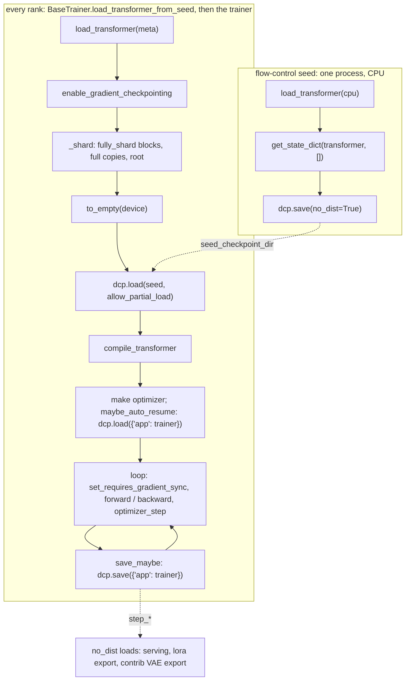

# FSDP2 and DCP

The trainers shard the transformer with FSDP2 (`torch.distributed.fsdp.fully_shard`) and load and save it with DCP (`torch.distributed.checkpoint`). This guide covers the parts of both that the repo depends on and where it uses them. It is checked against torch 2.12, the version in `uv.lock`. For everything else, see the official docs: [`fully_shard`](https://docs.pytorch.org/docs/stable/distributed.fsdp.fully_shard.html), the [FSDP2 tutorial](https://docs.pytorch.org/tutorials/intermediate/FSDP_tutorial.html), [DeviceMesh](https://docs.pytorch.org/tutorials/recipes/distributed_device_mesh.html), the [DCP API](https://docs.pytorch.org/docs/stable/distributed.checkpoint.html) and the [DCP recipe](https://docs.pytorch.org/tutorials/recipes/distributed_checkpoint_recipe.html).

Related chapters:

- [distributed](../training/distributed.md): which collectives may run where.
- [outputs](../training/outputs.md): what a training checkpoint holds and how checkpoints rotate and resume.
- [adapter](../adapters/adapter.md#meta-init-and-the-seed-checkpoint): what the seed holds and which state `dcp.load` cannot restore.

## Config Example

```jsonc
{
  "launch": {"type": "sft", "generate_dcp_seed": true}, // flow-control seed before torchrun (cli.md)
  "seed_checkpoint_dir": "/dev/shm/flow-control/seed",  // DCP, written once by a single process
  "hsdp_shard_dim": 4,         // mesh (W / 4, 4) named ("replicate", "shard"); 1: replicate only
  // "gradient_checkpointing": true,
  "checkpoint_root": "$auto",  // training checkpoints: DCP directories step_* and rolling_step_*
  "auto_resume": true
}
```

## Lifecycle



## FSDP2

### Mesh

```python
# BaseTrainer.init_device_mesh
mesh = init_device_mesh(device_type, (W // hsdp_shard_dim, hsdp_shard_dim), mesh_dim_names=("replicate", "shard"))
```

On a 2D mesh `fully_shard` runs HSDP: parameters are placed `(Replicate(), Shard(0))`. Each parameter is chunked on dim 0 across the `hsdp_shard_dim` ranks of a shard group and replicated across groups. Gradients are reduce-scattered within the shard group, then all-reduced across replicas. With `hsdp_shard_dim: 1` every rank holds the full parameters and gradients are only all-reduced; with `hsdp_shard_dim: W` it is plain FSDP. Keep a shard group inside one fast interconnect domain: every forward all-gathers over it.

### Sharding Units

```python
# BaseTrainer._shard
for _, module in transformer.named_modules():  # also walks the blocks of full variant copies (transformer.variants)
    if type(module).__name__ in fsdp_layers:   # transformer._no_split_modules or _repeated_blocks
        fully_shard(module, mesh=self.mesh)
for copy in transformer.variants.values():     # the rest of each full variant copy
    fully_shard(copy, mesh=self.mesh)
fully_shard(transformer, mesh=self.mesh)       # the root: embedders, norms, output layers
```

- Each `fully_shard` call groups the parameters under its module that no earlier call took. A group is all-gathered in one collective before its module's forward and reduce-scattered in one after its backward. Calls therefore go bottom-up, blocks first and the root last. A module called outside its parent unit's `forward` needs a unit of its own (contrib `rgba_vae_training` shards `quant_conv` / `post_quant_conv`, which `encode()` / `decode()` call directly).
- `fully_shard` turns parameters into DTensors in place and adds `FSDPModule` methods to the module's class.
- `reshard_after_forward` keeps its default: blocks free their gathered parameters after forward and gather them again in backward, and the root keeps its own. No-grad sampling forwards gather every block on every call.
- `fully_shard` broadcasts nothing. Every rank must hold equal values before sharding, which loading the seed guarantees ([cli](../scripts/cli.md#seed-checkpoint)).
- The trainable parameters of one unit must share one dtype; FSDP2 raises otherwise. `cast_trainable_parameters` casts them all to `trainable_dtype` before `_shard`. Frozen parameters may differ: fp32 EMA slots, fp8 `storage_dtype` weights.

### Gradient Accumulation

```python
# SftTrainer.run, RolloutTrainerBase._train_on_rollouts: before every microbatch's backward
self.transformer.set_requires_gradient_sync(is_sync_step)  # recurses into every unit
```

With sync off, gradients accumulate unsharded on each rank without communication. The backward of the last microbatch reduce-scatters and all-reduces them. Every rank passes the same value ([distributed](../training/distributed.md)). `clip_grad_norm_` on DTensor gradients reduces the norm across the mesh.

### Mixed Precision

The repo passes no `MixedPrecisionPolicy`. Parameters are already stored in their compute dtype, so all-gathers move `hf_model.dtype` (bf16), and gradients are reduced in the trainable parameters' dtype (`trainable_dtype`). The adapter casts inputs and returns fp32 velocities ([precision](../adapters/precision.md)).

## DCP

### Save and Load

```python
dcp.save(state_dict, checkpoint_id=path)   # collective: each rank writes its own shards (__<rank>_*.distcp), .metadata last
dcp.load(state_dict, checkpoint_id=path,   # collective, in place: fills the tensors already in state_dict
         planner=DefaultLoadPlanner(allow_partial_load=True))  # requested keys the checkpoint lacks are skipped
dcp.load(state_dict, checkpoint_id=path, no_dist=True)  # one process, no collectives
```

- Loading is in place. The DTensors in the requested state dict, sharded over the current mesh, decide what each rank reads. A checkpoint saved under one world size or `hsdp_shard_dim` therefore loads under another.
- Nested dicts are flattened into dotted keys: `{"app": {"transformer": {...}}}` is stored as `app.transformer.<fqn>`.
- A key that several ranks hold is written once, by one rank, and every rank loads that copy. This covers replicated DTensor shards across HSDP replicas, plain tensors and non-tensor values (ints, bytes, pickled objects). Per-rank state needs a key that differs per rank.
- `.metadata` is renamed into place after all data is written, so a directory without it is incomplete (`CheckpointingMixin.find_latest_checkpoint`, `scripts/export.py`).
- `no_dist=True` is for single-process tools: `flow-control seed`, serving's loads, `scripts/lora.py` and the contrib VAE `export_checkpoint`. A process without a process group falls back to it with a warning.
- Every rank calls `dcp.save` and `dcp.load`, HSDP replicas included, because DCP deduplicates replicas itself. The torch docstring's note on saving from one replica group concerns FSDP1's `HYBRID_SHARD`.

### Stateful

```python
class DcpMixin(BaseModel):  # training/mixins/dcp.py
    def save_dcp_checkpoint(self, checkpoint_path: str):
        dcp.save({"app": self}, checkpoint_id=checkpoint_path)  # DCP calls self.state_dict()

    def load_dcp_checkpoint(self, checkpoint_path: str):
        dcp.load({"app": self}, checkpoint_id=checkpoint_path,  # self.state_dict() gives the targets,
                 planner=DefaultLoadPlanner(allow_partial_load=True))  # then self.load_state_dict(loaded)
```

The trainer itself is the `Stateful`: anything with `state_dict()` and `load_state_dict()` placed in the top-level dict. What its `state_dict()` returns is in [outputs](../training/outputs.md).

### Distributed State Dicts

```python
# training/mixins/base.py
get_state_dict(transformer, [], options=StateDictOptions(strict=False))[0]  # the seed: every parameter and buffer
get_model_state_dict(transformer, options=StateDictOptions(strict=False))  # model_state_dict: then drop frozen params outside model.variant_modules()
get_optimizer_state_dict(transformer, optimizer, options=StateDictOptions(strict=False, ignore_frozen_params=True))
set_model_state_dict(transformer, state, options=StateDictOptions(strict=False))  # and set_optimizer_state_dict
```

- These return the unwrapped module's FQNs, without FSDP, compile or DDP prefixes. The tensors are sharded DTensors (`full_state_dict=False`), so DCP saves each rank's own shards. Optimizer state is keyed by parameter FQN rather than by index, so it survives a change of mesh.
- Training checkpoints leave out the frozen base weights (`ignore_frozen_params=True` for the optimizer; filtering by FQN in `model_state_dict`, since `get_model_state_dict`'s `submodules=` is deprecated). They come back from the seed.
- `strict=False` lets a partial state dict load.

### Offline Access

```python
from torch.distributed.checkpoint.format_utils import dcp_to_torch_save
dcp_to_torch_save(checkpoint_dir, "checkpoint.pt")  # the whole checkpoint as one torch.save file, for inspection

stored = dcp.FileSystemReader(checkpoint_dir).read_metadata().state_dict_metadata  # keys and shapes, no data read
```

The repo's offline readers load only the keys they need with `no_dist=True` (`scripts/lora.py` `_load_dcp_slots`, serving's `_load_dcp_training`).

### Why Not `torch.save`

- `torch.save` of a sharded model first gathers every shard on one rank: the full model in one process's memory and one writer. With DCP, every rank writes its own shards in parallel.
- A `torch.save` file is tied to the layout it was gathered for. DCP reshards at load.
- DCP loads subsets (`allow_partial_load`) and lists keys from `.metadata` without reading tensor data.

## Rules in This Repo

- The transformer is built on meta, sharded, given storage with `to_empty`, then loaded with `dcp.load`, so each rank allocates only its own shard. Without a seed and with `hsdp_shard_dim > 1`, each rank first loads the whole model on CPU.
- `to_empty` leaves uninitialized whatever the seed does not hold: non-persistent buffers and tables built in `__init__` ([adapter](../adapters/adapter.md#meta-init-and-the-seed-checkpoint)).
- `allow_partial_load` together with `strict=False` skips mismatched keys without an error. A renamed module, or a `model.variants` that realizes different slots, loads nothing for those keys. A loader that needs every key checks them against `.metadata` itself, as `scripts/lora.py` does.
- `dcp.save`, `dcp.load` and `set_requires_gradient_sync` follow the collective rules in [distributed](../training/distributed.md).

| Where | What |
|---|---|
| `BaseTrainer.init_device_mesh` | Process group and the `("replicate", "shard")` mesh |
| `BaseTrainer._shard` | `fully_shard` units |
| `BaseTrainer.load_transformer_from_seed` | Meta build, shard, `to_empty`, seed `dcp.load` |
| `BaseTrainer.save_transformer_to_seed` | Seed `dcp.save(no_dist=True)` |
| `model_state_dict`, `optimizer_state_dict` and their loaders (`training/mixins/base.py`) | `StateDictOptions` of training checkpoints |
| `DcpMixin`, `CheckpointingMixin` (`training/mixins/dcp.py`) | `{"app": trainer}` save, load, rotation, resume |
| `serving/engine.py` `_load_dcp_seed` / `_load_dcp_training`, `scripts/lora.py` `_load_dcp_slots` | `no_dist` loads into an unsharded transformer |

## Standalone Example

[`fsdp/dcp.py`](fsdp/dcp.py) is the same pattern on a toy model with hand-written LoRA layers. It runs one process per GPU through `mp.spawn` and writes into the working directory. Its stages are `create_seed` (single-process `dcp.save`), `train_lora` (meta build, `fully_shard`, `to_empty`, seed load, one step, save the LoRA state through a `Stateful`), `resume_lora` and `export_lora` (`dcp_to_torch_save`).

```bash
uv run docs/guides/fsdp/dcp.py create_seed
uv run docs/guides/fsdp/dcp.py train_lora
```
