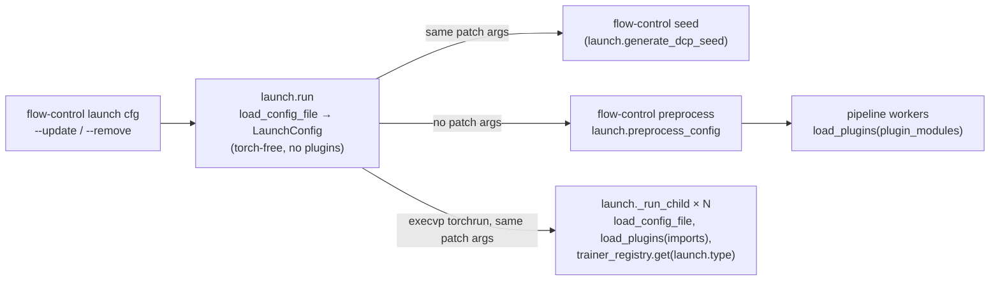

# Configs and plugins

Every `flow-control` command reads one config file into pydantic models. Algorithmic choices in those models are open discriminated unions over a `Registry`: a plugin module registers a new member, and a config selects it by tag after naming the module in `imports`.

## Config Specs Examples

### Patch a Config From the Command Line

```bash
flow-control launch examples/nft/pickscore_sd35/train.nft.jsonc \
  --update '$.run_id=pickscore-lr-a' \
  --update '$.rollout.sampler.steps=20' \
  --update '$.model.variants.default.rank=64' \
  --remove '$.validation_variants'
# VALUE is a JSON5 literal when it parses as one, else a string; both flags repeat.
```

### Use a contrib Plugin

```jsonc
{
  "imports": ["flow_control.contrib.momentum_guidance"], // registers prediction "momentum"
  "sampler": {
    "type": "grid", "steps": 28,
    "transition": {"type": "euler", "prediction": {
      "type": "cfg", "scale": 4.5,
      "prediction": {"type": "momentum", "alpha": 0.5, "beta": 0.75} // also the negative branch: `negative` defaults to `prediction`
    }}
  }
}
```

### Use an Out-of-tree Plugin

```jsonc
{
  "imports": ["examples.plugins.toy"], // a module path from the repo root, no __init__.py needed; local/<project>/x.py is "local.<project>.x"
  "sampler": {"type": "grid", "steps": 20, "shift": {"type": "toy_constant", "value": 3.0}}
}
```

### Shorthands

```jsonc
"sampler": [ /* ... */ ],              // list_as: {"type": "sequential", "steps": [...]}
"shift": 3.0,                           // number_as: {"type": "constant", "shift_value": 3.0}
"prediction": 4.5,                      // number_as: {"type": "cfg", "scale": 4.5}
"transition": "euler",                  // bare string: the tag with default fields
"warmup": "standard"
```

### Editor Schema With Plugins

```bash
flow-control schema                      # core members only, into schema/ (gitignored)
flow-control schema --config local/my_project/train.jsonc --output-dir local/my_project/schema
# then in that config: "$schema": "./schema/nft.schema.json"
```

## Where Patches and Plugins Apply



Each process re-reads the file and applies the patches itself; nothing rewrites the config on disk. The resolved config is snapshotted into the run directory ([outputs](../training/outputs.md)).

## Python Spec

### Loading

```python
# flow_control/utils/config.py
def load_config_file(path: str, updates: Sequence[str] = (), removes: Sequence[str] = ()) -> dict:
    # .json/.json5/.jsonc (json5), .yaml/.yml, .toml; drops a top-level "$schema"; must be an object
    # then apply_config_patches: every --update, then every --remove

def apply_config_patches(config: dict, updates: Sequence[str] = (), removes: Sequence[str] = ()) -> dict:
    # --update JSONPATH=VALUE: jsonpath_ng update_or_create, so it may set a key the file omits;
    #   the first "=" outside quotes and brackets splits path from value
    # --remove JSONPATH: raises when the path matches nothing

def format_config_patch_args(updates, removes) -> list[str]:  # back to CLI args for a subprocess
```

`imports: list[str]` is a field of every config that accepts plugins: `BaseTrainer`, `PreprocessConfig`, `ServeConfig` and `RewardServerConfig`. `load_plugins(config.get("imports", []))` runs before any model is built:

| Process | Call site |
|---|---|
| `preprocess`, `seed`, `export`, `serve`, `reward-server`, `lora` | `flow_control/scripts/cli.py` `_dispatch`, `_dispatch_lora` |
| torchrun children of `launch` | `flow_control/scripts/launch.py` `_run_child` |
| `schema --config` | `flow_control/scripts/schema.py` `run` |
| spawned preprocess workers | `flow_control/utils/pipeline/workers.py`, from `plugin_modules` |

### Registry and RegistryUnion

```python
# flow_control/utils/registry.py
class Registry[T]:
    def __init__(self, name: str, *, base: type[T] | None = None, check: Callable[[type], None] | None = None): ...
    def register(self, tag: str) -> Callable[[type[C]], type[C]]: ...
    # raises on a non-subclass of `base`, a failing `check`, or a tag held by another class
    def members(self) -> Mapping[str, type[T]]: ...
    def get(self, tag: str) -> type[T] | None: ...

class RegistryUnion:  # Annotated metadata turning a base type into an open tagged union
    def __init__(self, registry: Registry, discriminator: str | Callable[[Any], str], *,
                 parser: Callable[[dict], Any] | None = None,   # custom dispatch (processor task × preset)
                 list_as: tuple[str, str] | None = None,       # [a, b]  -> {disc: tag, field: [a, b]}
                 number_as: tuple[str, str] | None = None): ...  # 4.5     -> {disc: tag, field: 4.5}
    # a bare string is {disc: string}; shorthands need a plain string discriminator and no parser

def load_plugins(modules: Iterable[str]) -> None: ...  # import each module once, for its @register side effects
```

A family declares its registry and union next to its base class:

```python
# flow_control/samplers/shift.py
shift_registry: Registry[BaseShift] = Registry("shift", base=BaseShift)
Shift = Annotated[BaseShift, RegistryUnion(shift_registry, "type", number_as=("constant", "shift_value"))]

class BaseGrid(BaseTrajectory):
    shift: Shift = ConstantShift()  # accepts {"type": ...}, "flux2", 3.0
```

Validation dispatches through the registry when a value is validated, so a member registered after the config class was built still validates. The JSON schema is the union as it stood when the class's schema was built. A config class holding a union whose members register after its module is imported (`BaseRollout`, `EndpointTrainer`, `BaseNode`) sets `defer_build=True`, and `flow-control schema --config` loads plugins before importing any config class.

### A New Member

```python
# flow_control/contrib/momentum_guidance.py
@prediction_registry.register("momentum")       # tag == the `type` literal
class Momentum(BasePrediction):
    type: Literal["momentum"] = "momentum"
    prediction: Prediction = Model()            # a child slot: any registered prediction
    alpha: float
    beta: float

    def run(self, row: Row, frame: Frame) -> Calls[torch.Tensor]:
        velocity = yield from self.prediction(row)
        previous = row.get("_momentum", velocity)  # node history on the row: one per branch
        row["_momentum"] = (1 - self.beta) * velocity + self.beta * previous
        return velocity + self.alpha * (velocity - previous)
```

The smallest standalone plugin is `examples/plugins/toy.py`.

## Registries

| Registry | Defined in | Selected by | Chapter |
|---|---|---|---|
| `adapter_registry` | `adapters/base.py` | `model`: tag `f"{arch}_{type}"`, no shorthands | [adapter](../adapters/adapter.md) |
| `task_registry` | `processors/base.py` | `processor.task` | [processors](../processors/processors.md) |
| `preset_registry` | `processors/presets/base.py` | `processor.preset`, mixed into the task class by `parse_processor` | [processors](../processors/processors.md) |
| `encoder_registry` | `processors/components/encoder/base.py` | a preset's `encoder` / `pooled_encoder` | [processors](../processors/processors.md) |
| `vae_registry` | `processors/components/vae.py` | a preset's `vae` | [processors](../processors/processors.md) |
| `source_registry` | `data/sources/base.py` | `dataset.type` via `open_source` (a dict; `concat` and `cache` are built in) | [data](../data/data.md) |
| `trainer_registry` | `training/mixins/base.py` | `launch.type`; built-ins register in `import_builtin_trainers` | [trainers](../training/trainers.md) |
| `objective_registry` | `training/endpoint.py` | `objective` | [trainers](../training/trainers.md) |
| `train_timesteps_registry` | `training/train_timesteps.py` | `train_timesteps` | [trainers](../training/trainers.md) |
| `advantage_registry` | `training/advantage.py` | `advantage` | [trainers](../training/trainers.md) |
| `timestep_weighting_registry` | `training/weighting.py` | `timestep_weighting`, `train_timesteps.weighting` | [trainers](../training/trainers.md) |
| `loss_weighting_registry` | `training/weighting.py` | `loss_weighting` | [trainers](../training/trainers.md) |
| `rollout_registry` | `training/rollouts/base.py` | `rollout` | [rollouts](../training/rollouts.md) |
| `scorer_registry` | `rewards/base.py` | every scorer entry (`rollout.reward`, `reward`, `validation_scorer`) | [rewards](../rewards/rewards.md) |
| `judge_registry` | `rewards/base.py` | `rollout.judge` | [rewards](../rewards/rewards.md) |
| `normalize_registry` | `rewards/normalize.py` | a scorer's `normalize` | [rewards](../rewards/rewards.md) |
| `trajectory_registry` | `samplers/trajectory.py` | `sampler`, `rollout.sampler`, `validation_sampler`; `list_as` sequential | [nodes](../sampler/nodes.md) |
| `transition_registry` | `samplers/transition.py` | `transition` | [nodes](../sampler/nodes.md) |
| `prediction_registry` | `samplers/prediction.py` | `prediction`, `negative`, `train_predictor`; `number_as` cfg | [nodes](../sampler/nodes.md) |
| `shift_registry` | `samplers/shift.py` | `shift`; `number_as` constant | [nodes](../sampler/nodes.md) |
| `warmup_registry` | `adapters/variants.py` | an `ema` variant's `warmup` | [variants](../adapters/variants.md) |
| `task_template_registry` | `serving/tasks/base.py` | the serving processor's `task` (Gradio form) | [serving](../scripts/serving.md) |
| `variant_registry` | `adapters/variants.py` | `model.variants.*.type` | [variants](../adapters/variants.md) |

Every registry except `variant_registry` is an extension point. Variant kinds are implemented inside `VariantsMixin` (`adapters/weights.py`) and are tightly coupled to it; a new kind is a core change.

## Extension Points and Core Contracts

### Extension Points

- A new member subclasses the family's base, declares `type: Literal["<tag>"]` (adapters: `arch` and `type`), and registers with `@<registry>.register("<tag>")`. It lives in `flow_control/contrib/` or in `local/<project>/`, and a config activates it through `imports` ([repo layout](repo-layout.md)).
- `source_registry` and `task_template_registry` are duck-typed (`base=None`): a member implements the protocol (`RawSource`, `TaskTemplate`) without subclassing.

### Core Contracts

- A type selectable through a registry union is live even if no config in the repo uses it: configs live on other machines and in `local/`. Do not delete, rename or change the meaning of a member without asking.
- The registry tag equals the member's discriminator value; dispatch looks the tag up and then validates the member against it.
- Plugins are passed explicitly, from `imports` or `plugin_modules`, never through an environment variable, and load before any config model is built.
- Core modules never import `flow_control.contrib`; a contrib member affects only runs whose config imports it.
