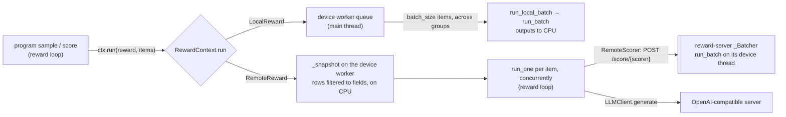

# Rewards

A reward scores decoded rows. Core knows two things about a reward:

- **Placement**: where a call executes. A `LocalReward` runs on the device worker (the main thread), batched across rows and groups. A `RemoteReward` runs on the reward loop (a background thread), one request per item, concurrently. Placement alone decides scheduling. A reward's inputs and outputs are its own business, and `ctx.run(reward, items)` is the one way to call any reward.
- **Slot**: the contract of a config field. A `Scorer` takes a row and returns `[C]` raw scores on its labels. It carries `name` / `weight` / `normalize` and is the only kind the framework aggregates and logs. A `Judge` takes a pair `(a, b)` and returns P(a ≻ b), with 0.5 for a tie. A rollout program turns judge results into its own reward components ([rollouts](../training/rollouts.md)).

| Slot ↓ / Placement → | `LocalReward` | `RemoteReward` |
|---|---|---|
| `Scorer` | `pickscore`, `hpsv2`, `clip_score`, `clip_image_similarity`, `aesthetic`, `image_reward`, `ocr`, `geneval`; contrib `pyiqa` | `rational_rewards_t2i`, `rational_rewards_edit`, `unified_reward`, `remote` |
| `Judge` | none in tree (a preference network would go here) | `unified_reward` |

Three fields take a scorer list: `rollout.reward` (every policy rollout), the trainer's `validation_scorer` (`null`: `rollout.reward`; `false`: no scoring) and the inference `reward`. `rollout.judge` of `round_robin` takes a judge. A program whose training signal is a judge validates with any scorer. The examples of these fields are in [rollouts](../training/rollouts.md).

## Config Specs Examples

### One Scorer

```jsonc
"reward": {"type": "pickscore"} // shorthand for a one-item list; label "pickscore"
```

### Several Scorers

```jsonc
"reward": [
  {"type": "pickscore"},                                // its class default normalize: affine 1/26
  {"type": "hpsv2", "weight": 0.5, "normalize": {"type": "clamp", "low": 0.0, "high": 0.4}},
  {"type": "clip_score", "name": "clip", "weight": 0.2} // name: the label prefix (default: type)
]
// labels: pickscore, hpsv2, clip. A multi-component scorer logs "<name>/<component>".
```

### MLLM Scorer

```jsonc
"reward": {
  "type": "rational_rewards_t2i",
  "llm": {"base_url": "http://127.0.0.1:8000/v1", "model": "RationalRewards-8B-T2I", "max_concurrency": 8}
  // "aspects": ["text_faithfulness", "physical_quality", "text_rendering"], // averaged into "overall"
  // "expose_aspects": true // log each aspect as a weight-0 component
}
// labels: rational_rewards_t2i/overall (weight 1); rational_rewards_t2i/text_faithfulness,
// .../physical_quality, .../text_rendering (weight 0, logged only)
```

### Remote Scorer

The server owns its scorers' configs, and the client names the server and the scorer.

```jsonc
// flow-control reward-server scorers.jsonc
{
  "imports": [],
  "port": 8001,
  // "device": "cuda:0",
  "scorers": {"pickscore": {"type": "pickscore"}, "hps": {"type": "hpsv2"}} // local scorers only
}
```

```jsonc
"reward": [
  {"type": "remote", "url": "http://node-12:8001", "scorer": "pickscore", // label: scorer, unless name is set
   "normalize": {"type": "affine", "scale": 0.0385}}, // the server returns raw scores; weight and normalize are the client's
  {"type": "hpsv2"}
]
```

### Judge

```jsonc
"judge": { // rollout.judge of round_robin; the program around it is in training/rollouts.md
  "type": "unified_reward",
  "mode": "rank", // the classic pair-rank template (UnifiedReward-qwen-7b); default "score": the UnifiedReward-2.0 pair-score template
  "llm": {"base_url": "http://127.0.0.1:8080/v1", "model": "UnifiedReward", "max_concurrency": 8}
}
```

### Contrib IQA Battery

```jsonc
{
  "imports": ["flow_control.contrib.iqa"], // needs the `iqa` dependency group
  "reward": {
    "type": "pyiqa",
    "metrics": [{"name": "psnr"}, {"name": "lpips"}, {"name": "musiq"}], // one component each: pyiqa/psnr, ...
    "reference": "reference[0]" // full-reference metrics compare against this condition image
    // "flip_lower_better": true // lower-is-better metrics (lpips) get negative weights
  }
}
```

## Where a Call Runs



The device worker serves local reward items between forward rounds, whenever the trainer is not inside a training step. Which thread may do what, and how a failure spreads to every rank, is in [distributed](../training/distributed.md).

## Python Spec

### Placement

```python
class LocalReward[I, O](BaseModel):  # device worker: sync, batched
    batch_size: PositiveInt = 32  # items per run_batch(); the worker fills it across groups

    def load(self, device: torch.device) -> None: ...  # once, before the first run_batch()
    def run_batch(self, items: list[I], /) -> list[O]: ...
        # one output per item; rows arrive as they are (CPU storage or device): move what you need;
        # run_local_batch calls it under no_grad and moves the outputs to CPU

class RemoteReward[I, O](BaseModel):  # reward loop: one request per item, concurrent
    @property
    @abstractmethod
    def fields(self) -> set[str]: ...  # row keys it reads; every row inside an item arrives as a CPU snapshot of these

    def load(self, device: torch.device) -> None: ...  # clients only; never touches the device
    async def run_one(self, item: I, /) -> O: ...

type Reward[I, O] = LocalReward[I, O] | RemoteReward[I, O]

class RewardContext:  # training/rollouts/runner.py; its other members are in training/rollouts.md
    async def run[I, O](self, reward: Reward[I, O], items: list[I]) -> list[O]:  # outputs in item order
        if isinstance(reward, LocalReward):
            ...  # a _Local request to the device worker, batched there with other groups' items
        snapshots = await ...  # a _Snapshot request: the device worker copies each item's rows to CPU, filtered to reward.fields
        return list(await asyncio.gather(*(_profiled(reward.run_one(item), profile) for item in snapshots)))
```

An item is a row, or a tuple or list of rows (a judge's pair). Neither `run_batch` nor `run_one` sees the context. A reward that depends on training progress reads `row["epoch"]` and, if remote, lists `epoch` in `fields`. Each remote request adds one entry to the group's `RewardProfile` (`rewards/profile.py`).

`load_rewards(config, device)` walks a pydantic config tree (nested models, lists, dict values, a reward's own fields) and calls `load` on every reward in it. Trainers call it on themselves and inference calls it on its `reward`.

### Slots

```python
class BaseScorer(BaseModel):  # scorer_registry; a Reward[Row, Tensor]
    type: str
    name: str | None = None  # label prefix; default type (remote: scorer)
    weight: float = 1.0  # scales every component weight
    normalize: Normalize = IdentityNormalize()  # a class may default it (pickscore: affine 1/26)

    @property
    @abstractmethod
    def fields(self) -> set[str]: ...  # row keys it reads: the remote snapshot, and the reward server's /info

    @property
    def labels(self) -> list[str]:  # components
        return ["score"]

    @property
    def weights(self) -> list[float]:  # per component; 0 = logged, not trained on
        return [1.0] * len(self.labels)

    async def score(self, ctx: RewardContext, rows: list[Row]) -> Tensor:  # [N, C] raw float32, CPU
        return torch.stack(await ctx.run(self, rows)).float().cpu()  # raises unless each output is [len(labels)]

class BaseJudge(BaseModel):  # judge_registry; a Reward[tuple[Row, Row], float]: P(a ≻ b), 0.5 a tie
    type: str

    @property
    @abstractmethod
    def fields(self) -> set[str]: ...  # read from either row of a pair

Scorer = Annotated[BaseScorer, RegistryUnion(scorer_registry, "type")]
Judge = Annotated[BaseJudge, RegistryUnion(judge_registry, "type")]
```

Every registered reward is one slot class and one placement. The registries check this at registration (`_one_placement`). A scorer returns raw, model-native values. It never applies its own `normalize`; `Scorers.normalize` does.

```python
@scorer_registry.register("pickscore")
class PickScoreScorer(BaseScorer, LocalReward[Row, Tensor]):
    type: Literal["pickscore"] = "pickscore"
    normalize: Normalize = Field(default_factory=lambda: AffineNormalize(scale=1.0 / 26.0))
    model: HfModelLoader[CLIPModel] = HfModelLoader(...)  # weights are config fields, loaded in load()

    @property
    def fields(self) -> set[str]:
        return {"clean_image", "prompt"}

    def load(self, device: torch.device) -> None: ...
    def run_batch(self, rows: list[Row]) -> list[Tensor]: ...  # [1] raw logit per row

@scorer_registry.register("rational_rewards_t2i")
class RationalRewardsT2IScorer(_RationalRewardsScorer):  # BaseScorer, RemoteReward[Row, Tensor]
    llm: LLMClient
    aspects: list[str] = ["text_faithfulness", "physical_quality", "text_rendering"]
    expose_aspects: bool = True

    @property
    def labels(self) -> list[str]:
        return ["overall", *self.aspects] if self.expose_aspects else ["overall"]

    async def run_one(self, row: Row) -> Tensor: ...  # one judge request; [C]; 0 on a failed request or parse

@judge_registry.register("unified_reward")
class UnifiedRewardJudge(BaseJudge, RemoteReward[tuple[Row, Row], float]):
    llm: LLMClient
    mode: Literal["score", "rank"] = "score"  # the official pair template the checkpoint was trained on

    async def run_one(self, pair: tuple[Row, Row]) -> float: ...  # one order per request; 0.5 when unparseable
```

The pairing schedule and order swapping belong to the program (`training/rollouts/pairwise.py`), not to the judge.

### Scorer Lists

```python
class Scorers(RootModel):  # a single scorer config is shorthand for a one-item list
    root: list[Scorer]

    @property
    def labels(self) -> list[str]: ...  # one component: "<label>"; several: "<label>/<component>"; a repeated label raises

    @property
    def weights(self) -> list[float]: ...  # scorer.weight * scorer.weights, flattened

    async def score(self, ctx: RewardContext, rows: list[Row]) -> Tensor:  # [N, C] raw; [N, 0] when empty
        return torch.cat(await asyncio.gather(*(s.score(ctx, rows) for s in self.root)), dim=-1)

    def normalize(self, raw: Tensor) -> Tensor: ...  # each scorer's normalize on its own columns
```

A program writes the raw and normalized `[C]` of each row with `write(rows, raw, normalized)` into `row["reward_raw"]` / `row["reward"]`. The trainer weights the normalized columns ([trainers](../training/trainers.md)) and logs `rollout/raw/<label>_*` and `rollout/normalized/<label>_*`.

### Normalization

`normalize_registry` (`rewards/normalize.py`) holds element-wise transforms from raw to the scale the advantage sees. A scorer has exactly one.

| `type` | Fields | Value |
|---|---|---|
| `identity` | | `x` |
| `affine` | `scale`, `offset` | `x * scale + offset` |
| `sigmoid` | `scale`, `offset` | `sigmoid((x - offset) * scale)` |
| `clamp` | `low`, `high` | `x.clamp(low, high)` |

### Remote Reward Server

```python
@scorer_registry.register("remote")
class RemoteScorer(BaseScorer, RemoteReward[Row, Tensor]):
    type: Literal["remote"] = "remote"
    url: str
    scorer: str  # the server's name for it; also the default label
    # labels, weights, fields: from GET /info at load(), which runs its own event loop;
    # weight and normalize: the client's (the hosted class's default normalize does not apply)

    async def run_one(self, row: Row) -> Tensor: ...  # one POST per row

class RewardServerConfig(BaseModel):  # flow-control reward-server
    imports: list[str] = []
    host: str = "0.0.0.0"
    port: int = 8001
    device: TorchDevice
    scorers: dict[str, Scorer]  # local scorers only: a remote one is rejected

# GET  /info            {name: {"labels": [...], "weights": [...], "fields": [...]}}
# POST /score/{name}    torch.save'd list of rows (torch.load(weights_only=True)) -> torch.save'd [N, C] raw
# Each scorer has a _Batcher: rows that arrive while a batch runs join its next run_batch()
# (up to batch_size); one device thread runs every scorer's batches.
```

The server hosts the scorers of a model too large to load on every training rank, or one that many runs share.

### LLM Client

`LLMClient` (`processors/components/llm.py`) is the OpenAI-compatible chat client of the MLLM rewards, and of processor captioning and enhancement ([processors](../processors/processors.md)).

```python
class LLMClient(BaseModel):
    base_url: str = "https://api.openai.com/v1"
    api_key: str = ""
    model: str = "auto"  # auto: the first id of GET /models
    max_concurrency: int = 0  # requests in flight; 0: unlimited
    timeout: int = 120
    retries: int = 2
    capacity_wait_timeout: float = 30 * 60
    max_tokens: int = 2048
    temperature: float | None = None
    enable_thinking: bool | None = None  # chat_template_kwargs
    extra_generate_kwargs: dict[str, Any] = {}
    image_multiple_of: int = 16
    image_max_pixels: int = 1024 * 1024

    async def generate(self, user_prompt: str | list[TextContent | ImageContent], images=None,
                       system_prompt="You are a helpful assistant.", context=None, strip_think=True) -> tuple[str, list[Message]]: ...
        # a string prompt: images go first; a content list: used verbatim (interleaved text and images)
    def encode_image(self, image: Tensor) -> str: ...  # PNG data URL, resized to the two image_* limits
```

`LLMClient` and `RemoteScorer` share `AiohttpSession` (`utils/aiohttp_session.py`). It keeps one session per running event loop and rebinds when the loop changes, because a client config outlives loops: the run-long reward loop, the `asyncio.run` in `load`, a script's own loop. On top of that it adds the `max_concurrency` slots, retries with backoff on connection errors and retryable statuses, and a bounded wait while a gateway reports no capacity. `parse_llm_json_output` extracts the last JSON object of an answer.

## Extension Points and Core Contracts

### Extension Points

- **Scorer**: `@scorer_registry.register(tag)` on `BaseScorer` plus one placement, with a `Literal` `type`. It implements `fields`, `labels` / `weights` when it has several components, and `run_batch` (local) or `run_one` (remote). A class may default `normalize`. It lives in `flow_control/rewards/`, or in contrib loaded through `imports` (`contrib/iqa`).
- **Judge**: `@judge_registry.register(tag)` on `BaseJudge` plus one placement. Only rollout programs consume judges.
- **Normalize**: a `normalize_registry` member with an element-wise `apply`.
- **Combinations**: gates, anchors, a judge against a fixed reference, rewards that depend on each other. Each of these is a rollout program in contrib that awaits its rewards through `ctx.run` ([rollouts](../training/rollouts.md)). A scorer that wraps a judge and a fixed field of the row is an ordinary contrib scorer.

What goes into core:

- Core takes concrete rule-based, CLIP-style and small-network scorers.
- MLLM scorers and judges are not recommended for core. How their requests are built and their answers parsed is too free-form to share. Write them in Python in contrib: a `RemoteReward` with an `llm: LLMClient` field and its own prompt and parser. Core keeps only the reference prompt templates of two published methods, RationalRewards (`rational_rewards_t2i`, `rational_rewards_edit`) and UnifiedReward (`unified_reward` scorer and judge).
- Core knows only placement and the two slots. A combination of rewards is a program, never a new core primitive.
- Odd config combinations are undefined behaviour and get no defensive checks.

### Core Contracts

- Two placements and two slots. A new placement, or a new slot that core fields accept, changes `RewardContext.run`, the registries and every consumer.
- A scorer returns `[C]` raw per row, in `labels` order, one output per item and in item order. `Scorers` owns label naming (`<label>`, `<label>/<component>`), weight flattening and normalization. Logs, the advantage and the inference report key on those labels.
- A `RemoteReward` sees only CPU snapshots of its `fields`. It runs no CUDA ops and no collectives. A `LocalReward` runs on the main thread and runs no collectives.
- The reward server protocol (`/info`, `/score/{name}`, `torch.save` payloads loaded with `weights_only=True`) is shared by `RemoteScorer` and `scripts/reward_server.py`. The server returns raw scores only.
