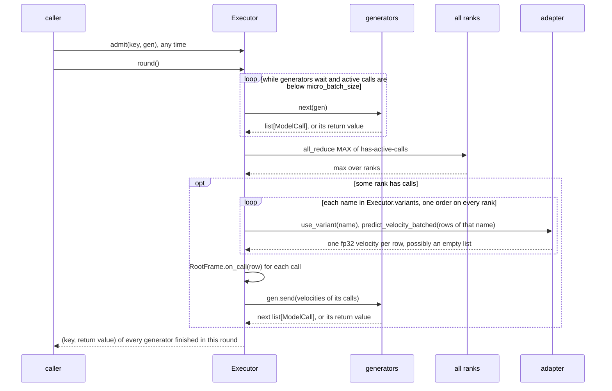

# Sampler runtime

The sampler runtime runs many sampler trees on one model at once. A **node** (`BaseNode`) is a pydantic config whose call returns a `Calls` generator, which yields lists of `ModelCall` and receives their velocities. The **Executor** batches the calls of many rows' generators across rows, branches and variants into collective **rounds**, and resumes each generator with its results. A **row** is one sample at one point, and its **frame** chain records the nodes active on it.

Nodes are straight-line per-sample code: they never batch, never call the model and never run collectives, and the executor never looks inside them. Any method (a new prediction, a step, a whole trajectory, or one node coupling all three) only has to be a generator of model calls. Core's node layers are in [nodes.md](nodes.md).

## Config examples

The runtime has two knobs, both set elsewhere.

### Calls in flight

```jsonc
"model": {
  "micro_batch_size": 8 // forwards are chunked by 8, and the Executor admits new runs while fewer than 8 calls are active
}
```

### Variant of a model call

```jsonc
"prediction": {"type": "model", "variant": "guide"} // this call runs under "guide"
// "prediction": "model" // variant None: the row's RootFrame.variant (inference "variant", Runner.submit(variant=))
```

See [../adapters/microbatching.md](../adapters/microbatching.md) for the chunking and [../adapters/variants.md](../adapters/variants.md) for variants.

## One round



## Python spec

### Calls

```python
@dataclass(slots=True)
class ModelCall:
    row: Row                    # evaluated at row["noisy_latents"], row["sigma"] when the round runs
    variant: str | None = None  # None: the row's RootFrame.variant

type Calls[T] = Generator[list[ModelCall], list[Tensor], T]  # yield calls, receive one fp32 velocity per call in order, return T

def gather[T](generators: Sequence[Calls[T]]) -> Calls[list[T]]: ...  # concurrent children: one yield per round, results in input order
```

A node composes children with `yield from` (one after another) or `gather` (in the same round):

```python
def run(self, row: Row, frame: Frame) -> Calls[Tensor]:
    velocity = yield from self.prediction(row)                                # a child's calls pass through
    cond, neg = yield from gather([self.prediction(row), negative(uncond)])  # both branches in one round
    yield from gather([])                                                     # no call, still a generator (renoise)
```

### Executor

```python
class Executor:
    def __init__(self, model: SamplerModel, variants: Sequence[str | None] = (None,)): ...
        # every name a call can resolve to, in one order on every rank; None is the adapter's active variant

    # Drivers: each owns the executor while it runs and closes everything admitted on exit.
    def stream(self, runs: Iterable[tuple[Row, Calls[None]]]) -> Iterator[Row]: ...  # pulls runs while backlog < micro_batch_size; completion order
    def evaluate[T](self, gens: Sequence[Calls[T]]) -> list[T]: ...                   # every generator at once, no window; input order

    # The round API, for a caller that schedules admissions itself (the rollout Runner)
    def admit(self, key: Any, gen: Calls[Any]) -> None: ...  # queued; a later round primes it when there is room
    def round(self) -> list[tuple[Any, Any]]: ...             # one collective round; (key, return value) of each generator it finished
    @property
    def backlog(self) -> int: ...                             # active calls + waiting generators
    def close(self) -> None: ...                              # close every active and waiting generator
```

Grad mode and the outer `use_variant` are the caller's. Each consumer uses a different entry:

```python
# Serving (ServingEngine._sample_and_decode): one row
with model.use_variant(variant):
    list(Executor(model, variants(sampler)).stream([(row, sampler(row))]))

# Training (TrainingPredictionMixin.predict_training): independent points, under the caller's grad and variant
Executor(model, variants(train_predictor)).evaluate([train_predictor(point) for point in points])

# Rollouts (Runner): one executor for the whole run, every variant of the model
executor = Executor(model, [None, "base", *model.variants])
executor.admit(request, gen)                  # when a program awaits ctx.admit / ctx.rollouts
if busy_on_any_rank:                          # the Runner's own all-reduce, so every rank calls round equally often
    for request, value in executor.round(): ...
```

The Runner's scheduling is described in [../training/rollouts.md](../training/rollouts.md).

### Rows

```python
type Row = dict[str, Any]

row["noisy_latents"]  # current x, [1, N, D]; nodes assign a new tensor, never write into it
row["sigma"]          # current σ; the engine starts it at 1.0
row["sigma_next"]     # the enclosing step's target σ, present only inside a transition
row["_generator"]     # the row's RNG
row["_frame"]         # innermost active Frame: the call chain

def derived[T](row: Row, key: str, make: Callable[[], T]) -> T: ...  # a branch value built once, kept on row[key]
def follow(sub: Row, row: Row) -> Row: ...  # move a derived row to the parent's noisy_latents, sigma, _frame (and sigma_next)
def data(row: Row) -> Row: ...              # the row without "_" keys: the start of a new point of the same sample
def randn(row: Row) -> Tensor: ...          # noise shaped like noisy_latents, drawn from row["_generator"]
```

Keys starting with `_` belong to the current run of the row: `_frame`, `_generator`, branch rows (`_uncond:negative`, `_uncond:positive`, `_tiles`), node state (`_noise`, `_momentum`) and adapter caches (`_cache`, `_img_ids`, ...). `data` drops them when a rollout row is decoded and when a training point is built. Row keys are listed in [../overview/row.md](../overview/row.md).

A concurrent branch gets its own derived row, built once and kept on the parent (from `Cfg.run`):

```python
uncond = follow(derived(row, "_uncond:negative", lambda: self.uncond_row(row)), row)
cond, neg = yield from gather([self.prediction(row), negative(uncond)])
```

A row object may appear in at most one call per round; the executor raises otherwise. A branch row kept on its parent keeps the same object identity across steps. The adapter caches stored on it (text ids and per-variant `_cache` entries) therefore survive from step to step, and node state such as `_momentum` stays separate per branch.

### Frames

```python
class Frame:
    node: object          # the active node; for a RootFrame, the engine
    parent: Frame | None
    root: RootFrame
    def snapshot(self) -> Frame: ...                   # copy of the chain without tensors, root shared: for recording
    def rerooted(self, root: RootFrame) -> Frame: ...  # copy of the chain under another root: for replay

type Observer = Callable[[Row, Any], None]  # (row, frame)

class RootFrame(Frame):  # placed on row["_frame"] by the engine
    def __init__(
        self,
        engine: object,
        observers: Sequence[tuple[type, Observer]] = (),  # called after a node of that class returns normally
        on_call: Callable[[Row], None] | None = None,      # after each forward of a call on this row or its branches
        variant: str | None = None,                        # what Model(variant=None) leaves of this row run under
    ): ...

class BaseNode(BaseModel):
    type: str
    frame_type: ClassVar[type[Frame]] = Frame

    @contextmanager
    def enter(self, row: Row) -> Iterator[Any]:  # the layer bases wrap run() in it
        frame = row["_frame"] = self.frame_type(self, row["_frame"])
        try:
            yield frame
        finally:
            row["_frame"] = frame.parent
        for kind, observer in frame.root.observers:  # only on normal return
            if isinstance(self, kind):
                observer(row, frame)

def caller(row: Row, kind: type | tuple[type, ...], who: str) -> Frame: ...
    # the nearest enclosing frame whose node is a `kind`; otherwise ValueError naming `who` and the chain
```

A node config is shared by every row, so the state of one invocation lives in generator locals or in its frame (`StepFrame`, `GridFrame`), never on `self`. The frame chain exposes that state without nodes exporting anything:

- Consumers attach observers to the root: GRPO records steps, and endpoint trainers keep the executed grid.
- A node reads its caller's frame instead of taking new parameters. `cfg_pp` reads the enclosing step's `sigma`, `sigma_next` and `eta`. `flash` and `differential_diffusion` read the enclosing grid's position.

```python
step = caller(row, (Euler, Ddim), who="cfg_pp needs an enclosing euler or ddim step")
factor = kappa(step.sigma, step.sigma_next, step.node.eta, isinstance(step.node, Ddim))
```

`follow` gives a branch row the parent's chain, so `caller`, `on_call` and the root's `variant` apply to branches too. Adapters read row keys, never frames. The FLUX.3 distilled flow map reads `row["sigma_next"]`, which `BaseTransition` sets for the duration of its step.

### Progress

```python
class BaseNode:
    def estimate_calls(self, row: Row) -> int: ...  # default: sum over child nodes
# Model: 1     Grid: steps * transition     multistep grids: steps * prediction
# Cfg: cond, plus negative when guided     Tiled: tiles * prediction

# Serving: one counter per request
total, done = sampler.estimate_calls(row), 0

def on_call(_: Row) -> None:
    nonlocal done
    done += 1
    report_progress(min(done / total, 1.0), f"{done}/{total} model calls")

row["_frame"] = RootFrame(self, on_call=on_call)
```

The call count can depend on the row or on runtime choices, so it is an estimate and progress is clamped. Training reports no per-sample progress.

### Static walk

Setup checks and collective requirements are queries over the config tree:

```python
def children(node: BaseModel) -> Iterator[BaseModel]: ...  # direct child models: fields, lists, dicts
def walk(tree: BaseModel) -> Iterator[BaseModel]: ...      # every model in the tree, depth first (shifts included)

def variants(tree: BaseModel) -> list[str | None]:         # same order on every rank
    return list(dict.fromkeys(n.variant for n in walk(tree) if isinstance(n, Model)))

cfg = next((n for n in walk(sampler) if isinstance(n, Cfg)), None)  # serving's cfg_scale slider; BaseGrid for steps
```

### Consumers

A consumer looks up what it needs and validates it. Nothing is exported specially for it.

```python
# Engine start (Runner._start): a fresh row per run
row = data(prepared)
row["noisy_latents"] = processor.initialize_latents(row, generator=generator, ...).float()
row.update(sigma=1.0, _generator=generator, _frame=RootFrame(self, observers, variant=variant))
gen = sampler(row)

# GRPO records: GrpoTrainer._rollout_observers() == [(BaseTransition, record)]
def record(row: Row, step: StepFrame) -> None:
    if step.node.is_stochastic(step):
        point = {"noisy_latents": step.latents, "sigma": step.sigma,
                 "next_latents": step.next_latents, "_frame": step.snapshot()}
        point["log_prob"] = step.node.log_prob({**data(row), **point}, step.velocity).log_prob
        row.setdefault("trajectory", []).append(point)

# GRPO replays (GrpoTrainer._point / _replay): each recorded step is a row of its own
point = {**rollout_without_trajectory, **rollout["trajectory"][i]}
point["_frame"] = point["_frame"].rerooted(RootFrame(self))  # the trainer's variant, not the one that sampled
(velocity,) = self.predict_training([point])                 # train_predictor under the recorded step's chain
step_log_prob = point["_frame"].node.log_prob(point, velocity)

# Endpoint trainers (NFT / RAM / AWM): observer (BaseGrid, keep_sigmas) keeps the executed grid in row["sigmas"].
# A training point is a fresh row whose chain holds no step (TrainingPredictionMixin.noised_point):
point = {**data(rollout), "clean_latents": x0, "noise": eps, "sigma": t,
         "noisy_latents": (1 - t) * x0 + t * eps, "_frame": RootFrame(self)}
```

A replayed GRPO point carries the recorded `StepFrame` and `GridFrame`, so `cfg_pp` and `flash` find their context in replay. It carries no `sigma_next`, so the FLUX.3 distilled flow map raises in replay. A training point has neither a step frame nor `sigma_next`, so both `cfg_pp` and the flow map raise there.

## Extension points and core contracts

**Extension points**

- A new node: any `BaseNode` whose call returns `Calls` ([nodes.md](nodes.md)).
- A new engine: build each row with `noisy_latents`, `sigma`, `_generator` and a `RootFrame` (observers, `on_call`, `variant`), then drive it with `stream`, `evaluate`, or `admit` + `round`. Build the executor with every variant name a call can resolve to.
- Observers: `(node class, callback(row, frame))` on a `RootFrame`. An observer reads the frame and writes to the row.

**Core contracts**

- `Calls`: a node yields `list[ModelCall]` and receives one fp32 velocity per call, in order. Only the executor runs forwards. Nodes run no collectives and never enter `use_variant`; a call's variant is `ModelCall.variant`, else the row's `RootFrame.variant`.
- The round is collective. Every rank calls `round` equally often. `stream` and `evaluate` ensure this through the all-reduce inside each round; a direct caller of `round` agrees on the count itself. A round in which any rank has calls runs `predict_velocity_batched` once per name in `Executor.variants`, in the same order on every rank, with an empty list where a rank has nothing. A name outside that list raises. After `round` raises, only `close` is safe, so a caller that must survive a failing node wraps its generators (the Runner's `_guarded`).
- A row object appears in at most one call per round. Each concurrent branch uses a derived row (`derived` + `follow`).
- `noisy_latents` and `sigma` are the row's point. Nodes replace `noisy_latents` and never write into it, because frames and recorded points hold earlier tensors by reference. Stochastic nodes draw only from `row["_generator"]` (`randn(row)` for noise), so a sample's randomness depends on its seed alone, not on which rows share its forward.
- Top-level `_` keys are runtime-only, and `data` drops them when a row leaves the run. A recorded `_frame` snapshot inside `row["trajectory"]` is the one runtime object kept for replay. `sigma_next` exists only inside a transition.
- Per-invocation node state lives in generator locals, in the node's frame or under `_` row keys, never on the node. Observers fire only on normal return.
