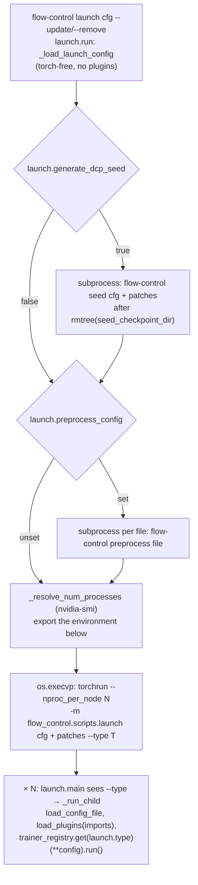
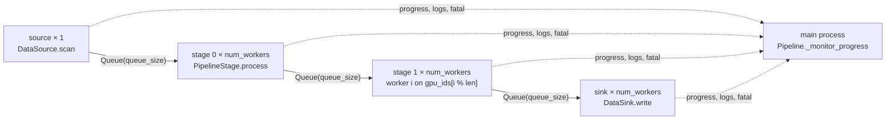

# Command line

`flow-control <command>` (`flow_control/scripts/cli.py`) is the only entry point. Every command except `report` and `schema` reads one config file and applies the `--update` / `--remove` patches. The process that builds the pydantic models loads the config's `imports` first ([config-plugins](../overview/config-plugins.md)). `launch` is the only command that starts a process group, and it covers a single node.

| Command | What it does | Concept |
|---|---|---|
| `launch <cfg>` | Runs a trainer (or batch `inference`) on the GPUs of one node: an optional seed and preprocess step, then torchrun | [Launch](#launch), [trainers](../training/trainers.md) |
| `seed <cfg>` | Writes the trainer's DCP seed checkpoint to `seed_checkpoint_dir` | [Seed checkpoint](#seed-checkpoint) |
| `preprocess <cfg>` | Encodes a raw source into a random cache (`PreprocessConfig`) | [data](../data/data.md) |
| `pack <cfg>` | Repacks a random cache into tar shards (`PackConfig`) | [data](../data/data.md), [formats](../data/formats.md) |
| `export <cfg> --output-dir D [--checkpoint-dir C]` | Calls the trainer's `export_checkpoint`. Only the contrib VAE trainer implements it. The default checkpoint is the newest `step_*`, `rolling_step_*` or `step_*_final` under `checkpoint_root`; `"$auto"` resolves to the configured `run_id`, else the experiment's newest run with a checkpoint | [trainers](../training/trainers.md) |
| `lora export \| import \| convert \| fuse <cfg> ...` | Offline conversion between DCP variant slots, native LoRA files and Diffusers / PEFT LoRAs, on CPU | [variants](../adapters/variants.md) |
| `reward-server <cfg>` | Hosts scorers over HTTP for `remote` scorers (`RewardServerConfig`) | [rewards](../rewards/rewards.md) |
| `serve <cfg>` | A Gradio UI for one model (`ServeConfig`) | [serving](serving.md) |
| `report <project> <run_id> --file F` | Appends a Markdown report (`--file` or `--text`) to an existing trackio run | [outputs](../training/outputs.md) |
| `schema [--config C] [--output-dir D]` | Writes JSON schemas: one per registered trainer, plus `preprocess`, `pack`, `serve` and `reward-server` | [config-plugins](../overview/config-plugins.md) |
| `describe <file>` | A separate console script: pretty-prints a `.pkl`, `.npy`, `.npz`, `.pt` or `.pth` file | |

## Launch

### Config Example

```jsonc
{
  "launch": {
    "type": "sft",                 // a trainer_registry tag; a plugin trainer's module goes in "imports"
    "devices": [4, 5, 6, 7],       // "all" (default), a count (the first N GPUs), or ids exported as CUDA_VISIBLE_DEVICES
    "generate_dcp_seed": true,     // rebuild seed_checkpoint_dir before every launch
    "preprocess_config": ["examples/sft/flux_t2i/preprocess.jsonc"], // each runs as `flow-control preprocess <file>` before training
    // "trackio_dir": "./runs/.trackio",
    "env": {"NCCL_P2P_LEVEL": "SYS"}  // exported to torchrun and the ranks only: the seed and preprocess steps run before it
  },
  "seed_checkpoint_dir": "/dev/shm/flow-control/seed" // top level; launch warns when it is not on tmpfs / ramfs
}
```

```bash
flow-control launch train.jsonc --update '$.train_steps=100'  # the patches reach seed and every rank, not preprocess
```

### Flow



| Variable | Value |
|---|---|
| everything in `launch.env` | As given |
| `TRACKIO_DIR` | `launch.trackio_dir`, unless `launch.env` sets it |
| `CUDA_VISIBLE_DEVICES` | `launch.devices` when it is a list |
| `OMP_NUM_THREADS` | `nproc // N`, unless `launch.env` sets it |
| `LOG_DIR` | `logs/slurm-<job>[_<array task>]` under Slurm, else `logs/local-<time>-<pid>`, unless `launch.env` or the environment sets it ([outputs](../training/outputs.md)) |

- The parent imports neither torch nor plugins: `LaunchConfig` lives in `training/launch_config.py`, apart from the trainers, so the parent execs torchrun without CUDA or thread state. Trainer validation happens in the children.
- Each process re-reads the config file and applies the patches itself; nothing rewrites the file.
- Requeues and restarts re-run the whole flow. `preprocess_config` re-runs too: with `output.overwrite: false` it then fails on the existing cache, and with `true` it re-encodes it.
- Run identity and `checkpoint_root: "$auto"` are resolved by rank 0 inside the trainer ([outputs](../training/outputs.md)).

## Seed Checkpoint

```bash
flow-control seed train.jsonc  # or "launch": {"generate_dcp_seed": true}
```

```python
# scripts/seed.py run(config)
trainer = trainer_registry.get(config["launch"]["type"])(**config)
trainer.set_seed()         # rank 0 outside torchrun: the LoRA initial values are a function of `seed`
trainer.seed_checkpoint()  # BaseTrainer: model.load_transformer(cpu), then save_transformer_to_seed:
                           #   dcp.save(get_state_dict(transformer, [])[0], checkpoint_id=seed_checkpoint_dir, no_dist=True)
```

Trainers build the transformer on the meta device, shard it, and DCP-load the seed (`BaseTrainer.load_transformer_from_seed`). Each rank reads only its own shards. Every rank also starts from the same values: `fully_shard` broadcasts nothing, so values drawn at load time (LoRA `A`) must be drawn once, here. What the seed contains and what `dcp.load` cannot restore is in [adapter](../adapters/adapter.md#meta-init-and-the-seed-checkpoint); the PyTorch side is in the [FSDP2 / DCP guide](../guides/fsdp2-dcp.md).

- The seed process holds the whole transformer, full variant copies included, in CPU memory.
- `generate_dcp_seed: true` without a `seed_checkpoint_dir` only warns and skips.
- A trainer of something other than the transformer overrides `seed_checkpoint` (contrib `rgba_vae_training`).

## Preprocess Pipeline

`flow-control preprocess` runs on `utils/pipeline`, a multi-process pipeline: one source process, `num_workers` processes per stage, sink processes, and bounded queues between them. Its stages, and where each part of a row is computed, are in [data](../data/data.md#processes-and-threads). `examples/pipeline.py` is a standalone demo.



```python
class PipelineStage(ABC):  # utils/pipeline/base.py; constructed inside its spawned worker
    def __init__(self, worker_id: int, device: int | None = None, **init_kwargs): ...  # load models here
    def process(self, item: Any) -> list[Any]: ...  # or `async def`; [] filters the item, [a, b] splits it

StageConfig(
    stage=ProcessorStage, num_workers=len(gpu_ids), gpu_ids=gpu_ids,
    max_concurrency=4,                   # async `process`: items in flight per worker
    num_threads=8, queue_size=16,        # torch.set_num_threads per worker; bound of the stage's output queue
    init_kwargs={...}, plugin_modules=imports,  # pickled into the worker; plugins imported there before construction
)
result = Pipeline(source=SourceConfig(...), stages=[...], sink=SinkConfig(...)).run()  # PipelineResult
```

- Workers use the spawn start method: each is a fresh interpreter, so everything it needs comes through `init_kwargs` and `plugin_modules`.
- A full queue blocks its producer, so the slowest stage sets the pace. Termination needs no sentinels: the main process counts the items in flight per queue and marks a stage done once its upstream is done and its count is zero.
- Every tensor crossing a queue is detached, moved to CPU and placed in shared memory (`_report_stage_output`).
- An exception in the source, a sink, any constructor or a synchronous `process` aborts the run (`PipelineResult.aborted`). An exception in an async `process` is logged and the item is dropped as filtered. In preprocess, an encoding error (`ProcessorStage`, async) therefore drops the row, and a loading error (`TorchDatasetLoaderStage`, sync) aborts.
- `_NoGradCoroutine` disables grad each time an async `process` resumes, because interleaved tasks break `torch.no_grad()`.
- An aborted preprocess raises and leaves the cache unfinalized: no `meta.json`, so it cannot be opened as a cache. A run that dropped rows finalizes without them.

## Extension Points and Core Contracts

Commands have no registry; a new command is a change to `scripts/cli.py`. What a command runs is extended through the registries it reads: `trainer_registry` for `launch`, `seed` and `export`, the data, processor and scorer registries for the others ([config-plugins](../overview/config-plugins.md#registries)).

- `LaunchConfig` and `scripts/launch.py` stay torch-free and plugin-free.
- `--update` / `--remove` reach every process that reads the same file; a command that spawns another on the same file forwards them (`format_config_patch_args`).
- A trainer serves `launch` through `run`, `seed` through `seed_checkpoint` and `export` through `export_checkpoint` (`BaseTrainer` lifecycle hooks); nothing outside the trainer special-cases a trainer type.
