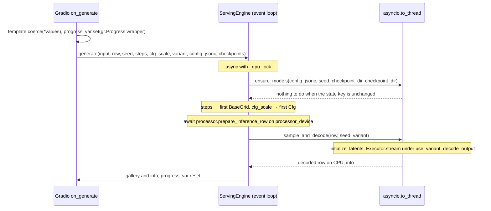

# Serving

**Outdated.** Serving lags the current adapter, variant and sampler APIs, and its interfaces need a refactor. This page records the design to keep; check the code before relying on it.

`flow-control serve` (`flow_control/serving/`) puts one model adapter, processor and sampler behind a Gradio form, to try a model or a training checkpoint by hand. It is one process without a process group, and it runs one request at a time. Batched inference and evaluation is the `inference` trainer ([trainers](../training/trainers.md)).

The engine is stateless per request. Each request carries the full config (the UI's JSONC box) and the checkpoint paths, and the engine reconciles its loaded models with them; between requests it keeps only those models and the key of the state they match. Reloading a model whose loader config did not change costs nothing, because `HfModelLoader` keeps loaded models in a process-wide cache.

## Config Examples

### Try a Model

`flow-control serve serve.jsonc`:

```jsonc
{
  "model": {"arch": "flux1", "type": "base"},
  "processor": {"task": "t2i", "preset": "flux1"}, // processor.task selects the Gradio form
  "sampler": {"type": "grid", "steps": 20},         // the UI's Steps and CFG sliders edit the first grid / cfg node
  "device": "cuda:0"
  // "seed": 42, "host": "0.0.0.0", "port": 7860, "share": false
}
```

### Inspect Training Checkpoints

```jsonc
{
  "model": {
    "arch": "flux1", "type": "base",
    "variants": { // as in the training config, so the slots exist to load into
      "default": {"type": "lora", "rank": 16},
      "ema": {"type": "ema", "of": "default", "decay": 0.999}
    }
  },
  "checkpoint_root": "./runs/flux_sft/<run_id>/checkpoints", // the UI lists its subdirectories
  "checkpoint_dir": "step_0002000",                          // relative to checkpoint_root, or absolute
  // "seed_checkpoint_dir": "/dev/shm/flow-control/seed",    // only for values hf_model does not reproduce
  "variant": "ema"                                           // Model leaves that name no variant run under it
}
```

A training checkpoint loads into `app.transformer.*` with `strict=False` and a partial-load planner: keys that match no tensor of the served transformer are skipped without an error.

### A Model Larger Than One GPU

```jsonc
{
  "device": "cuda:0",           // with device_memory_distribution: cuda:0 and cuda:1
  "processor_device": "cuda:2", // encoders and VAE; default: device
  // "offload_processor": true, // one GPU: the processor's modules wait on CPU while the transformer samples
  "model": {
    "arch": "flux2", "type": "base",
    "hf_model": {
      "library": "diffusers", "class_name": "Flux2Transformer2DModel",
      "pretrained_model_id": "black-forest-labs/FLUX.2-dev", "subfolder": "transformer",
      "device_memory_distribution": ["36GiB", "36GiB"] // accelerate device map from `device` upward
    }
  },
  "processor": {
    "task": "tie", "preset": "flux2",
    "encoder": {"type": "mistral3", "device_memory_distribution": ["32GiB", "32GiB"], "no_split_modules": ["MistralDecoderLayer"]}
  },
  "sampler": {"type": "grid", "steps": 28, "shift": "flux2"}
}
```

## A Request



## Python Spec

### ServingEngine

```python
class ServingEngine:
    def __init__(self, config: ServeConfig) -> None: ...
    def load_all(self) -> None: ...  # at startup: load_transformer, seed + training checkpoint, encode and decode models

    async def generate(self, input_row: dict[str, Any], *, seed=None, steps=None, cfg_scale=None, variant=None,
                       config_jsonc=None, seed_checkpoint_dir=None, checkpoint_dir=None, force_reload=False,
                       ) -> tuple[dict[str, Any], dict[str, Any]]:  # (decoded row on CPU, display info)
        async with self._gpu_lock:  # every model mutation and all GPU work, one request at a time
            if config_jsonc is not None:
                await asyncio.to_thread(self._ensure_models, config_jsonc, seed_checkpoint_dir, checkpoint_dir, force_reload)
            first_node(self.sampler, BaseGrid).steps = steps  # when given; warn_once without a grid
            first_node(self.sampler, Cfg).scale = cfg_scale   # when given; warn_once without a cfg node
            row = await self.processor.prepare_inference_row(deep_move_to_device(input_row, self.processor_device))
            return await asyncio.to_thread(self._sample_and_decode, row, self.seed if seed is None else seed, variant or self.variant)

    async def reload(self, *, config_jsonc: str, seed_checkpoint_dir=None, checkpoint_dir=None) -> str: ...
        # the UI's Reload Models: _ensure_models(..., force_reload=True)
```

`first_node` walks the sampler tree depth first (`walk`), so a sampler with several grids or cfg nodes (SDEdit, a piecewise CFG schedule) gets the overrides on the first one only. The override mutates `self.sampler` until the next config change.

### Reconciling a Request's State

```python
def _ensure_models(self, config_jsonc, seed_checkpoint_dir, checkpoint_dir, force_reload=False) -> None:
    state_key = (config_jsonc, seed_checkpoint_dir, checkpoint_dir)
    if not force_reload and state_key == self._last_state_key:
        return  # the common request
    new_model, new_processor, new_sampler = self._parse_requested_state(config_jsonc)  # fresh pydantic objects
    fresh = force_reload or checkpoints_changed or new_model.hf_model.config_key != self.model.hf_model.config_key
    if force_reload:
        self._unload_loaders(self.model, self.processor)  # every loader in the old state
    elif fresh:
        self.model.hf_model.unload_model()  # the old transformer: checkpoints were loaded into it
    with HfModelLoader.loading_scope() as scope:
        new_model.load_transformer(device=self.model_device)  # a cache hit only calls _attach
        new_processor.load_models("encode", self.processor_device)
        new_processor.load_models("decode", self.processor_device)
    if fresh:
        _load_dcp_seed(new_model.transformer, seed_checkpoint_dir)       # dcp.load(no_dist=True), flat keys
        _load_dcp_training(new_model.transformer, resolved_checkpoint)  # {"app": _TransformerStateful}: app.transformer.*
    self._commit_state(...)
    scope.purge_stale()  # cached models this state did not ask for
    # on an exception: _cleanup_failed_reload unloads what this attempt loaded fresh, then re-raises
```

A failed reload leaves `_last_state_key` and the committed model, processor and sampler in place. When the attempt had already unloaded the old transformer (`force_reload`, or a checkpoint or `hf_model` change), that transformer is gone too.

### The Shared Model Cache

```python
class HfModelLoader[T](BaseModel):  # utils/hf_model.py; also the base of every encoder and VAE
    _model_cache: ClassVar[dict[tuple, Any]] = {}  # process-wide: config_key -> loaded model

    @property
    def config_key(self) -> tuple: ...  # library, class_name, pretrained_model_id, revision, subfolder, dtype,
                                        # dequantize, device_memory_distribution, extra_from_pretrained_kwargs

    def load_model(self, device: torch.device, frozen: bool = True) -> bool:
        # records config_key in the active LoadingScope
        # False: this instance already holds a model, or it adopts the cached one; True: a fresh load to set up
    def unload_model(self) -> None: ...  # drop this instance's model and its cache entry, then empty the device cache

    @classmethod
    def loading_scope(cls) -> AbstractContextManager[LoadingScope]: ...  # a ContextVar; collects the keys loaded inside

class LoadingScope:
    def purge_stale(self) -> list[str]: ...  # remove every cache entry whose key no load in the scope asked for

# BaseModelAdapter.load_transformer
if not self.hf_model.load_model(device=device, frozen=not self.trainable):
    self._attach()  # rebind every LoraLinear / VariantModule selector to self._active; take transformer.variants
    return
self._install_modules()
self._realize(device)  # ... the fresh-load path (adapter.md)
```

- Adapters with the same `hf_model.config_key` share one transformer, including the modules `_install_modules` added and the variant slots and copies the first adapter realized. An adapter whose `type` or `variants` differ but whose key is equal gets those, not its own: after editing either, use Reload Models, which unloads everything first.
- Encoders and VAEs share the same way: two processors with equal encoder configs hold one encoder.
- The cache lives in every process, training included; only serving reloads and purges.

### Progress

```python
progress_var: ContextVar[ProgressCallback | None]  # utils/progress.py; ProgressCallback = (fraction, description) -> None
def report_progress(fraction: float, description: str) -> None: ...  # a no-op without a callback

# _sample_and_decode
total, done = self.sampler.estimate_calls(row), 0
def on_call(_: Row) -> None:  # the Executor calls RootFrame.on_call once per leaf model call
    nonlocal done
    done += 1
    report_progress(min(done / total, 1.0), f"{done}/{total} model calls")
row.update(sigma=1.0, _generator=generator, _frame=RootFrame(self, on_call=on_call))
```

The Gradio handler sets `progress_var` before `engine.generate` and resets it after. `asyncio.to_thread` runs its function in a copy of the caller's context, so reports from `_ensure_models` and `_sample_and_decode` reach that request's callback. `estimate_calls` is each node's estimate, summed over the tree.

### Sampling

```python
@torch.no_grad()
def _sample_and_decode(self, row, seed: int, variant: str | None):
    row = deep_cast_float_dtype(row, self.model.dtype)
    if self.offload_processor:
        self._move_processor_models(torch.device("cpu"))  # encode and decode components leave the GPU
    generator = torch.Generator(device=self.model_device).manual_seed(seed)
    self.processor.initialize_latents(row, generator=generator, device=self.model_device)
    row.update(sigma=1.0, _generator=generator, _frame=RootFrame(self, on_call=on_call))
    with self.model.use_variant(variant):  # None keeps the adapter's active variant
        list(Executor(self.model, variants(self.sampler)).stream([(row, self.sampler(row))]))
    if self.offload_processor:
        self._move_processor_models(self.processor_device)
    return self.processor.decode_output(row["noisy_latents"].to(self.processor_device), row), info
```

A request's row skips `processor.resample`, so its condition fields must already be samples: `condition_posterior: "mode"`, the default ([data](../data/data.md#processor-hooks)).

## Extension Points and Core Contracts

### Extension Points

A task gets its form from `task_template_registry` (`serving/tasks/base.py`), looked up by `processor.task`. The registry is duck-typed: a template implements the `TaskTemplate` protocol without subclassing. Built-in templates: `t2i`, `t2i_control`, `tie`, `inpaint`, `qwen_layered`; a processor task without one (`tiled_t2i`, contrib `efficient_layered`) fails when the form renders.

```python
# flow_control/contrib/my_task/serving.py; the serve config lists the module in "imports"
from typing import Any

import gradio as gr
from PIL import Image

from flow_control.data.coercion import _coerce_to_image_tensor
from flow_control.serving.tasks import task_template_registry

@task_template_registry.register("my_task")  # == processor.task
class MyTaskTemplate:
    def render(self) -> list[gr.components.Component]:  # called inside the form's @gr.render
        self.prompt = gr.Textbox(label="Prompt", lines=3)
        self.image = gr.Image(label="Input", type="pil")
        return [self.prompt, self.image]

    def coerce(self, prompt: str, image: Image.Image) -> dict[str, Any]:  # component values in render order
        return {"prompt": prompt, "clean_image": _coerce_to_image_tensor(image)}  # the task's inference InputRow
```

- `coerce` raises `gr.Error` for a user-facing input error.
- The gallery shows `clean_image`, `base_image` and `layer_images` of the decoded row (`_extract_images`); RGBA outputs get a background selector.

### Core Contracts

- A request carries its whole state; the engine derives everything from `(config_jsonc, seed_checkpoint_dir, checkpoint_dir)` and keeps nothing else per request.
- `_gpu_lock` serializes every model mutation and all GPU work. Code that touches the engine's models runs under it.
- `config_key` names every loader field that changes the loaded weights. A new `HfModelLoader` field that changes them joins the key; otherwise the cache hands out stale models.
