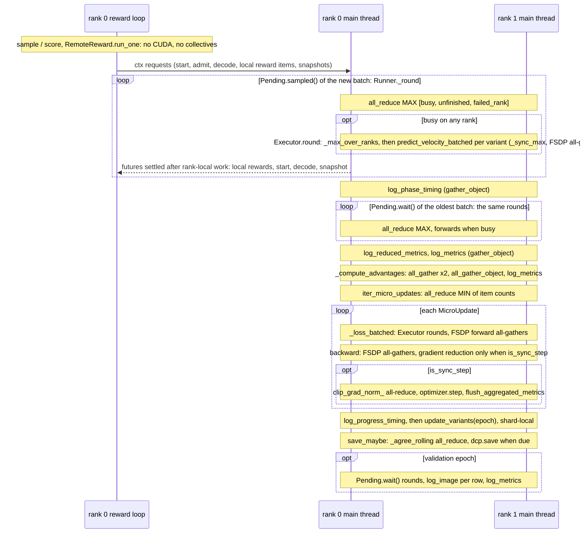

# Distributed execution

Every rank runs the same `run()`. A collective blocks until every rank issues it, so ranks must issue collectives in the same order and the same number of times. This includes the ones FSDP issues inside forwards and backwards. This chapter lists where a collective may sit, which places must stay free of them, and the invariants that keep counts equal. Background on FSDP2 and DCP is in [the FSDP2 / DCP guide](../guides/fsdp2-dcp.md).

## Config Examples

### Replicate Only

```jsonc
{
  "launch": {"type": "nft", "devices": 8, "env": {"NCCL_P2P_LEVEL": "SYS"}}, // env: exported before torchrun; the library reads none of it
  // "hsdp_shard_dim": 1 // mesh (8, 1): full weights on every rank, gradients all-reduced (DDP-like)
}
```

### HSDP

```jsonc
"hsdp_shard_dim": 4 // mesh (W / 4, 4): parameters sharded within groups of 4, replicated across groups
```

```python
# BaseTrainer.init_device_mesh, first thing in distributed_main; needs torchrun (flow-control launch)
dist.init_process_group(backend=devutil.dist_backend(dev), device_id=dev)
mesh = init_device_mesh(device_type, (W // hsdp_shard_dim, hsdp_shard_dim), mesh_dim_names=("replicate", "shard"))
# BaseTrainer._shard: fully_shard each _no_split_modules / _repeated_blocks module, each full variant copy, then the root
```

## One RL Epoch on Two Ranks



## Rules

| Rule | Where | How the count is fixed |
|---|---|---|
| **A** | Main thread, outside any round. | Every rank runs the same sequence unconditionally. A branch around a Rule-A call may test only config and values that are equal on every rank (step and epoch counters, reduced flags). |
| **B** | Inside a round, driven from the main thread by `Pending.sampled` / `wait` / `as_completed` or `Executor.evaluate` / `stream`. | Every rank makes the round's collectives or none. An earlier all-reduce of rank-local flags decides which. |
| **C** | Implicit, on the main thread: FSDP forward / backward, DTensor reductions. | They ride on a Rule A or B site that fixes the forward count, or on one backward per `MicroUpdate`. |
| **D** | Offline, single process (`no_dist=True`). | No process group is involved. |

### Sanctioned Sites

| Site | Collective | Rule |
|---|---|---|
| `BaseTrainer.init_device_mesh` | `init_process_group`, `init_device_mesh` | A |
| `BaseTrainer.load_transformer_from_seed` | seed `dcp.load` | A |
| `main_process_first` | `barrier` | A |
| `LoggingMixin.resolve_run_context` | `broadcast_object_list` (`_sync_context_value`) | A |
| `log_metrics`, `flush_aggregated_metrics`, `log_progress_timing`, `log_phase_timing`, `log_reduced_metrics` | `gather_object` to rank 0 | A |
| `log_image` | `gather_object` ×3; a padding row passes `None` | A |
| `DcpMixin.save_dcp_checkpoint` / `load_dcp_checkpoint` (`save_maybe`, `maybe_auto_resume`, `_final`) | DCP planning and I/O | A |
| `CheckpointingMixin._agree_rolling` | `all_reduce` MAX of rank 0's decision | A |
| `MicrobatchTrainMixin.iter_micro_updates` | `all_reduce` MIN of `[n, -n]` | A |
| `RolloutMixin._compute_advantages` | `all_gather` ×2, `all_gather_object` | A |
| `Inference._gather_scored` | `gather_object` | A |
| `ReportWriter.__init__` / `finalize` | `barrier` | A |
| `Runner._round` | `all_reduce` MAX of `[busy, unfinished, failed_rank]` | B |
| `Executor._round` | `_max_over_ranks` (`all_reduce` MAX) | B |
| `predict_velocity_batched` | `_sync_max` per call and per chunk, `_share_dummy` broadcast ([microbatching](../adapters/microbatching.md)) | B |
| Transformer forward / backward | FSDP all-gather; gradient reduce-scatter / all-reduce gated by `set_requires_gradient_sync` | C |
| `clip_grad_norm_` in `optimizer_step` | DTensor norm reduction | C |
| `model_state_dict`, `optimizer_state_dict` and their loaders | DTensor state-dict collectives, inside DCP | C |
| `flow-control seed` (`save_transformer_to_seed`), serving's DCP loads, `scripts/lora.py`, contrib VAE `export_checkpoint` | `dcp.save` / `dcp.load` with `no_dist=True` | D |

### Collective-free

| Where | Thread | Why |
|---|---|---|
| Rollout programs' `sample` / `score`, every `ctx` coroutine, `RemoteReward.run_one` | reward loop | Not the main thread; progress follows remote I/O and differs per rank. |
| `prepare` (`prepare_row`, online encoding), `LocalReward.run_batch`, `Runner._start` / `_decode` / `_snapshot` | main, around the round's collectives | Counts are per rank. Encoders, VAE and reward models load per rank and are never sharded. |
| Sampler node generators, observers (`record`, `keep_sigmas`), `RootFrame.on_call` | main, inside `Executor` | They yield `ModelCall`s; the Executor owns the forwards ([nodes](../sampler/nodes.md)). |
| `objective.compute`, `advantage.compute`, `train_timesteps.draw`, `_build_train_plan`, `update_variants` | main | Local tensor math; the EMA lerp runs on local shards. |
| The body of `for ... in pending.as_completed()` | main | Each rank receives a different number of groups per round. |
| `@main_process_only`: `init_tracker`, `finish_tracker`, `rotate_archival_maybe`, `rotate_rolling_maybe` | rank 0 | Only one rank calls them. |
| `rollout_dump` (rank 0), `profile_dump` (per rank) | main | File writes only. |
| DataLoader workers (`store.get`) | worker processes | Outside the process group. |

### Invariants

- Every rank holds the same config. Variant orders, scorers and logging calls all derive from it.
- Collective order comes from config order or a sort. Examples are the Runner's Executor variants `[None, "base", *model.variants]`, `variants(tree)` and `sorted(objective.required_variants())`. Never iterate a set to issue collectives, because string hashing differs per process.
- Prompt counts per rank are equal: `num_prompts_per_epoch % world_size == 0` and `ids[rank::world_size]`.
- Row counts per rank are equal. Planner padding guarantees this for SFT, validation and inference ([data](../data/data.md)). A padding row joins every collective and contributes nothing.
- Forward and backward counts per optimizer update are equal. `_build_train_plan` gives every rank the same item count (checked in `iter_micro_updates`). Under autograd, dummy forwards join the graph with weight 0, so a training call needs at least one real item on every rank.
- A rollout program's `score` returns exactly `k` rows per group. This is unchecked: `_compute_advantages` all-gathers `[B_local, C]` tensors that must have equal shapes, and it slices its own advantages at `rank * B_local`.
- A decision from rank-local state is reduced before anyone acts on it. Examples: `_agree_rolling` uses rank 0's clock, `resolve_run_context` uses rank 0's run id, and the Runner reduces its flags.

### Failures

Inside a Runner round, a failure is recorded on its group or submission. This covers a program, a reward, a sampler node (through `_guarded`) and `prepare`. The next `_round` reduces `failed_rank`, and every rank raises together. Anywhere else an exception is rank-local, and its peers block in their next collective until the NCCL timeout. Examples are `check_loss` / `_check_finite_loss`, an OOM inside a forward, and an error in the body of an `as_completed()` loop. `distributed_main` logs the traceback before `cleanup()`, so the failing rank's log has the cause.

## Extension Points and Core Contracts

**Extension points**

- Rollout programs, rewards, objectives, advantage estimators, sampler nodes and observers live in collective-free zones. They need no knowledge of ranks.
- A trainer reports metrics and images through the `log_*` methods, called from `run()` on every rank at points its loop reaches equally often.
- A trainer gets a new device workload into the forward schedule through `Runner.submit` or `Executor.evaluate`, not by calling the adapter in a loop of its own.

**Core contracts**

- The sites above are the only collectives. Adding a collective anywhere else, making one conditional on rank-local data, or issuing one off the main thread is a design discussion before any code.
- The round protocol is a core contract: the Runner's flag all-reduce, then `Executor.round`, then `predict_velocity_batched` once per variant in a fixed order with `_sync_max` agreement and dummy forwards.
- The invariants above are core contracts. A change that breaks one (a program returning a variable row count, a train plan sized by rank-local data) is a design discussion too.
