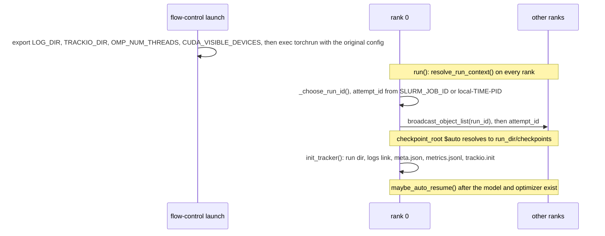

# Run outputs

A training run writes everything under one **run directory**, `runs_root/experiment_name/run_id`: the config it ran with, its metrics, a link to its rank logs, optional dumps, and its DCP checkpoints. The same `run_id` names the run in Trackio. With `checkpoint_root: "$auto"` and `auto_resume`, a requeued job finds the run again, so one run spans every preemption and requeue. Inference writes a report directory instead ([formats](../data/formats.md#inference-report)). DCP itself is covered in [the FSDP2 / DCP guide](../guides/fsdp2-dcp.md).

## Config Examples

### Preemption-safe Run

```jsonc
{
  "launch": {"type": "nft"},       // "trackio_dir": "./runs/.trackio" by default, exported as TRACKIO_DIR
  "experiment_name": "sd35_nft_pickscore",
  // "runs_root": "./runs",
  "checkpoint_root": "$auto",      // runs_root/experiment_name/run_id/checkpoints
  "auto_resume": true,             // reuse the newest run of the experiment that has a complete checkpoint, and resume it
  // "checkpoint_interval": 5,     // archival step_*: in epochs for RL, optimizer steps for SFT; 0 disables
  // "max_checkpoints": 5,         // archival dirs kept; <= 0 keeps all
  // "rolling_checkpoint_interval_seconds": 1800.0 // one rolling_step_*; 0 disables
}
```

### Pin a Run

```jsonc
"run_id": "my-ablation-a" // any string: the run dir and the Trackio run name. auto_resume searches only generated ids, so a launch without run_id never picks this one
```

### Resume From a Given Checkpoint

```jsonc
"resume_from_dir": "./runs/sd35_nft_pickscore/<run_id>/checkpoints/step_0000400" // wins over auto_resume
```

### Trackio Project and Offline Dumps

```jsonc
{
  "trackio_project": "sd35_rl", // default: experiment_name; runs are named by run_id
  // "trackio_space_id": "user/space", // sync to a Hugging Face Space
  "profile_dump": true,         // reward_profiles/epoch<EEEEE>_rank<r>.json
  "rollout_dump": true          // rollout_rows/step_<SSSSSSS>.jsonl
}
```

## Layout

```
<runs_root>/<experiment_name>/<run_id>/
├── meta.json                               # the resolved config + flow_control_version, rewritten every attempt
├── metrics.jsonl                           # rank 0, appended across attempts
├── logs -> <LOG_DIR>                       # the current attempt's rank logs
├── reward_profiles/epoch<EEEEE>_rank<r>.json  # profile_dump, every rank
├── rollout_rows/step_<SSSSSSS>.jsonl       # rollout_dump, rank 0
└── checkpoints/                            # checkpoint_root "$auto"
    ├── step_<SSSSSSS>/                     # archival
    ├── rolling_step_<SSSSSSS>/             # rolling, at most one
    └── step_<SSSSSSS>_final/               # end of run()

./runs/.trackio/                            # launch.trackio_dir -> TRACKIO_DIR; Trackio's files, one <project>.db per project

<LOG_DIR>/                                  # launcher default: ./logs/slurm-<job>[_<array>]/ or ./logs/local-<YYYYMMDDHHMMSS>-<pid>/
├── rank0000.log                            # appended
├── rank0000.traceback.log                  # uncaught tracebacks; emptied at each process start
└── rank<NNNN>.log

<profile.output_dir>/<tag>_rank<r>.json.gz  # profile: tag epoch<e> (RL) or inference
```

`<SSSSSSS>` is the optimizer step, zero-padded to 7 digits. `examples/slurm/train.sbatch` sends Slurm's own stdout and stderr to `./logs/slurm-<job>.{out,err}`.

## Run Identity



`_choose_run_id` on rank 0, first match:

| Condition | `run_id` |
|---|---|
| `run_id` set | that value |
| `checkpoint_root: "$auto"` and `auto_resume` | the newest directory under `runs_root/experiment_name` named in the generated format that holds a complete `step_*` or `rolling_step_*` checkpoint |
| otherwise | new: `YYYYMMDDHHMMSS-<8 hex>` |

- Launching a config with `$auto` and `auto_resume` again continues the newest checkpointed run of that experiment. For a fresh run, drop `auto_resume` or set a new `run_id`.
- With an explicit `checkpoint_root` and no `run_id`, every attempt opens a new run directory and Trackio run, while `auto_resume` reads the shared checkpoint root.
- `attempt_id` names one process launch: `slurm-<job>[_<array>]` or `local-<YYYYMMDDHHMMSS>-<pid>`. It appears in `meta.json` and in rank 0's "Run started" log line.

Without the launcher, `LOG_DIR` falls back to `./logs/slurm-<job>[_<array>]` under Slurm and `./logs` otherwise, and `TRACKIO_DIR` stays whatever the environment sets.

## Files

### `meta.json`

`model_dump(mode="json")` of the trainer config after `resolve_run_context`, so it holds the resolved `run_id`, `attempt_id` and `checkpoint_root`, plus `flow_control_version`. Rank 0 rewrites it on every attempt, so it describes the latest attempt. The same dict is the Trackio run config.

### `metrics.jsonl`

One JSON object per metric per emit, written by rank 0, line-buffered:

```json
{"t": 1760000000.12, "step": 400, "key": "rollout/reward_mean", "value": 0.8123}
```

| Field | Value |
|---|---|
| `t` | `time.time()` at the emit, shared by the keys of one call |
| `step` | Optimizer step (`_current_step`) the metric is logged at |
| `key` | Metric name |
| `value` | `float` |

- `log_metrics` averages each key over the ranks that reported it. `flush_aggregated_metrics` first averages the microbatches of one optimizer update on each rank. `log_reduced_metrics` (`profile/reward/*`) reduces the raw per-rank payloads instead: pooled latency percentiles, maximum spans, summed counts.
- The file is opened in append mode on every attempt. A resumed attempt logs the steps between its checkpoint and the kill again, after the earlier lines, and `validation_at_start` logs the resumed step again.

### Rank Logs

`rank<NNNN>.log` holds every record of one rank, appended; under Slurm a requeued job keeps its job id, so `./logs/slurm-<job>/` accumulates all attempts. `rank<NNNN>.traceback.log` keeps uncaught tracebacks and is emptied when the process starts. The run directory's `logs` link is re-pointed at each attempt's `LOG_DIR`.

### Dumps

| Option | File | Writer | Content |
|---|---|---|---|
| `profile_dump` | `reward_profiles/epoch<EEEEE>_rank<r>.json` | every rank, per trained batch | `epoch`, `policy_version`, `step`, `wait_at_train_s`, and the remote requests' raw `perf_counter` times `submit` / `done` (`done` 0.0: still pending) |
| `rollout_dump` | `rollout_rows/step_<SSSSSSS>.jsonl` | rank 0, per trained batch | one line per rollout of all ranks: `step`, `key`, `raw` / `normalized` (`{label: value}` over `_reward_labels()`), `weights`, `combined` (Σ weight × normalized), `advantage` |

Both carry the optimizer step at which the batch's training starts, the step its `rollout/*` metrics are logged at.

## Metrics

| Name | Logged by | Notes |
|---|---|---|
| `train/loss`, `train/lr` | SFT, after each optimizer step | |
| `train/<metric>` | RL, `flush_aggregated_metrics` after each optimizer step | GRPO: `loss`, `policy_loss`, `ratio_mean`, `approx_kl`, `clipfrac`, `kl_loss`; endpoint trainers: the objective's `LossOutput.metrics` |
| `rollout/reward_mean`, `rollout/reward_std`, `rollout/reward_group_std`, `rollout/adv_abs_mean` | `_compute_advantages` | over all ranks' rollouts; reward = Σ `_reward_weights()` × `row["reward"]`; `group_std`: mean over prompts of the within-prompt std |
| `rollout/raw/<label>_{mean,std,group_std}`, `rollout/normalized/<label>_{mean,std}` | `_compute_advantages` | one set per `_reward_labels()` entry |
| `rollout/policy_lag` | `_finish_rollouts` | epochs between sampling and training a batch ([rollouts](rollouts.md#n-step-off)) |
| `val/*`, `val/<variant>/*` | `validate_and_log` | `reward_mean`, `reward_std`, `raw/<label>_{mean,std}`, `normalized/<label>_{mean,std}`; the first `validation_variants` entry is unsuffixed; only with a scorer |
| `profile/rollout/rollout_{elapsed_s,items_per_s}` | `_start_rollouts` | at the step the batch is sampled, which is earlier than its `rollout/*` under `rollout_lookahead` |
| `profile/reward/*`, `profile/reward/wait_at_train_s` | `_finish_rollouts` | `count`, `latency_{mean,p50,p95,max}_s`, `produce_span_s`, `reward_span_s`, `tail_wait_s`, `overlap_ratio`, `throughput_per_s`, `max_in_flight`; remote requests only |
| `profile/train/training_{elapsed_s,items_per_s}` | `_train_on_rollouts` | |
| `profile/validation[/<variant>]/validating_{elapsed_s,items_per_s}` | `validate_and_log` | |

Images go to Trackio only, as `validation/<key>` and `validation/<variant>/<key>`, captioned with the prompt; `image_background` blends their alpha first. Trackio also records GPU system metrics (`auto_log_gpu`), which are not in `metrics.jsonl`.

### Trackio

Rank 0 calls `trackio.init(project=trackio_project or experiment_name, name=run_id, config=<meta.json>, space_id=trackio_space_id, resume="allow")`, so every attempt of a run appends to one Trackio run. Every metric emitted to `metrics.jsonl` is also logged to Trackio. Deleting the run directory leaves the run in Trackio's database; delete it through Trackio.

```bash
TRACKIO_DIR=./runs/.trackio uv run trackio show --project <project>
```

## Checkpoints

```python
# DcpMixin: DCP calls trainer.state_dict() / load_state_dict() (the Stateful protocol)
dcp.save({"app": trainer}, checkpoint_id=path)
dcp.load({"app": trainer}, checkpoint_id=path, planner=DefaultLoadPlanner(allow_partial_load=True))
```

| Key | RL (`RolloutTrainerBase`) | SFT | Inference | Content |
|---|---|---|---|---|
| `transformer` | ✓ | ✓ | ✓ (load only) | `model_state_dict`: every trainable parameter, plus every module of `variant_modules()`: each variant's LoRA slots, full variant copies, the EMA step counters `variant_counts` |
| `optimizer` | ✓ | ✓ | | `get_optimizer_state_dict` over the trainable parameters |
| `cursor` | ✓ | | | `RowCursor` `{"pass", "position"}`; without `checkpoint_rollouts`, from before the oldest in-flight batch took its prompts ([rollouts](rollouts.md#n-step-off)) |
| `rollouts` | ✓ | | | `{"world_size", "count", "<rank>": bytes}`: with `checkpoint_rollouts`, each rank's scored in-flight batches as one `torch.save` blob of `(epoch, policy_version, cursor_state_before, profile, rows)` per batch; `count` 0 otherwise |
| `dataloader` | | ✓ | | `StatefulDataLoader` state |
| `scheduler` | ✓ | ✓ | | LR scheduler state |
| `current_step` | ✓ | ✓ | | optimizer steps taken |
| `current_epoch` | ✓ | | | next RL epoch to train |
| `rng` | ✓ | ✓ | | `{"<rank>": bytes}`: each rank's pickled global RNG state (torch, numpy, `random`, accelerator) under its own key (`rng_state_dict`) |

The contrib `VaeTrainer` defines its own keys.

- Frozen weights outside the variant modules, the base transformer under LoRA, are not saved. Resume and inference with `checkpoint_dir` first load the base weights (`load_transformer_from_seed`, from `seed_checkpoint_dir` or pretrained), then the checkpoint over them.
- Loading is partial: a key missing from the checkpoint keeps its loaded value; a missing `cursor` restarts the prompt plan with a warning; a missing `rng` is skipped.
- RL batches sampled ahead (`rollout_lookahead`) are saved only with `checkpoint_rollouts`; otherwise a resume samples them again ([rollouts](rollouts.md#n-step-off)).
- Per-rank state needs a key per rank: DCP keeps one copy of each non-tensor entry, so an entry shared by every rank would restore one rank's value on all of them. A rank missing from the checkpoint keeps its own `rng` entry.

### Tiers

`save_maybe` runs at every **clean boundary**: after each RL epoch (before validation) and after each SFT optimizer step. There is no save on preemption, so a hard kill loses at most the rolling interval plus one boundary.

| Tier | Directory | Written | Kept |
|---|---|---|---|
| Archival | `step_<SSSSSSS>` | with `checkpoint_interval > 0`: when the boundary's progress (RL: epoch, SFT: step) is a multiple of it, and at the last boundary | the newest `max_checkpoints`, rotated by rank 0 after each save |
| Rolling | `rolling_step_<SSSSSSS>` | when `rolling_checkpoint_interval_seconds` have passed since the last rolling save, or since this process's first boundary; rank 0's clock decides for every rank (`_agree_rolling`) | one; the new directory is written before the old one is removed |
| Final | `step_<SSSSSSS>_final` | at the end of `run()` | never rotated, never auto-resumed |

Resume selection in `maybe_auto_resume`: `resume_from_dir` if set; otherwise, with `auto_resume`, the highest step among `step_*` and `rolling_step_*` that contains DCP's `.metadata` (written last, so partially written directories are skipped); otherwise a fresh start. `flow-control export` without `--checkpoint-dir` picks the highest `step_*`, `rolling_step_*` or `step_*_final` ([cli](../scripts/cli.md)).

## Python Spec

```python
class LoggingMixin(BaseModel):  # flow_control/training/mixins/logging.py
    experiment_name: str
    runs_root: str = "./runs"
    run_id: str | None = None
    attempt_id: str | None = None
    trackio_project: str | None = None
    trackio_space_id: str | None = None
    image_background: BlendBackground | None = None  # blend alpha before logging images; None keeps it

    def resolve_run_context(self) -> None: ...  # every rank, before anything touches run_dir or checkpoint_root
    @main_process_only
    def init_tracker(self) -> None: ...  # rank 0, collective-free
    @property
    def run_dir(self) -> Path: ...  # runs_root / experiment_name / run_id

    # Collective: every rank calls each one equally often (distributed.md)
    def log_metrics(self, metrics: Mapping[str, float | Tensor], step: int) -> None: ...  # per-key mean over the reporting ranks
    def flush_aggregated_metrics(self, step: int) -> None: ...  # this rank's buffer averaged, then log_metrics
    def log_reduced_metrics(self, local_payload: dict, reduce: Callable[[list[dict]], dict[str, float]], step: int) -> None: ...
    def log_phase_timing(self, description: str, elapsed_s: float, count: float, step: int, prefix: str = "profile") -> None: ...
        # <prefix>/<slug>_elapsed_s and, for a positive duration, <prefix>/<slug>_items_per_s
    def log_progress_timing(self, progress: Progress, step: int, prefix: str = "profile") -> None: ...  # the same per Rich task
    def log_image(self, image: Tensor | None, image_key: str, step: int, name: str = "validation", caption: str | None = None) -> None: ...
        # Trackio "<name>/<image_key>"; None: this rank sends nothing (a padding row)

    def log_aggregated_metrics(self, metrics: Mapping[str, float | Tensor]) -> None: ...  # local buffer, no collective
```

A trainer logs at points its loop reaches equally often on every rank, and adds a dump as a file under `run_dir` named so that ranks never write the same path.

## Extension Points and Core Contracts

**Extension points**

- New metrics under an existing prefix or a new one, through the `log_*` methods.
- New per-run files under `run_dir/<name>/`, written by rank 0 or under per-rank names.
- New keys in a trainer's `state_dict`. Read them with `.get()` in `load_state_dict` when older checkpoints lack them.

**Core contracts**

- The `metrics.jsonl` record `{"t", "step", "key", "value"}`, the metric prefixes and `meta.json` are read by tools outside the library.
- Checkpoint directory names: `step_<7 digits>`, `rolling_step_<7 digits>` and `_final` are matched by `CheckpointingMixin`, `LoggingMixin` (`_has_checkpoint`) and `flow-control export`. The generated `run_id` format is what `auto_resume` searches for.
- The existing `state_dict` keys of each trainer: `auto_resume` loads runs already on disk, so renaming or re-shaping a key breaks their resume.
- `resolve_run_context` runs on every rank before `init_tracker` and before any checkpoint access; `init_tracker` issues no collective.
