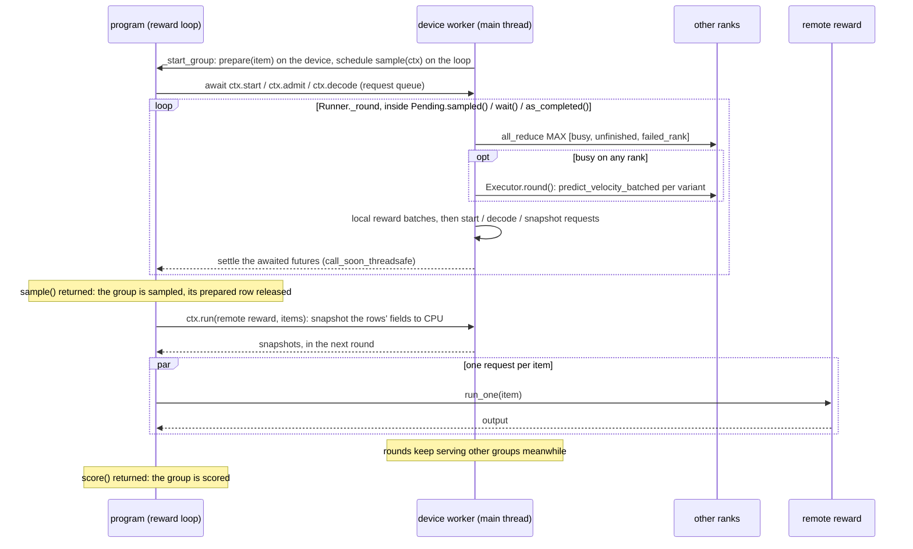
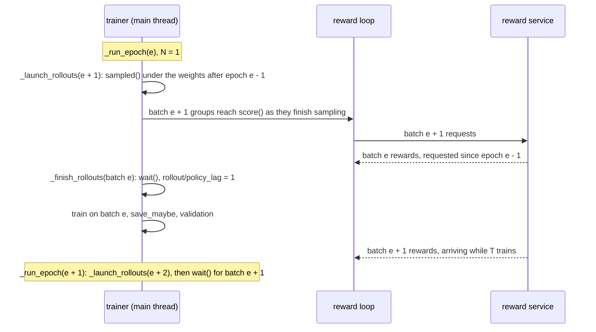

# Rollouts

A **rollout program** (`rollout.type`) turns one prompt into its K scored rows. It makes every model call of the prompt's **group** (the policy rollouts and anything else it samples), calls rewards, and writes the reward components the advantage sees. The **Runner** runs the groups of many prompts at once on two threads: the **device worker** (the main thread) and the **reward loop** (a background asyncio thread). The RL trainers sample every batch through it, optionally `rollout_lookahead` batches ahead of training (**n-step-off**). Validation and inference use the same Runner with one row per group.

Scorers, judges and their placement are in [rewards](../rewards/rewards.md). Which prompts a batch takes is in [data](../data/data.md#rowcursor). The losses that consume the rows are in [trainers](trainers.md).

## Config Examples

### Pointwise

```jsonc
{
  "num_prompts_per_epoch": 48,   // M; a prompt's K rollouts stay on one rank, so world_size divides M
  "num_rollouts_per_prompt": 24, // K, ctx.k
  "rollout": {
    "type": "pointwise",         // every rollout scored on its own by `reward`
    "sampler": {"type": "grid", "steps": 10, "transition": {"type": "euler", "eta": 0.9}}, // what ctx.rollouts() samples with
    "reward": {"type": "pickscore"} // shorthand for a one-item scorer list; pointwise needs at least one
  }
  // "rollout_storage_device": "cpu" // where decoded rows wait for training; "device" keeps them on the accelerator
}
```

### Pairwise (Pref-GRPO)

```jsonc
"rollout": {
  "type": "round_robin",
  "sampler": {...},
  "judge": {"type": "unified_reward", "llm": {"base_url": "http://127.0.0.1:8080/v1", "model": "UnifiedReward", "max_concurrency": 8}},
  // "swap_orders": true, // ask (a, b) and (b, a): s = (s_ab + 1 - s_ba) / 2
  "opponents": 4,         // even; each rollout meets 4 others along a seeded random cycle. null: all K(K-1)/2 pairs
  "weight": 0.5,          // of the win-rate component "round_robin"
  "reward": [{"type": "hpsv2", "weight": 0.5}] // optional scorers; their components follow "round_robin"
}
// validation_scorer defaults to rollout.reward (hpsv2 here); with no scorers, name one or set it to false
```

### n-step-off

```jsonc
{
  "rollout_lookahead": 1, // N batches sampled ahead of training; 0 (default): sample, wait for rewards, train
  // "checkpoint_rollouts": false, // true: a checkpoint keeps the batches sampled ahead (and waits for their rewards)
  "rollout": {
    "type": "pointwise",
    "sampler": {...},
    "reward": {"type": "rational_rewards_t2i", "llm": {...}} // a remote reward is where the overlap pays
  }
}
```

### Out-of-Tree: Judge Against an Online EMA Anchor

```jsonc
{
  "imports": ["my_plugins.anchored"], // registers the program and its judge
  "model": {"variants": {"default": {"type": "lora", "rank": 64}, "ema": {"type": "ema", "of": "default", "decay": 0.999}}},
  "rollout": {
    "type": "my_anchored",
    "sampler": {...},
    "judge": {"type": "my_pair_judge", "llm": {...}},
    "weight": 0.5,
    "reward": [{"type": "hpsv2", "weight": 0.5}]
  }
}
```

The program is in [Out-of-Tree Program](#out-of-tree-program).

### Validation and Inference

```jsonc
// trainer
"validation_sampler": {"type": "grid", "steps": 20},
"validation_variants": ["default", "ema"],    // one Runner.submit per entry
"validation_scorer": [{"type": "pickscore"}], // null (default): rollout.reward; false: no scoring

// inference
"sampler": {"type": "grid", "steps": 20},
"variant": "ema",
"reward": {"type": "pickscore"}
```

## The Runner



`ctx.admit` resolves once its generator returns: one round per list of calls it yields.

- Programs run no CUDA ops and no collectives. Every `ctx` method queues a request and the device worker does the device work.
- Rows are shared, not copied. One thread touches a row at a time: the device worker while a `ctx` call on the row is awaited, the program otherwise. `_decode` replaces a row's contents with the stored copy and keeps the dict object, so the program's reference stays valid.
- `Pending.sampled()`, `wait()` and `as_completed()` are collectives. Every rank calls the same one, in the same order ([distributed](distributed.md)). A submission's groups start, and all device work (forwards, local rewards, start, decode, snapshots) runs, only inside them.
- A failed group fails every rank. An exception in `prepare`, a program, a reward or a sampler node (caught by `_guarded`) is recorded, and the next round raises on every rank: the failing rank its own exception, the others a `RuntimeError` naming that rank.
- Randomness comes from `ctx.seed(...)` and the row's `_generator`, never from the global RNG, which is seeded per rank and consumed in scheduling order.
- Groups start lazily, at most one per round, while the executor's window has room: `backlog` plus `k` for every started group that has not admitted yet stays below `micro_batch_size`. A group's prepared row stays on the device until its `sample()` returns.
- Which rows share a forward depends on timing, so runs are reproducible per seed, not bit for bit.

## Python Spec

### Rollout Programs

`sample` returns whatever `score` needs. `score` returns the rows the trainer trains on, with `reward_raw` / `reward` (`[C]` on `labels`, fp32, CPU) set by `write` ([row](../overview/row.md)).

```python
class BaseRollout[G](BaseModel):  # rollout_registry; flow_control/training/rollouts/base.py
    model_config = ConfigDict(extra="forbid", defer_build=True)  # schema built after plugins register their judges / scorers
    type: str
    sampler: Trajectory  # the policy sampler: ctx.rollouts() samples with it
    reward: Scorers = Scorers([])  # scorers on every policy rollout

    @property
    def labels(self) -> list[str]:  # the reward components the advantage and the logs see
        return self.reward.labels

    @property
    def weights(self) -> list[float]:  # per component; 0 logs a component only
        return self.reward.weights

    async def sample(self, ctx: SampleContext, /) -> G: ...  # every model call of the group
    async def score(self, ctx: RewardContext, group: G, /) -> list[Row]: ...  # rewards only

Rollout = Annotated[BaseRollout, RegistryUnion(rollout_registry, "type")]

def write(rows: list[Row], raw: Tensor, normalized: Tensor) -> None: ...  # [N, C] each -> row["reward_raw"], row["reward"]

@rollout_registry.register("pointwise")
class PointwiseRollout(BaseRollout[list[Row]]):
    async def sample(self, ctx: SampleContext) -> list[Row]:
        return await ctx.rollouts()

    async def score(self, ctx: RewardContext, rows: list[Row]) -> list[Row]:
        raw = await self.reward.score(ctx, rows)  # [K, C] raw, CPU
        write(rows, raw, self.reward.normalize(raw))
        return rows

@rollout_registry.register("round_robin")
class RoundRobinRollout(PointwiseRollout):  # Pref-GRPO
    judge: Judge
    swap_orders: bool = True
    opponents: Annotated[int, Field(ge=2, multiple_of=2)] | None = None
    weight: float = 1.0
    # labels: ["round_robin", *reward.labels]; weights: [weight, *reward.weights]

    async def score(self, ctx: RewardContext, rows: list[Row]) -> list[Row]:
        wins, raw = await asyncio.gather(
            win_rates(ctx, self.judge, rows, swap_orders=self.swap_orders, opponents=self.opponents),
            self.reward.score(ctx, rows),
        )
        write(rows, torch.cat([wins, raw], -1), torch.cat([wins, self.reward.normalize(raw)], -1))  # a win rate needs no normalize
        return rows
```

### Pairwise Helpers

`flow_control/training/rollouts/pairwise.py`, shared by `round_robin` and out-of-tree programs:

```python
def schedule(n: int, opponents: int | None, rng: random.Random) -> list[tuple[int, int]]: ...
    # None or >= n - 1: every pair (i, j), i < j. Otherwise the rows form a shuffled cycle and each
    # plays the opponents / 2 next along it: exactly `opponents` distinct opponents, each pair once

async def preferences(ctx: RewardContext, judge: BaseJudge, pairs: list[tuple[Row, Row]], swap_orders: bool) -> Tensor: ...
    # [P] P(a ≻ b); with swap_orders both orders go in one ctx.run(): (s_ab + 1 - s_ba) / 2

async def win_rates(ctx, judge, rows, *, swap_orders: bool, opponents: int | None) -> Tensor: ...
    # [K, 1] (0.5 + wins) / (played + 1): a tie with itself, so over every pair the mean of the
    # win matrix with a 0.5 diagonal; schedule seeded by ctx.seed("round_robin", ctx.epoch, ctx.prompt_id)
```

### Out-of-Tree Program

The config above. The anchor is sampled in `sample`, so it runs under the same weights as the policy rollouts; it is not returned, so it is not trained on.

```python
@rollout_registry.register("my_anchored")
class AnchoredRollout(BaseRollout[tuple[list[Row], Row]]):  # every rollout judged against one fresh EMA sample of its prompt
    type: Literal["my_anchored"] = "my_anchored"
    judge: Judge
    weight: float = 1.0

    @property
    def labels(self) -> list[str]:
        return ["judge", *self.reward.labels]

    @property
    def weights(self) -> list[float]:
        return [self.weight, *self.reward.weights]

    async def sample(self, ctx: SampleContext) -> tuple[list[Row], Row]:
        anchor = await ctx.start(ctx.seed("anchor", ctx.epoch, ctx.prompt_id), variant="ema")
        rows, _ = await asyncio.gather(ctx.rollouts(), ctx.admit(self.sampler(anchor)))  # one executor, forwards grouped by variant
        await ctx.decode(anchor)
        return rows, anchor

    async def score(self, ctx: RewardContext, group: tuple[list[Row], Row]) -> list[Row]:
        rows, anchor = group
        s, raw = await asyncio.gather(
            preferences(ctx, self.judge, [(row, anchor) for row in rows], swap_orders=True),
            self.reward.score(ctx, rows),
        )
        judged = rearrange(s, "k -> k 1")
        write(rows, torch.cat([judged, raw], -1), torch.cat([judged, self.reward.normalize(raw)], -1))
        return rows
```

Any other way of calling the model goes through the same calls: `ctx.start` a row under the variant it needs, set its `noisy_latents` / `sigma` if it should not start from noise, and `ctx.admit` any sampler node on it ([runtime](../sampler/runtime.md)).

### Contexts

```python
class RewardContext:  # what score() gets; flow_control/training/rollouts/runner.py
    prompt: Row      # the store item, CPU
    prompt_id: int   # its global row id
    k: int           # num_rollouts_per_prompt; 1 in validation and inference
    epoch: int       # the batch's epoch; validation: 0, or the step with validation_same_seed false

    def seed(self, *parts: object) -> int: ...  # derive_seed(trainer seed, ":".join(map(str, parts)))
    async def run[I, O](self, reward: Reward[I, O], items: list[I]) -> list[O]: ...
        # item order. LocalReward: items buffered and batched on the device worker across groups.
        # RemoteReward: rows inside each item snapshotted to CPU (reward.fields only), one request per item

class SampleContext(RewardContext):  # what sample() gets; its methods raise once sample() has returned
    async def start(self, seed: int, variant: str | None = None) -> Row: ...
        # data(prepared) with fresh noise at σ = 1, _generator seeded with `seed`, and a RootFrame whose
        # variant Model(variant=None) leaves use. None: submit()'s variant; if that is None too, the active one
    async def admit[T](self, gen: Calls[T]) -> T: ...  # joins the executor at its next round; the generator's return value
    async def decode(self, row: Row) -> list[str]: ...
        # processor.decode_output in place (clean_latents := the sampled latents), then the row moves to
        # the runner's storage without its "_" keys; returns the keys decode_output wrote
    async def rollouts(self, n: int | None = None) -> list[Row]: ...
        # the policy samples: start(seed("rollout", epoch, prompt_id, i)) under submit()'s observers,
        # row["epoch"] set, submit()'s sampler admitted, decoded. n defaults to k; a later call continues i
```

- Write a program as if every reward were remote. A local reward's items wait for the device worker, which serves them between forward rounds whenever a `Pending` method runs, never during a training step.
- A program that awaits a remote reward inside `sample()` holds the batch's `sampled()`, and with it the next training step, until the reward returns.

### Runner and Pending

```python
class Runner:  # owned by RunnerMixin for the whole run; inference opens its own
    def __init__(self, model: RunnerModel, processor: BaseProcessor, storage: torch.device, seed: int): ...
        # Executor(model, [None, "base", *model.variants]): every variant, one order on every rank
        # storage: where decoded rows go (rollout_storage); seed: the base of every ctx.seed()

    def submit[G](
        self,
        items: Iterable[tuple[int, Row]],  # (prompt_id, store item), pulled lazily on the main thread
        sample: Callable[[SampleContext], Awaitable[G]],
        score: Callable[[RewardContext, G], Awaitable[list[Row]]],
        *,
        prepare: Callable[[Row], Row],  # store item -> prepared row on the device, once per group
        k: int,
        epoch: int,
        variant: str | None,  # ctx.start(variant=None)
        sampler: Trajectory | None = None,  # ctx.rollouts()
        observers: Sequence[tuple[type, Observer]] = (),  # ctx.rollouts(): what the trainer records
    ) -> Pending: ...  # nothing runs until a Pending method is called

    def close(self) -> None: ...  # cancels the programs and requests still on the loop

class Pending:  # the groups of one submit()
    profile: RewardProfile  # one entry per remote request of these groups (profile/reward/*)

    def sampled(self) -> None: ...  # collective: serve rounds until every group on every rank left sample()
    def wait(self) -> list[list[Row]]: ...  # collective: until every score() returned; submission order
    def as_completed(self) -> Iterator[list[Row]]: ...  # collective; each group's rows in completion order
```

One device-worker round, inside every `Pending` method:

```python
@torch.no_grad()
def _round(self, pending: Pending, until: Literal["sampled", "scored"]) -> bool:
    self._take_requests()  # from the loop: admits join the executor; local reward items buffer; start / decode / snapshot queue
    self._start_group()    # at most one new group while the window has room: prepare(item), schedule sample() on the loop
    busy, unfinished, failed_rank = self._all_reduce([...])
    # MAX over ranks of: this rank has executor work; `pending` has not reached `until`; rank + 1 of a recorded failure
    if failed_rank:
        self._raise(...)   # on every rank
    if busy:
        self._forward()    # Executor.round(): collective; settles each finished generator's future
    self._serve_local()    # every buffered local-reward item of any submission, batch_size at a time; no collective
    while self._rows:
        self._serve(self._rows.popleft())  # _start, _decode (then the move to storage), _snapshot
    if not busy and unfinished:
        self._idle()       # wait up to 20 ms for a request instead of spinning
    return not unfinished
```

### Trainer Integration

```python
class RunnerMixin(DataMixin):
    def make_runner(self, model: ModelAdapter, storage: torch.device = CPU) -> None: ...  # once, after load_processor
    def cleanup(self) -> None: ...  # closes the runner on every exit of run(): batches sampled ahead keep issuing requests until then

@dataclass
class PendingRollouts:  # flow_control/training/mixins/rollout.py
    epoch: int                           # the batch's own epoch: seeds its prompts and rollout noise
    policy_version: int                  # _current_epoch when it was sampled
    groups: Pending
    cursor_state_before: dict[str, int]  # RowCursor state before this batch took its prompts

def _start_rollouts(self, epoch: int) -> PendingRollouts:  # RolloutMixin
    cursor_state_before = self._cursor.state_dict()
    mine = self._cursor.take(self.num_prompts_per_epoch, epoch=epoch)[self.rank :: self.world_size]
    groups = self.runner.submit(
        ((i, self._store.get(i)) for i in mine),
        self.rollout.sample, self.rollout.score,
        prepare=prepare,  # prepare_row(item, mode="inference", epoch=epoch), cast to model.dtype
        k=self.num_rollouts_per_prompt, epoch=epoch, variant=self._rollout_variant(),
        sampler=self.rollout.sampler, observers=self._rollout_observers(),
    )
    groups.sampled()  # every model call of the batch ran under the current weights; logs profile/rollout/*
    return PendingRollouts(epoch, self._current_epoch, groups, cursor_state_before)

def _finish_rollouts(self, pending: PendingRollouts) -> list[Row]:
    rows = pending.wait()  # submission order, K rows per prompt; a batch restored from a checkpoint is already scored
    ...  # profile/reward/*, profile/reward/wait_at_train_s, rollout/policy_lag; profile_dump
    return rows

# RolloutTrainerBase
def _prime_rollouts(self) -> None:  # before the first epoch, fresh or resumed
    first = self._current_epoch + len(self._pending_rollouts)  # batches restored from the checkpoint
    last = min(self._current_epoch + self.rollout_lookahead, self.train_epochs)
    for epoch in range(first, last):
        self._launch_rollouts(epoch)  # appends to self._pending_rollouts

def _run_epoch(self) -> None:
    epoch = self._current_epoch
    if epoch + self.rollout_lookahead < self.train_epochs:
        self._launch_rollouts(epoch + self.rollout_lookahead)
    rows = self._finish_rollouts(self._pending_rollouts.popleft())
    advantages = self._compute_advantages(rows, step=self._current_step)  # rollout.labels / weights, or the trainer's _reward_labels()
    self._train_on_rollouts(rows, advantages)  # the only place the weights change
    self.model.update_variants("epoch")
```

The train-plan and loss hooks take these `list[Row]` ([trainers](trainers.md)). What GRPO records during a rollout and replays is in [runtime](../sampler/runtime.md#consumers).

### n-step-off

In the synchronous loop (`rollout_lookahead: 0`) training waits for the tail of the batch's rewards, and the reward service waits through the training step for the next batch. A larger reward pool shortens the first wait and lengthens the second; a smaller one does the reverse, so their sum is never zero at any pool size. Sampling the next batches before waiting on the current one keeps requests flowing to the reward service across training steps, so a continuous-batching server stays full and the trainer waits only when rewards are slower than sampling plus training.



- `groups.sampled()` returns only when every group of the batch, on every rank, has left `sample()`, so every model call of a batch, its policy rollouts and anything else a program samples, ran under the weights current at its launch.
- Remote rewards and the programs' `score` keep running on the loop thread during training, checkpointing and validation. Local reward items wait for the next round: the next launch, `wait()`, or a validation pass.
- A batch's epoch number seeds its prompts and noise, so `rollout_lookahead` changes only which weights sample each batch. Each batch trains under a policy `rollout/policy_lag` epochs newer than the one that sampled it: `N` in steady state, less in the first `N` epochs.
- Endpoint objectives that sample with `old` (NFT, RAM, AWM with `off_policy`) draw the batch from the `old` of its launch epoch, while the loss reads the velocity of the current `old` ([variants](../adapters/variants.md)).
- GRPO's ratio divides by the log-prob recorded during sampling, so it compares against the policy that actually sampled the batch, `N` epochs back; `clip_range` bounds the update as usual.

Resume. By default in-flight batches are dropped: the checkpoint's `cursor` is the oldest in-flight batch's `cursor_state_before` and `current_epoch` is the next epoch to train, so `_prime_rollouts` re-samples those batches with the same prompts and seeds under the checkpoint's weights, and their lag is below `N` until the lookahead refills. With `checkpoint_rollouts: true`, `state_dict` waits (collectively) for the in-flight batches' rewards and saves them scored, one blob per rank, with the cursor as it stands; a resume restores them as scored `PendingRollouts` (`groups=None`) and samples only the epochs after them, so it trains on the same rollouts an uninterrupted run would. Such a checkpoint resumes only on the same world size and with `rollout_lookahead` at least the number of batches it holds ([outputs](outputs.md#checkpoints)).

### Validation and Inference

Both submit one group per item, `k=1`, with these programs (`flow_control/training/mixins/validation.py`):

```python
def sample_one(sampler: Trajectory, base_seed: int):
    async def sample(ctx: SampleContext) -> list[Row]:
        row = await ctx.start(derive_seed(base_seed, ctx.prompt[KEY]))
        await ctx.admit(sampler(row))
        await ctx.decode(row)
        return [row]
    return sample

def score_one(scorer: Scorers | None):
    async def score(ctx: RewardContext, rows: list[Row]) -> list[Row]:
        if scorer is not None and not is_padding(rows[0]):
            raw = await scorer.score(ctx, rows)
            write(rows, raw, scorer.normalize(raw))
        return rows  # padding rows too: the image logging that follows is collective
    return score

# ValidationMixin.validate_and_log, once per validation_variants entry, on the trainer's Runner
groups = self.runner.submit(items, sample_one(self.validation_sampler, base_seed), score_one(scorer),
                            prepare=prepare, k=1, epoch=epoch, variant=name).wait()
# main thread: log_image per row (None for padding) up to validation_log_images, then val[/<name>]/* metrics

# Inference.run, on its own Runner: its sample also keeps the keys decode() wrote for the records
for (row,) in self.runner.submit(..., variant=self.variant).as_completed():
    ...  # each non-padding row into the report as it finishes; this loop body runs no collective
```

The report layout is in [formats](../data/formats.md#inference-report). A validation pass on the trainer's Runner also serves the local reward items of batches sampled ahead.

## Extension Points and Core Contracts

**Extension points**

- A rollout program is a `BaseRollout[G]` registered in `rollout_registry`. It implements `sample` (every model call, through `ctx.start` / `admit` / `decode` / `rollouts`) and `score` (rewards only, through `ctx.run`; `write` sets `reward_raw` / `reward`), and overrides `labels` / `weights` when it adds components. It declares judge or scorer fields of its own and reuses `schedule` / `preferences` / `win_rates`. Randomness comes from `ctx.seed(...)` and row generators.
- Core holds only published programs (`pointwise`, `round_robin`). Anchors, gates, online EMA anchors and similar programs live in `flow_control/contrib/<name>/` or `local/`, loaded through `imports` ([config plugins](../overview/config-plugins.md)), and are edited per experiment rather than made configurable.
- A program that calls the DiT another way gives the executor different generators through `ctx.start` / `admit` / `decode`. It needs no new core primitive.
- A new sampling consumer (a trainer phase, an evaluation) calls `Runner.submit` with its own `sample` / `score` and drives the result from the main thread on every rank.

**Core contracts**

- The `SampleContext` / `RewardContext` API and the two phases: `sample` makes every model call, `score` calls rewards only.
- The threading rules of [The Runner](#the-runner): no CUDA or collectives in programs, one thread per row at a time, `Pending` methods as collectives, a failed group failing every rank. The round protocol is shared with [distributed](distributed.md).
- In RL, `score` returns exactly `k` rows per group, each with `reward_raw` / `reward` as `[C]` on `labels` ([distributed](distributed.md#invariants)).
- `_start_rollouts` returns only after `sampled()`: weights change only in training, and a batch never mixes weight versions.
- Without `checkpoint_rollouts`, the checkpoint saves the cursor from before the oldest in-flight batch and a resume re-samples those batches; with it, the batches are saved scored and the cursor as it stands.
