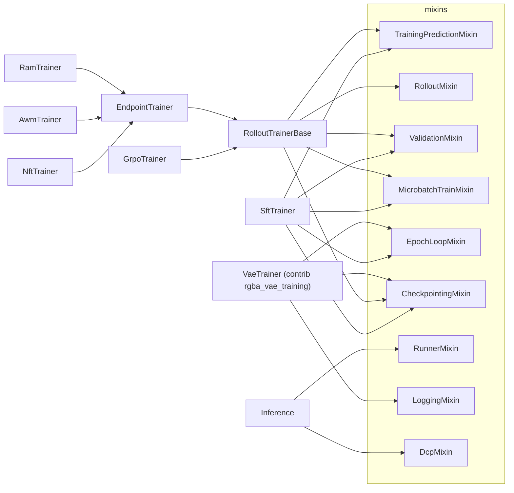

# Trainers

A trainer is the config model that `launch.type` selects from `trainer_registry`, and its `run()` is the whole job on every rank. Trainers are composed from mixins. Each mixin owns one concern (mesh, data, logging, sampling, batching, checkpoints). The method-specific part is small: `SftTrainer` regresses dataset rows, and the RL trainers turn scored rollouts into train items and losses. Which collectives each part may issue is in [distributed.md](distributed.md).

## Config examples

### SFT

```jsonc
{
  "launch": {"type": "sft", "generate_dcp_seed": true},
  "experiment_name": "flux_sft",
  "checkpoint_root": "$auto",
  "seed_checkpoint_dir": "/dev/shm/flow-control/seed",
  "model": {
    "arch": "flux1", "type": "base",
    "variants": {
      "default": {"type": "lora", "rank": 16},
      "ema": {"type": "ema", "of": "default", "decay": 0.999}
    }
  },
  "processor": {"task": "t2i", "preset": "flux1"},
  "dataset": {"type": "cache", "path": "./data/my_set/flux1"},
  "train_predictor": "model",   // shorthand for {"type": "model"}; a cfg tree trains guided velocities
  "train_batch_size": 32,       // G: rows per optimizer update, over all ranks
  "train_micro_batch_size": 2,  // rows per backward, per rank: G / W / 2 accumulation steps
  "train_steps": 2000,
  // "timestep_weighting": {"type": "logit_normal"},
  // "loss_weighting": {"type": "uniform"},
  // "cfg_drop_prob": 0.0,      // a dropped row trains on processor.get_negative_row
  "validation_dataset": {"type": "cache", "path": "./data/my_set/flux1_validation"},
  "validation_sampler": {"type": "grid", "steps": 20},
  "validation_variants": ["ema"], // the first logs as val/*, the others as val/<name>/*
  "validation_steps": 500         // in optimizer steps, 0: off; SFT scores nothing unless validation_scorer is set
}
```

### GRPO

```jsonc
{
  "launch": {"type": "grpo"},
  "num_prompts_per_epoch": 48,     // M distinct prompts per epoch; a prompt's K rollouts stay on one rank
  "num_rollouts_per_prompt": 24,   // K
  "rollout": {
    "type": "pointwise",
    "sampler": {
      "type": "grid", "steps": 10, "shift": 3.0,
      "transition": {"type": "euler", "eta": 0.7, "prediction": {"type": "cfg", "scale": 4.5}} // eta > 0: steps to replay
    },
    "reward": {"type": "pickscore"}
  },
  "train_predictor": {"type": "cfg", "scale": 4.5}, // replays each recorded step; repeat the rollout's prediction
  "train_batch_size": 5760,        // (rollout, recorded step) items per update, over all ranks
  "train_micro_batch_size": 4,
  // "num_inner_epochs": 1,
  // "advantage": {"type": "per_prompt", "use_global_std": true}, // or "global", "gdpo"
  "kl_beta": 0.01,                 // > 0 reads the "ref" variant
  // "clip_range": 1e-4, "adv_clip_max": 5.0,
  "model": {
    "arch": "sd3", "type": "base", "micro_batch_size": 4,
    "variants": {
      "default": {"type": "lora", "rank": 32},
      "ema": {"type": "ema", "of": "default", "decay": 0.9},
      "ref": {"type": "alias", "of": "base"}
    }
  },
  "train_epochs": 500,
  "validation_epochs": 10,         // 0 disables periodic validation
  "validation_variants": ["ema"]
}
```

### NFT

```jsonc
{
  "launch": {"type": "nft"},
  "objective": {"type": "nft", "beta": 1.0, "kl_beta": 1e-4}, // rollouts by "old"; reads "old" and "ref"
  "train_timesteps": {"type": "grid", "count": 4, "mode": "stratified"}, // 4 re-noised points per rollout
  "train_batch_size": 4608,        // 48 × 24 rollouts × 4 points: one update per epoch
  "train_micro_batch_size": 4,
  "train_predictor": "model",
  "rollout": {
    "type": "pointwise",
    "sampler": {"type": "dpm", "steps": 10, "shift": 3.0, "order": 2},
    "reward": {"type": "pickscore"}
  },
  "model": {
    "arch": "sd3", "type": "base",
    "variants": {
      "default": {"type": "lora", "rank": 32},
      "old": {"type": "ema", "of": "default", "decay": 0.5, "every": "epoch"}, // moved after each epoch's training
      "ref": {"type": "alias", "of": "base"}
    }
  }
}
```

### Another Objective on an Endpoint Trainer

`nft`, `awm` and `ram` are presets of one `EndpointTrainer`. They differ only in defaults, so any of them takes any registered objective.

| `launch.type` | `objective` default | `train_timesteps` default | Other defaults |
|---|---|---|---|
| `nft` | `nft` | `grid`: every step start | |
| `awm` | `awm` | `grid`: `count` 6, `window` 0.9, `exclude_first`, `stratified` | |
| `ram` | `ram` | `continuous`: `count` 8, `power_law` α = 1 | `clip_grad_norm: 0.0` |

```jsonc
{
  "launch": {"type": "nft"},
  "objective": {"type": "weighted_fm", "eta": 1.0}, // reward-weighted FM on the policy's own rollouts; no auxiliary variant
  "train_timesteps": {
    "type": "continuous", "count": 8,
    "weighting": {"type": "power_law", "alpha": 1.0, "shift": 3.0} // repeat the rollout sampler's shift
  }
}
```

### Sharding, Compile, Profile

```jsonc
{
  "hsdp_shard_dim": 8,              // FSDP shard group; 1: replicate only (DDP-like)
  // "gradient_checkpointing": true,
  "torch_compile": {},              // TorchCompileConfig defaults: inductor, dynamic false
  "profile": {"output_dir": "./draft/profile"} // <tag>_rank<r>.json.gz; RL: outer epoch profile.epoch (default 1); inference: the whole loop
}
```

## Composition



| Mixin | Owns | Config fields |
|---|---|---|
| `BaseTrainer` | process group and the `("replicate", "shard")` mesh (`init_device_mesh`); `set_seed` (`seed + rank`); `load_transformer_from_seed` (gradient checkpointing, `_shard`, seed load, `compile_transformer`); `profile_scope`; per-rank RNG state for checkpoints (`rng_state_dict`); lifecycle hooks `run` / `seed_checkpoint` / `export_checkpoint` | `launch`, `imports`, `seed`, `hsdp_shard_dim`, `gradient_checkpointing`, `torch_compile`, `profile` |
| `DataMixin` | stores, `make_planner`, `prepare_row` ([data](../data/data.md)) | `processor`, `dataset`, `group_size`, `megabatch_groups`, `shuffle_mode`, `num_dataloader_workers` |
| `TrainingPredictionMixin` | `noised_point`, `predict_training` (an `Executor` over `train_predictor`) | `model`, `train_predictor` |
| `RunnerMixin` | the run-long `Runner`, closed in `cleanup` ([rollouts](rollouts.md)) | |
| `LoggingMixin` | run identity, Trackio and `metrics.jsonl`, the collective `log_*` methods ([outputs](outputs.md)) | `experiment_name`, `runs_root`, `run_id`, `attempt_id`, `trackio_project`, `trackio_space_id`, `image_background` |
| `ValidationMixin` | validation loader, `validate_variants` / `validate_and_log` | `validation_dataset`, `validation_sampler`, `validation_variants`, `validation_scorer`, `validation_at_start`, `validation_log_images`, `validation_log_rewards`, `validation_annotate_images`, `validation_same_seed`, `validation_num_workers` |
| `RolloutMixin` | prompt cursor, `_start_rollouts` / `_finish_rollouts`, `_compute_advantages` | `rollout`, `num_prompts_per_epoch`, `num_rollouts_per_prompt`, `prompt_sampling`, `rollout_storage_device`, `advantage`, `profile_dump`, `rollout_dump` |
| `MicrobatchTrainMixin` | batch arithmetic, `iter_micro_updates`, `_check_finite_loss` | `train_batch_size`, `train_micro_batch_size` |
| `EpochLoopMixin` | step-counted loop over a `RowStream` loader (`epoch_microbatches`) | `train_steps` |
| `DcpMixin`, `CheckpointingMixin` | DCP save / load of the trainer's `state_dict`; archival and rolling tiers; auto-resume ([outputs](outputs.md)) | `checkpoint_root`, `auto_resume`, `checkpoint_interval`, `max_checkpoints`, `rolling_checkpoint_interval_seconds` |

The concrete trainers own the optimizer (`optimizer_config`, `scheduler_config`, `clip_grad_norm`), `seed_checkpoint_dir` / `resume_from_dir`, and their loop: SFT `train_steps`, `validation_steps`, `timestep_weighting`, `loss_weighting`, `cfg_drop_prob`, `cost_test_mode`; RL `train_epochs`, `validation_epochs`, `num_inner_epochs`, `rollout_lookahead`; GRPO `clip_range`, `adv_clip_max`, `kl_beta`; endpoint `objective`, `train_timesteps`.

## Python Spec

### A Trainer

```python
@trainer_registry.register("sft")  # the launch.type tag; plugins register from a module in "imports"
class SftTrainer(TrainingPredictionMixin, ValidationMixin, MicrobatchTrainMixin, EpochLoopMixin, CheckpointingMixin):
    @distributed_main  # init_device_mesh first; logs an exception's traceback; cleanup() (closes the runner) on every exit
    def run(self) -> None:
        for name in self.validation_variants:
            self.model.resolve(name)  # an undeclared variant fails before any weight loads
        self.set_seed()
        self.resolve_run_context()  # every rank: run_id broadcast; before anything touches run_dir / checkpoint_root
        self.init_tracker()         # rank 0 only, collective-free
        self.load_transformer_from_seed(self.model, self.seed_checkpoint_dir)
        #   enable_gradient_checkpointing -> _shard -> seed dcp.load -> compile_transformer
        self.make_optimizer_and_scheduler()  # over the sharded (DTensor) trainable parameters
        self.load_processor()
        self.make_train_dataloader()
        self.make_validation_dataloader()
        self.make_runner(self.model)  # validation samples through the Runner
        load_rewards(self, self.device)
        self.maybe_auto_resume(self.resume_from_dir)  # after the optimizer: its state loads into it
        ...

    def state_dict(self) -> dict[str, Any]: ...  # DCP Stateful: model_state_dict, optimizer_state_dict, loader / cursor, step, rng
    def load_state_dict(self, state_dict: dict[str, Any]) -> None: ...
```

`seed_checkpoint` (`flow-control seed`) and `export_checkpoint` (`flow-control export`) have defaults on `BaseTrainer`; a trainer of something other than the transformer overrides them (contrib `VaeTrainer`).

### Training Arithmetic

| Quantity | Value | Checked by |
|---|---|---|
| G | `train_batch_size`: items per optimizer update, over all ranks | |
| per rank | `local_train_batch_size` = G / W | `G % W == 0` |
| accumulation | `grad_acc_steps` = G / W / `train_micro_batch_size` | divisibility raises |
| SFT updates per epoch | `len(loader) // grad_acc_steps`; the stream drops the tail short of one update | `make_train_loader` |
| RL updates per inner epoch | ⌈items per rank / (G / W)⌉; a short tail chunk is a smaller update (warned once) | `iter_micro_updates`: equal item counts on every rank |

Divisibility rules shared with the data stack are listed in [data](../data/data.md); physical forwards inside one microbatch are the adapter's ([microbatching](../adapters/microbatching.md)).

```python
# RolloutTrainerBase._train_on_rollouts
for train_items in self._build_train_plan(rows):  # one list per inner epoch
    for update in self.iter_micro_updates(train_items):  # all_reduce: equal counts on every rank, else raise
        self.transformer.set_requires_gradient_sync(update.is_sync_step)  # reduce-scatter only on the last microbatch
        loss = self._loss_batched(update.items, rows, advantages)  # mean over the microbatch
        (loss * update.loss_scale).backward()  # len(micro) / len(chunk): sums to 1 over the chunk
        if update.is_sync_step:
            optimizer_step(self.model, self._optimizer, self._scheduler, self.clip_grad_norm)
            self._current_step += 1
            self.flush_aggregated_metrics(self._current_step)  # train/* from LossOutput.metrics

# SftTrainer: every microbatch weighs 1 / grad_acc_steps; inside it, the mean over real rows
loss = sum(per_row_loss * (0.0 if is_padding(row) else 1.0)) / max(1, real_rows)  # padding forwards, weighs nothing
(loss / self.grad_acc_steps).backward()

def optimizer_step(model, optimizer, scheduler, clip_grad_norm):
    if clip_grad_norm > 0.0:
        torch.nn.utils.clip_grad_norm_(model.transformer.parameters(), clip_grad_norm)
    optimizer.step()
    model.update_variants("step")  # EMAs with every: "step"
    scheduler.step()
    optimizer.zero_grad()
```

### RL Epoch and Hooks

```python
def _run_epoch(self) -> None:  # RolloutTrainerBase
    if epoch + self.rollout_lookahead < self.train_epochs:
        self._launch_rollouts(epoch + self.rollout_lookahead)  # sampled under the current weights (n-step-off: rollouts.md)
    rows = self._finish_rollouts(self._pending_rollouts.popleft())  # rewards in, list[Row]
    self._check_rollouts(rows)
    advantages = self._compute_advantages(rows, step=self._current_step)  # gathered over ranks; this rank's slice
    self._train_on_rollouts(rows, advantages)
    self.model.update_variants("epoch")  # EMAs with every: "epoch" (NFT / RAM "old")
```

| Hook | Default | Overridden by |
|---|---|---|
| `_build_train_plan(rows) -> list[list[ItemT]]` | abstract | GRPO: recorded steps, rollouts shuffled, steps contiguous; endpoint: `train_timesteps.draw` per rollout |
| `_loss_batched(items, rows, advantages) -> Tensor` | abstract | GRPO: clipped ratio + `kl_beta` × KL to `ref`; endpoint: `objective.compute` per point, mean |
| `_check_rollouts(rows)` | no-op | GRPO: every row recorded a stochastic step |
| `_rollout_observers() -> list[(type, Observer)]` | `[]` | GRPO: `(BaseTransition, record)`; endpoint: `(BaseGrid, keep_sigmas)` |
| `_rollout_variant() -> str` | `"default"` | endpoint: `objective.rollout_variant()` |
| `_required_variants() -> frozenset[str]` | empty | GRPO: `{"ref"}` when `kl_beta > 0`; endpoint: `objective.required_variants()` |
| `_reward_labels()` / `_reward_weights()` | `rollout.labels` / `rollout.weights` | a trainer that appends columns to `row["reward"]` and `row["reward_raw"]` before the advantage |

The variant names are resolved at the top of `run()`; how the rollout and auxiliary variants run is in [variants](../adapters/variants.md).

### Objectives

```python
@dataclass(slots=True)
class LossOutput:
    loss: Tensor                  # 0-dim, attached to the graph
    metrics: dict[str, Tensor]    # 0-dim, detached, unprefixed; logged as train/<key>

class BaseObjective(BaseModel, ABC):  # objective_registry; EndpointTrainer.objective
    type: str
    def rollout_variant(self) -> str: ...  # samples the rollout endpoints
    def required_variants(self) -> frozenset[str]: ...  # velocities compute() reads from aux
    def compute(self, point: Row, current: Tensor, aux: dict[str, Tensor]) -> LossOutput: ...

# EndpointTrainer._loss_batched, per microbatch
point = self.noised_point(row, sigma, torch.randn_like(row["clean_latents"].float()))
# point: data(row) + clean_latents (fp32), noise, sigma (float), noisy_latents, advantage [1] fp32
for name in sorted(self.objective.required_variants()):  # sorted: the same forward order on every rank
    with torch.no_grad(), self.model.use_variant(name):
        aux[name] = self.predict_training(points)
current = self.predict_training(points)  # fp32 [1, N, D] per point, under "default"
```

A minimal objective, in `flow_control/contrib/<name>/` or `local/<project>/`, loaded through `imports`:

```python
@objective_registry.register("anchored_fm")
class AnchoredFmObjective(BaseObjective):
    type: Literal["anchored_fm"] = "anchored_fm"
    beta: float = 0.1

    def rollout_variant(self) -> str:
        return "default"

    def required_variants(self) -> frozenset[str]:
        return frozenset({"ref"})  # the config must declare "ref"

    def compute(self, point: Row, current: Tensor, aux: dict[str, Tensor]) -> LossOutput:
        target = point["noise"] - point["clean_latents"]
        fm = ((current - target) ** 2).mean() * torch.exp(point["advantage"]).mean()
        anchor = ((current - aux["ref"]) ** 2).mean()
        loss = fm + self.beta * anchor
        return LossOutput(loss, {"loss": loss.detach(), "anchor": anchor.detach()})
```

### Advantages, Train Timesteps, Weightings

```python
class AdvantageEstimator(BaseModel, ABC):  # advantage_registry: per_prompt, global, gdpo
    def compute(self, rewards: Tensor, prompt_ids: Tensor, weights: Tensor) -> Tensor: ...
    # rewards [B, C] gathered over all ranks (row["reward"], normalized, unweighted); prompt_ids [B]; weights [C]; -> [B]

class BaseTrainTimesteps(BaseModel, ABC):  # train_timesteps_registry: grid, continuous
    def draw(self, sigmas: list[float]) -> list[float]: ...
    # sigmas: the rollout's executed grid, terminal included (row["sigmas"]); the count must not depend on rank-local data

class BaseTimestepWeighting(BaseModel):  # timestep_weighting_registry: SFT timestep_weighting, continuous.weighting
    def sample_timesteps(self, batch_size: int) -> Tensor: ...  # σ in [0, 1], from the global RNG

class BaseLossWeighting(BaseModel):  # loss_weighting_registry: SFT loss_weighting
    def get_weights(self, timesteps: Tensor) -> Tensor: ...
```

### Seeds

| Draw | Generator | Depends on rank |
|---|---|---|
| SFT timesteps, training noise, cfg drop; RL train-plan order, `train_timesteps.draw`, endpoint re-noising | global RNG, `set_seed`: `seed + rank` | yes |
| Rollout noise and every stochastic node of a rollout | `row["_generator"]`, `ctx.seed("rollout", epoch, prompt_id, i)` | no |
| Validation and inference noise | `derive_seed(seed, key)`, or `seed + step` with `validation_same_seed: false` | no |
| LoRA initial values | `flow-control seed` calls `set_seed()` outside the launcher (rank 0: `seed`) | no |

A prompt's rollouts and a validation sample are the same whatever the world size. The full table is in [data](../data/data.md).

### Behaviour Worth Knowing

- **Variants.** `optimizer_step` moves `every: "step"` EMAs after each optimizer step. The RL loop moves `every: "epoch"` EMAs after each epoch's training phase, and SFT never does. Gradient checkpointing recomputes under the variant active in the forward, because `enable_gradient_checkpointing` pins it ([variants](../adapters/variants.md)).
- **Validation.** It runs once per `validation_variants` entry, with `validation_sampler` on the run-long Runner. SFT validates every `validation_steps` optimizer steps; RL validates every `validation_epochs` epochs, after the checkpoint. Both validate at start unless `validation_at_start: false`. `validation_scorer: null` means the RL trainer's `rollout.reward` (SFT: no scoring), and `false` disables scoring.
- **Checkpoints.** RL `checkpoint_interval` counts epochs, SFT counts steps. A resumed RL run re-samples the batches that were in flight, because the cursor saved is the one from before the oldest pending batch, unless `checkpoint_rollouts` saved them ([outputs](outputs.md), [rollouts](rollouts.md)).
- **Profiling.** `profile` traces the RL outer epoch `profile.epoch` (with `record_function` ranges `phase/rollout`, `phase/reward_wait`, `phase/train`) and the whole inference loop. SFT takes no trace.
- **GRPO replay.** The ratio compares the log-prob recorded at rollout time with the replay under `train_predictor`, so `train_predictor` repeats the rollout transition's prediction.

## Extension Points and Core Contracts

**Extension points**

- A new loss on rollout endpoints is an objective (`objective_registry`), used through any endpoint preset. It needs no trainer.
- New advantage normalizations go in `advantage_registry`, re-noising schedules in `train_timesteps_registry`, and SFT timestep and loss weightings in `timestep_weighting_registry` / `loss_weighting_registry`.
- A new RL method that is neither replay nor endpoint subclasses `RolloutTrainerBase[ItemT]`. It implements `_build_train_plan` and `_loss_batched` and overrides the hooks above. A trainer of a different shape composes mixins, registers in `trainer_registry`, and implements `run` under `@distributed_main` and `state_dict` / `load_state_dict`.
- `flow_control/` holds published algorithms only. Unpublished objectives and trainers live in `flow_control/contrib/<name>/` or `local/<project>/` and are activated through `imports` ([repo layout](../overview/repo-layout.md)).

**Core contracts**

- `_build_train_plan` gives every rank the same item count per inner epoch, and `_loss_batched` reaches the model only through `predict_training`, so forward and backward counts match across ranks ([distributed](distributed.md)).
- `row["reward"]` and `row["reward_raw"]` hold the `_reward_labels()` columns in that order, `[C]` on every row.
- `run()` resolves the run context on every rank before `init_tracker` and before any checkpoint access.
- The setup order: variants resolved, seed set, transformer sharded, seed-loaded and compiled, then the optimizer, then the resume.
- The checkpoint keys of `state_dict` are what `auto_resume` reads back from runs already on disk.
